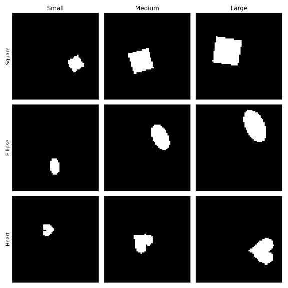

```text
Dataset Overview
Total images in dataset: 368640

Feature: shape_and_scale
Description: Combined 9-class target. 0-2: Square (Small, Med, Large), 3-5: Ellipse (Small, Med, Large), 6-8: Heart (Small, Med, Large).
Distinct values: [0 1 2 3 4 5 6 7 8]
Result: Marginal uniformity holds. For each distinct value, there are exactly 40960 images, as expected (368640 total / 9 distinct values).

Feature: shape
Description: Base shape. 0: Square, 1: Ellipse, 2: Heart.
Distinct values: [0 1 2]
Result: Marginal uniformity holds. For each distinct value, there are exactly 122880 images, as expected (368640 total / 3 distinct values).

Feature: scale
Description: Base scale. 0: Small, 1: Medium, 2: Large.
Distinct values: [0 1 2]
Result: Marginal uniformity holds. For each distinct value, there are exactly 122880 images, as expected (368640 total / 3 distinct values).

Feature: orientation
Description: Rotation angle. 40 distinct values evenly spaced from 0 to 2π.
Distinct values: [ 0  1  2  3  4  5  6  7  8  9 10 11 12 13 14 15 16 17 18 19 20 21 22 23
 24 25 26 27 28 29 30 31 32 33 34 35 36 37 38 39]
Result: Marginal uniformity holds. For each distinct value, there are exactly 9216 images, as expected (368640 total / 40 distinct values).

Feature: pos_x
Description: Horizontal position. 32 distinct values.
Distinct values: [ 0  1  2  3  4  5  6  7  8  9 10 11 12 13 14 15 16 17 18 19 20 21 22 23
 24 25 26 27 28 29 30 31]
Result: Marginal uniformity holds. For each distinct value, there are exactly 11520 images, as expected (368640 total / 32 distinct values).

Feature: pos_y
Description: Vertical position. 32 distinct values.
Distinct values: [ 0  1  2  3  4  5  6  7  8  9 10 11 12 13 14 15 16 17 18 19 20 21 22 23
 24 25 26 27 28 29 30 31]
Result: Marginal uniformity holds. For each distinct value, there are exactly 11520 images, as expected (368640 total / 32 distinct values).

This step checks if the dataset contains all possible combinations of the base generative latent factors.
There are 368640 unique combinations, corresponding to the Cartesian product of all distinct latent factor values.
Result: Joint uniformity holds. Every combination appears exactly 1 times (368640 total / 368640 combinations).

Statistical Independence Check
Cramér's V will be used to measure effect size, expecting exactly 0.0 for perfect independence (base factors) or 1.0 for perfect dependence (engineered features).
Expected outcomes:
- The engineered 'shape_and_scale' feature is expected to be highly dependent on 'shape' and 'scale' (by construction).
- All other base generative factors (shape, scale, orientation, pos_x, pos_y) should be mutually independent because they were generated via a Cartesian product.

Pair: shape_and_scale and shape
Chi-square statistic: 737280.0000
Cramér's V: 1.0000
Confirmed perfect dependence.

Pair: shape_and_scale and scale
Chi-square statistic: 737280.0000
Cramér's V: 1.0000
Confirmed perfect dependence.

Pair: shape_and_scale and orientation
Chi-square statistic: 0.0000
Cramér's V: 0.0000
Confirmed perfect statistical independence.

Pair: shape_and_scale and pos_x
Chi-square statistic: 0.0000
Cramér's V: 0.0000
Confirmed perfect statistical independence.

Pair: shape_and_scale and pos_y
Chi-square statistic: 0.0000
Cramér's V: 0.0000
Confirmed perfect statistical independence.

Pair: shape and scale
Chi-square statistic: 0.0000
Cramér's V: 0.0000
Confirmed perfect statistical independence.

Pair: shape and orientation
Chi-square statistic: 0.0000
Cramér's V: 0.0000
Confirmed perfect statistical independence.

Pair: shape and pos_x
Chi-square statistic: 0.0000
Cramér's V: 0.0000
Confirmed perfect statistical independence.

Pair: shape and pos_y
Chi-square statistic: 0.0000
Cramér's V: 0.0000
Confirmed perfect statistical independence.

Pair: scale and orientation
Chi-square statistic: 0.0000
Cramér's V: 0.0000
Confirmed perfect statistical independence.

Pair: scale and pos_x
Chi-square statistic: 0.0000
Cramér's V: 0.0000
Confirmed perfect statistical independence.

Pair: scale and pos_y
Chi-square statistic: 0.0000
Cramér's V: 0.0000
Confirmed perfect statistical independence.

Pair: orientation and pos_x
Chi-square statistic: 0.0000
Cramér's V: 0.0000
Confirmed perfect statistical independence.

Pair: orientation and pos_y
Chi-square statistic: 0.0000
Cramér's V: 0.0000
Confirmed perfect statistical independence.

Pair: pos_x and pos_y
Chi-square statistic: 0.0000
Cramér's V: 0.0000
Confirmed perfect statistical independence.

```

**Random Samples per Shape & Scale Class**



