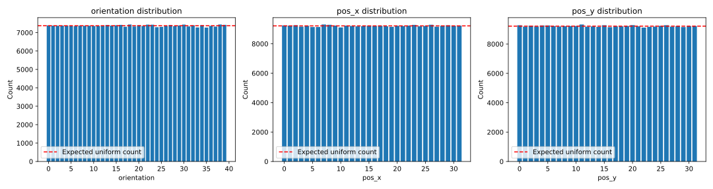
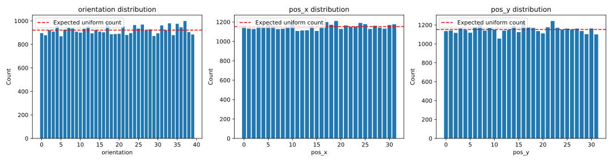
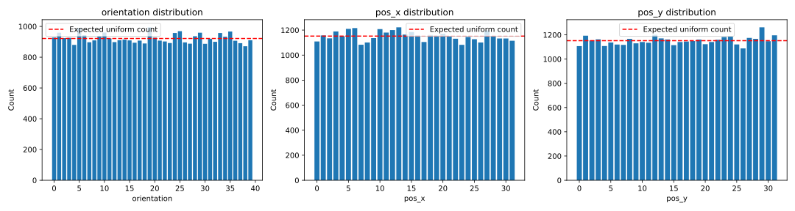

```text
X_train size: 294912
X_val size: 36864
X_test size: 36864

============================================================
=== Split: train - Marginal Uniformity Analysis ===
============================================================

--- Stratified Features (Deterministic Uniformity) ---
Feature: shape_and_scale
  Unique values: [0 1 2 3 4 5 6 7 8]
  Counts: [32768 32768 32768 32768 32768 32768 32768 32768 32768]
  Uniformity score (Entropy): 1.0000
  Expected count: 32768.0
  All counts match expected exactly: True
  Explanation: This feature is perfectly balanced by construction due to stratification.

Feature: shape
  Unique values: [0 1 2]
  Counts: [98304 98304 98304]
  Uniformity score (Entropy): 1.0000
  Expected count: 98304.0
  All counts match expected exactly: True
  Explanation: This feature is perfectly balanced by construction due to stratification.

Feature: scale
  Unique values: [0 1 2]
  Counts: [98304 98304 98304]
  Uniformity score (Entropy): 1.0000
  Expected count: 98304.0
  All counts match expected exactly: True
  Explanation: This feature is perfectly balanced by construction due to stratification.


--- Statistical Features (Statistical Uniformity) ---
Feature: orientation
  Unique values: [ 0  1  2  3  4  5  6  7  8  9 10 11 12 13 14 15 16 17 18 19 20 21 22 23
 24 25 26 27 28 29 30 31 32 33 34 35 36 37 38 39]
  Counts: [7392 7379 7372 7381 7380 7358 7348 7377 7372 7373 7356 7362 7361 7412
 7380 7398 7419 7316 7441 7334 7399 7355 7434 7428 7295 7312 7351 7410
 7353 7386 7435 7336 7397 7280 7404 7274 7363 7326 7441 7422]
  Uniformity score (Entropy): 1.0000
  Chi-square statistic: 9.5137
  p-value: 1.0000e+00
  Conclusion: Distribution is consistent with uniform
  Explanation: These factors were not explicitly stratified so a statistical test is used.

Feature: pos_x
  Unique values: [ 0  1  2  3  4  5  6  7  8  9 10 11 12 13 14 15 16 17 18 19 20 21 22 23
 24 25 26 27 28 29 30 31]
  Counts: [9249 9232 9259 9167 9222 9137 9142 9311 9289 9239 9110 9233 9208 9184
 9198 9228 9214 9216 9188 9154 9221 9205 9239 9284 9185 9216 9291 9162
 9225 9256 9219 9229]
  Uniformity score (Entropy): 1.0000
  Chi-square statistic: 7.2270
  p-value: 1.0000e+00
  Conclusion: Distribution is consistent with uniform
  Explanation: These factors were not explicitly stratified so a statistical test is used.

Feature: pos_y
  Unique values: [ 0  1  2  3  4  5  6  7  8  9 10 11 12 13 14 15 16 17 18 19 20 21 22 23
 24 25 26 27 28 29 30 31]
  Counts: [9278 9186 9250 9195 9265 9265 9221 9190 9213 9223 9228 9329 9179 9201
 9166 9281 9148 9202 9202 9224 9286 9203 9119 9168 9184 9237 9281 9183
 9217 9155 9209 9224]
  Uniformity score (Entropy): 1.0000
  Chi-square statistic: 7.1191
  p-value: 1.0000e+00
  Conclusion: Distribution is consistent with uniform
  Explanation: These factors were not explicitly stratified so a statistical test is used.


============================================================
=== Split: val - Marginal Uniformity Analysis ===
============================================================

--- Stratified Features (Deterministic Uniformity) ---
Feature: shape_and_scale
  Unique values: [0 1 2 3 4 5 6 7 8]
  Counts: [4096 4096 4096 4096 4096 4096 4096 4096 4096]
  Uniformity score (Entropy): 1.0000
  Expected count: 4096.0
  All counts match expected exactly: True
  Explanation: This feature is perfectly balanced by construction due to stratification.

Feature: shape
  Unique values: [0 1 2]
  Counts: [12288 12288 12288]
  Uniformity score (Entropy): 1.0000
  Expected count: 12288.0
  All counts match expected exactly: True
  Explanation: This feature is perfectly balanced by construction due to stratification.

Feature: scale
  Unique values: [0 1 2]
  Counts: [12288 12288 12288]
  Uniformity score (Entropy): 1.0000
  Expected count: 12288.0
  All counts match expected exactly: True
  Explanation: This feature is perfectly balanced by construction due to stratification.


--- Statistical Features (Statistical Uniformity) ---
Feature: orientation
  Unique values: [ 0  1  2  3  4  5  6  7  8  9 10 11 12 13 14 15 16 17 18 19 20 21 22 23
 24 25 26 27 28 29 30 31 32 33 34 35 36 37 38 39]
  Counts: [896 878 920 909 956 869 925 942 935 908 900 932 957 894 922 909 903 992
 886 888 890 953 880 896 964 935 969 918 927 871 894 961 919 979 879 975
 946 999 904 884]
  Uniformity score (Entropy): 0.9998
  Chi-square statistic: 51.7530
  p-value: 8.3048e-02
  Conclusion: Distribution is consistent with uniform
  Explanation: These factors were not explicitly stratified so a statistical test is used.

Feature: pos_x
  Unique values: [ 0  1  2  3  4  5  6  7  8  9 10 11 12 13 14 15 16 17 18 19 20 21 22 23
 24 25 26 27 28 29 30 31]
  Counts: [1162 1131 1127 1164 1147 1173 1162 1126 1130 1145 1202 1107 1112 1114
 1158 1107 1148 1199 1171 1210 1128 1164 1150 1154 1190 1177 1128 1161
 1142 1131 1168 1176]
  Uniformity score (Entropy): 0.9999
  Chi-square statistic: 20.3924
  p-value: 9.2702e-01
  Conclusion: Distribution is consistent with uniform
  Explanation: These factors were not explicitly stratified so a statistical test is used.

Feature: pos_y
  Unique values: [ 0  1  2  3  4  5  6  7  8  9 10 11 12 13 14 15 16 17 18 19 20 21 22 23
 24 25 26 27 28 29 30 31]
  Counts: [1135 1141 1116 1162 1147 1118 1179 1213 1140 1167 1151 1056 1140 1148
 1192 1124 1231 1173 1169 1135 1111 1176 1242 1170 1151 1162 1151 1162
 1136 1103 1163 1100]
  Uniformity score (Entropy): 0.9999
  Chi-square statistic: 37.4931
  p-value: 1.9583e-01
  Conclusion: Distribution is consistent with uniform
  Explanation: These factors were not explicitly stratified so a statistical test is used.


============================================================
=== Split: test - Marginal Uniformity Analysis ===
============================================================

--- Stratified Features (Deterministic Uniformity) ---
Feature: shape_and_scale
  Unique values: [0 1 2 3 4 5 6 7 8]
  Counts: [4096 4096 4096 4096 4096 4096 4096 4096 4096]
  Uniformity score (Entropy): 1.0000
  Expected count: 4096.0
  All counts match expected exactly: True
  Explanation: This feature is perfectly balanced by construction due to stratification.

Feature: shape
  Unique values: [0 1 2]
  Counts: [12288 12288 12288]
  Uniformity score (Entropy): 1.0000
  Expected count: 12288.0
  All counts match expected exactly: True
  Explanation: This feature is perfectly balanced by construction due to stratification.

Feature: scale
  Unique values: [0 1 2]
  Counts: [12288 12288 12288]
  Uniformity score (Entropy): 1.0000
  Expected count: 12288.0
  All counts match expected exactly: True
  Explanation: This feature is perfectly balanced by construction due to stratification.


--- Statistical Features (Statistical Uniformity) ---
Feature: orientation
  Unique values: [ 0  1  2  3  4  5  6  7  8  9 10 11 12 13 14 15 16 17 18 19 20 21 22 23
 24 25 26 27 28 29 30 31 32 33 34 35 36 37 38 39]
  Counts: [928 959 924 926 880 989 943 897 909 935 960 922 898 910 914 909 894 908
 889 994 927 908 902 892 957 969 896 888 936 959 887 919 900 957 933 967
 907 891 871 910]
  Uniformity score (Entropy): 0.9999
  Chi-square statistic: 39.1684
  p-value: 4.6232e-01
  Conclusion: Distribution is consistent with uniform
  Explanation: These factors were not explicitly stratified so a statistical test is used.

Feature: pos_x
  Unique values: [ 0  1  2  3  4  5  6  7  8  9 10 11 12 13 14 15 16 17 18 19 20 21 22 23
 24 25 26 27 28 29 30 31]
  Counts: [1109 1157 1134 1189 1151 1210 1216 1083 1101 1136 1208 1180 1200 1222
 1164 1185 1158 1105 1161 1156 1171 1151 1131 1082 1145 1127 1101 1197
 1153 1133 1133 1115]
  Uniformity score (Entropy): 0.9998
  Chi-square statistic: 40.3125
  p-value: 1.2214e-01
  Conclusion: Distribution is consistent with uniform
  Explanation: These factors were not explicitly stratified so a statistical test is used.

Feature: pos_y
  Unique values: [ 0  1  2  3  4  5  6  7  8  9 10 11 12 13 14 15 16 17 18 19 20 21 22 23
 24 25 26 27 28 29 30 31]
  Counts: [1107 1193 1154 1163 1108 1137 1120 1117 1167 1130 1141 1135 1201 1171
 1162 1115 1141 1145 1149 1161 1123 1141 1159 1182 1185 1121 1088 1175
 1167 1262 1148 1196]
  Uniformity score (Entropy): 0.9999
  Chi-square statistic: 31.8698
  p-value: 4.2307e-01
  Conclusion: Distribution is consistent with uniform
  Explanation: These factors were not explicitly stratified so a statistical test is used.

```

**Spatial/Rotational features distribution in train split**



**Spatial/Rotational features distribution in val split**



**Spatial/Rotational features distribution in test split**



```text

=== Split: train ===
Number of unique combinations: 9
Expected count per combination: 32768.00
All combinations appear exactly expected times: True

=== Split: val ===
Number of unique combinations: 9
Expected count per combination: 4096.00
All combinations appear exactly expected times: True

=== Split: test ===
Number of unique combinations: 9
Expected count per combination: 4096.00
All combinations appear exactly expected times: True
Pairwise Independence Analysis Explanation:
Pairs involving 'shape_and_scale' and its base components ('shape' or 'scale') should yield a Cramér's V of 1.0 (perfectly dependent).
All other base feature pairs should yield a Cramér's V of 0.0 (perfectly independent).

============================================================
=== Split: train - Pairwise Independence Analysis ===
============================================================
Pair: shape_and_scale vs shape
  Chi-square statistic: 589824.0000
  Cramér's V: 1.0000
  Normalized Mutual Information (NMI): 0.6667
  Perfectly dependent

Pair: shape_and_scale vs scale
  Chi-square statistic: 589824.0000
  Cramér's V: 1.0000
  Normalized Mutual Information (NMI): 0.6667
  Perfectly dependent

Pair: shape_and_scale vs orientation
  Chi-square statistic: 62.0339
  Cramér's V: 0.0051
  Normalized Mutual Information (NMI): 0.0000
  Statistically independent (p-value: 1.0000e+00 >= 0.05)

Pair: shape_and_scale vs pos_x
  Chi-square statistic: 49.8109
  Cramér's V: 0.0046
  Normalized Mutual Information (NMI): 0.0000
  Statistically independent (p-value: 1.0000e+00 >= 0.05)

Pair: shape_and_scale vs pos_y
  Chi-square statistic: 43.0691
  Cramér's V: 0.0043
  Normalized Mutual Information (NMI): 0.0000
  Statistically independent (p-value: 1.0000e+00 >= 0.05)

Pair: shape vs scale
  Chi-square statistic: 0.0000
  Cramér's V: 0.0000
  Normalized Mutual Information (NMI): 0.0000
  Perfectly independent

Pair: shape vs orientation
  Chi-square statistic: 13.3862
  Cramér's V: 0.0048
  Normalized Mutual Information (NMI): 0.0000
  Statistically independent (p-value: 1.0000e+00 >= 0.05)

Pair: shape vs pos_x
  Chi-square statistic: 13.0940
  Cramér's V: 0.0047
  Normalized Mutual Information (NMI): 0.0000
  Statistically independent (p-value: 1.0000e+00 >= 0.05)

Pair: shape vs pos_y
  Chi-square statistic: 13.9825
  Cramér's V: 0.0049
  Normalized Mutual Information (NMI): 0.0000
  Statistically independent (p-value: 1.0000e+00 >= 0.05)

Pair: scale vs orientation
  Chi-square statistic: 16.9385
  Cramér's V: 0.0054
  Normalized Mutual Information (NMI): 0.0000
  Statistically independent (p-value: 1.0000e+00 >= 0.05)

Pair: scale vs pos_x
  Chi-square statistic: 10.9673
  Cramér's V: 0.0043
  Normalized Mutual Information (NMI): 0.0000
  Statistically independent (p-value: 1.0000e+00 >= 0.05)

Pair: scale vs pos_y
  Chi-square statistic: 11.6183
  Cramér's V: 0.0044
  Normalized Mutual Information (NMI): 0.0000
  Statistically independent (p-value: 1.0000e+00 >= 0.05)

Pair: orientation vs pos_x
  Chi-square statistic: 236.7300
  Cramér's V: 0.0051
  Normalized Mutual Information (NMI): 0.0001
  Statistically independent (p-value: 1.0000e+00 >= 0.05)

Pair: orientation vs pos_y
  Chi-square statistic: 243.3022
  Cramér's V: 0.0052
  Normalized Mutual Information (NMI): 0.0001
  Statistically independent (p-value: 1.0000e+00 >= 0.05)

Pair: pos_x vs pos_y
  Chi-square statistic: 187.0619
  Cramér's V: 0.0045
  Normalized Mutual Information (NMI): 0.0001
  Statistically independent (p-value: 1.0000e+00 >= 0.05)


============================================================
=== Split: val - Pairwise Independence Analysis ===
============================================================
Pair: shape_and_scale vs shape
  Chi-square statistic: 73728.0000
  Cramér's V: 1.0000
  Normalized Mutual Information (NMI): 0.6667
  Perfectly dependent

Pair: shape_and_scale vs scale
  Chi-square statistic: 73728.0000
  Cramér's V: 1.0000
  Normalized Mutual Information (NMI): 0.6667
  Perfectly dependent

Pair: shape_and_scale vs orientation
  Chi-square statistic: 266.3271
  Cramér's V: 0.0301
  Normalized Mutual Information (NMI): 0.0012
  Statistically independent (p-value: 9.7122e-01 >= 0.05)

Pair: shape_and_scale vs pos_x
  Chi-square statistic: 225.1769
  Cramér's V: 0.0276
  Normalized Mutual Information (NMI): 0.0011
  Statistically independent (p-value: 8.4799e-01 >= 0.05)

Pair: shape_and_scale vs pos_y
  Chi-square statistic: 226.7943
  Cramér's V: 0.0277
  Normalized Mutual Information (NMI): 0.0011
  Statistically independent (p-value: 8.2909e-01 >= 0.05)

Pair: shape vs scale
  Chi-square statistic: 0.0000
  Cramér's V: 0.0000
  Normalized Mutual Information (NMI): 0.0000
  Perfectly independent

Pair: shape vs orientation
  Chi-square statistic: 62.7186
  Cramér's V: 0.0292
  Normalized Mutual Information (NMI): 0.0004
  Statistically independent (p-value: 8.9610e-01 >= 0.05)

Pair: shape vs pos_x
  Chi-square statistic: 66.6762
  Cramér's V: 0.0301
  Normalized Mutual Information (NMI): 0.0004
  Statistically independent (p-value: 3.1940e-01 >= 0.05)

Pair: shape vs pos_y
  Chi-square statistic: 55.9328
  Cramér's V: 0.0275
  Normalized Mutual Information (NMI): 0.0003
  Statistically independent (p-value: 6.9262e-01 >= 0.05)

Pair: scale vs orientation
  Chi-square statistic: 77.5330
  Cramér's V: 0.0324
  Normalized Mutual Information (NMI): 0.0004
  Statistically independent (p-value: 4.9363e-01 >= 0.05)

Pair: scale vs pos_x
  Chi-square statistic: 54.1577
  Cramér's V: 0.0271
  Normalized Mutual Information (NMI): 0.0003
  Statistically independent (p-value: 7.5041e-01 >= 0.05)

Pair: scale vs pos_y
  Chi-square statistic: 65.1836
  Cramér's V: 0.0297
  Normalized Mutual Information (NMI): 0.0004
  Statistically independent (p-value: 3.6663e-01 >= 0.05)

Pair: orientation vs pos_x
  Chi-square statistic: 1040.2173
  Cramér's V: 0.0302
  Normalized Mutual Information (NMI): 0.0040
  Statistically independent (p-value: 9.9984e-01 >= 0.05)

Pair: orientation vs pos_y
  Chi-square statistic: 1054.3486
  Cramér's V: 0.0304
  Normalized Mutual Information (NMI): 0.0040
  Statistically independent (p-value: 9.9947e-01 >= 0.05)

Pair: pos_x vs pos_y
  Chi-square statistic: 872.9520
  Cramér's V: 0.0276
  Normalized Mutual Information (NMI): 0.0034
  Statistically independent (p-value: 9.8020e-01 >= 0.05)


============================================================
=== Split: test - Pairwise Independence Analysis ===
============================================================
Pair: shape_and_scale vs shape
  Chi-square statistic: 73728.0000
  Cramér's V: 1.0000
  Normalized Mutual Information (NMI): 0.6667
  Perfectly dependent

Pair: shape_and_scale vs scale
  Chi-square statistic: 73728.0000
  Cramér's V: 1.0000
  Normalized Mutual Information (NMI): 0.6667
  Perfectly dependent

Pair: shape_and_scale vs orientation
  Chi-square statistic: 270.3585
  Cramér's V: 0.0303
  Normalized Mutual Information (NMI): 0.0012
  Statistically independent (p-value: 9.5733e-01 >= 0.05)

Pair: shape_and_scale vs pos_x
  Chi-square statistic: 236.9508
  Cramér's V: 0.0283
  Normalized Mutual Information (NMI): 0.0011
  Statistically independent (p-value: 6.8212e-01 >= 0.05)

Pair: shape_and_scale vs pos_y
  Chi-square statistic: 207.0702
  Cramér's V: 0.0265
  Normalized Mutual Information (NMI): 0.0010
  Statistically independent (p-value: 9.7254e-01 >= 0.05)

Pair: shape vs scale
  Chi-square statistic: 0.0000
  Cramér's V: 0.0000
  Normalized Mutual Information (NMI): 0.0000
  Perfectly independent

Pair: shape vs orientation
  Chi-square statistic: 71.1701
  Cramér's V: 0.0311
  Normalized Mutual Information (NMI): 0.0004
  Statistically independent (p-value: 6.9492e-01 >= 0.05)

Pair: shape vs pos_x
  Chi-square statistic: 61.6225
  Cramér's V: 0.0289
  Normalized Mutual Information (NMI): 0.0004
  Statistically independent (p-value: 4.8964e-01 >= 0.05)

Pair: shape vs pos_y
  Chi-square statistic: 72.9103
  Cramér's V: 0.0314
  Normalized Mutual Information (NMI): 0.0004
  Statistically independent (p-value: 1.6191e-01 >= 0.05)

Pair: scale vs orientation
  Chi-square statistic: 62.7939
  Cramér's V: 0.0292
  Normalized Mutual Information (NMI): 0.0004
  Statistically independent (p-value: 8.9484e-01 >= 0.05)

Pair: scale vs pos_x
  Chi-square statistic: 44.2080
  Cramér's V: 0.0245
  Normalized Mutual Information (NMI): 0.0003
  Statistically independent (p-value: 9.5740e-01 >= 0.05)

Pair: scale vs pos_y
  Chi-square statistic: 54.7591
  Cramér's V: 0.0273
  Normalized Mutual Information (NMI): 0.0003
  Statistically independent (p-value: 7.3136e-01 >= 0.05)

Pair: orientation vs pos_x
  Chi-square statistic: 1102.6282
  Cramér's V: 0.0311
  Normalized Mutual Information (NMI): 0.0042
  Statistically independent (p-value: 9.8667e-01 >= 0.05)

Pair: orientation vs pos_y
  Chi-square statistic: 1095.1859
  Cramér's V: 0.0310
  Normalized Mutual Information (NMI): 0.0042
  Statistically independent (p-value: 9.9129e-01 >= 0.05)

Pair: pos_x vs pos_y
  Chi-square statistic: 824.2655
  Cramér's V: 0.0269
  Normalized Mutual Information (NMI): 0.0032
  Statistically independent (p-value: 9.9945e-01 >= 0.05)


============================================================
=== Data Leakage Verification ===
============================================================
Split 'train' unique base instances: 294912
Split 'val' unique base instances: 36864
Split 'test' unique base instances: 36864
Intersection size (train & val): 0
Intersection size (train & test): 0
Intersection size (val & test): 0
Success: No data leakage detected between any of the splits!
```

