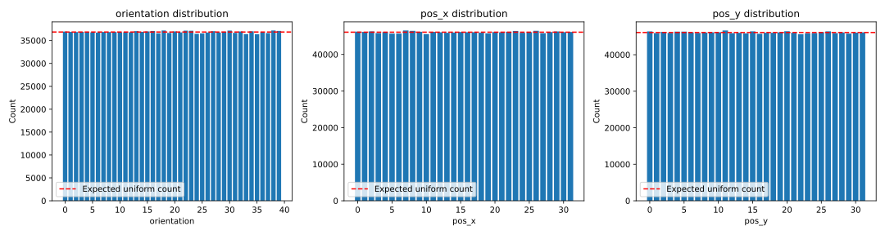
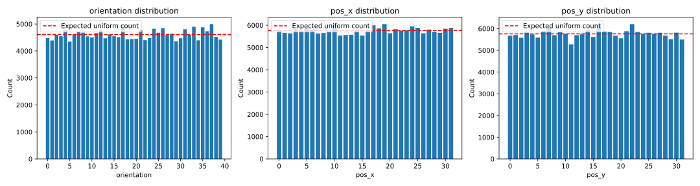
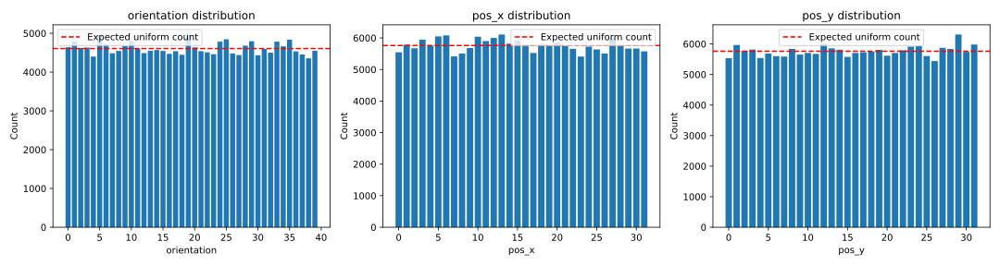

```text
X_train size: 1474560
X_val size: 184320
X_test size: 184320

============================================================
=== Split: train - Marginal Uniformity Analysis ===
============================================================

--- Stratified Features (Deterministic Uniformity) ---
Feature: shape_and_scale
  Unique values: [0 1 2 3 4 5 6 7 8]
  Counts: [163840 163840 163840 163840 163840 163840 163840 163840 163840]
  Uniformity score (Entropy): 1.0000
  Expected count: 163840.0
  All counts match expected exactly: True
  Explanation: This feature is perfectly balanced by construction due to stratification.

Feature: shape
  Unique values: [0 1 2]
  Counts: [491520 491520 491520]
  Uniformity score (Entropy): 1.0000
  Expected count: 491520.0
  All counts match expected exactly: True
  Explanation: This feature is perfectly balanced by construction due to stratification.

Feature: scale
  Unique values: [0 1 2]
  Counts: [491520 491520 491520]
  Uniformity score (Entropy): 1.0000
  Expected count: 491520.0
  All counts match expected exactly: True
  Explanation: This feature is perfectly balanced by construction due to stratification.

Feature: contrast
  Unique values: [0 1 2 3 4]
  Counts: [294912 294912 294912 294912 294912]
  Uniformity score (Entropy): 1.0000
  Expected count: 294912.0
  All counts match expected exactly: True
  Explanation: This feature is perfectly balanced by construction due to stratification.


--- Statistical Features (Statistical Uniformity) ---
Feature: orientation
  Unique values: [ 0  1  2  3  4  5  6  7  8  9 10 11 12 13 14 15 16 17 18 19 20 21 22 23
 24 25 26 27 28 29 30 31 32 33 34 35 36 37 38 39]
  Counts: [36960 36895 36860 36905 36900 36790 36740 36885 36860 36865 36780 36810
 36805 37060 36900 36990 37095 36580 37205 36670 36995 36775 37170 37140
 36475 36560 36755 37050 36765 36930 37175 36680 36985 36400 37020 36370
 36815 36630 37205 37110]
  Uniformity score (Entropy): 1.0000
  Chi-square statistic: 47.5684
  p-value: 1.6322e-01
  Conclusion: Distribution is consistent with uniform
  Explanation: These factors were not explicitly stratified so a statistical test is used.

Feature: pos_x
  Unique values: [ 0  1  2  3  4  5  6  7  8  9 10 11 12 13 14 15 16 17 18 19 20 21 22 23
 24 25 26 27 28 29 30 31]
  Counts: [46245 46160 46295 45835 46110 45685 45710 46555 46445 46195 45550 46165
 46040 45920 45990 46140 46070 46080 45940 45770 46105 46025 46195 46420
 45925 46080 46455 45810 46125 46280 46095 46145]
  Uniformity score (Entropy): 1.0000
  Chi-square statistic: 36.1350
  p-value: 2.4104e-01
  Conclusion: Distribution is consistent with uniform
  Explanation: These factors were not explicitly stratified so a statistical test is used.

Feature: pos_y
  Unique values: [ 0  1  2  3  4  5  6  7  8  9 10 11 12 13 14 15 16 17 18 19 20 21 22 23
 24 25 26 27 28 29 30 31]
  Counts: [46390 45930 46250 45975 46325 46325 46105 45950 46065 46115 46140 46645
 45895 46005 45830 46405 45740 46010 46010 46120 46430 46015 45595 45840
 45920 46185 46405 45915 46085 45775 46045 46120]
  Uniformity score (Entropy): 1.0000
  Chi-square statistic: 35.5957
  p-value: 2.6080e-01
  Conclusion: Distribution is consistent with uniform
  Explanation: These factors were not explicitly stratified so a statistical test is used.


============================================================
=== Split: val - Marginal Uniformity Analysis ===
============================================================

--- Stratified Features (Deterministic Uniformity) ---
Feature: shape_and_scale
  Unique values: [0 1 2 3 4 5 6 7 8]
  Counts: [20480 20480 20480 20480 20480 20480 20480 20480 20480]
  Uniformity score (Entropy): 1.0000
  Expected count: 20480.0
  All counts match expected exactly: True
  Explanation: This feature is perfectly balanced by construction due to stratification.

Feature: shape
  Unique values: [0 1 2]
  Counts: [61440 61440 61440]
  Uniformity score (Entropy): 1.0000
  Expected count: 61440.0
  All counts match expected exactly: True
  Explanation: This feature is perfectly balanced by construction due to stratification.

Feature: scale
  Unique values: [0 1 2]
  Counts: [61440 61440 61440]
  Uniformity score (Entropy): 1.0000
  Expected count: 61440.0
  All counts match expected exactly: True
  Explanation: This feature is perfectly balanced by construction due to stratification.

Feature: contrast
  Unique values: [0 1 2 3 4]
  Counts: [36864 36864 36864 36864 36864]
  Uniformity score (Entropy): 1.0000
  Expected count: 36864.0
  All counts match expected exactly: True
  Explanation: This feature is perfectly balanced by construction due to stratification.


--- Statistical Features (Statistical Uniformity) ---
Feature: orientation
  Unique values: [ 0  1  2  3  4  5  6  7  8  9 10 11 12 13 14 15 16 17 18 19 20 21 22 23
 24 25 26 27 28 29 30 31 32 33 34 35 36 37 38 39]
  Counts: [4480 4390 4600 4545 4780 4345 4625 4710 4675 4540 4500 4660 4785 4470
 4610 4545 4515 4960 4430 4440 4450 4765 4400 4480 4820 4675 4845 4590
 4635 4355 4470 4805 4595 4895 4395 4875 4730 4995 4520 4420]
  Uniformity score (Entropy): 0.9998
  Chi-square statistic: 258.7652
  p-value: 3.1847e-34
  Conclusion: Distribution significantly deviates from uniform
  Explanation: These factors were not explicitly stratified so a statistical test is used.

Feature: pos_x
  Unique values: [ 0  1  2  3  4  5  6  7  8  9 10 11 12 13 14 15 16 17 18 19 20 21 22 23
 24 25 26 27 28 29 30 31]
  Counts: [5810 5655 5635 5820 5735 5865 5810 5630 5650 5725 6010 5535 5560 5570
 5790 5535 5740 5995 5855 6050 5640 5820 5750 5770 5950 5885 5640 5805
 5710 5655 5840 5880]
  Uniformity score (Entropy): 0.9999
  Chi-square statistic: 101.9618
  p-value: 1.7092e-09
  Conclusion: Distribution significantly deviates from uniform
  Explanation: These factors were not explicitly stratified so a statistical test is used.

Feature: pos_y
  Unique values: [ 0  1  2  3  4  5  6  7  8  9 10 11 12 13 14 15 16 17 18 19 20 21 22 23
 24 25 26 27 28 29 30 31]
  Counts: [5675 5705 5580 5810 5735 5590 5895 6065 5700 5835 5755 5280 5700 5740
 5960 5620 6155 5865 5845 5675 5555 5880 6210 5850 5755 5810 5755 5810
 5680 5515 5815 5500]
  Uniformity score (Entropy): 0.9999
  Chi-square statistic: 187.4653
  p-value: 2.7041e-24
  Conclusion: Distribution significantly deviates from uniform
  Explanation: These factors were not explicitly stratified so a statistical test is used.


============================================================
=== Split: test - Marginal Uniformity Analysis ===
============================================================

--- Stratified Features (Deterministic Uniformity) ---
Feature: shape_and_scale
  Unique values: [0 1 2 3 4 5 6 7 8]
  Counts: [20480 20480 20480 20480 20480 20480 20480 20480 20480]
  Uniformity score (Entropy): 1.0000
  Expected count: 20480.0
  All counts match expected exactly: True
  Explanation: This feature is perfectly balanced by construction due to stratification.

Feature: shape
  Unique values: [0 1 2]
  Counts: [61440 61440 61440]
  Uniformity score (Entropy): 1.0000
  Expected count: 61440.0
  All counts match expected exactly: True
  Explanation: This feature is perfectly balanced by construction due to stratification.

Feature: scale
  Unique values: [0 1 2]
  Counts: [61440 61440 61440]
  Uniformity score (Entropy): 1.0000
  Expected count: 61440.0
  All counts match expected exactly: True
  Explanation: This feature is perfectly balanced by construction due to stratification.

Feature: contrast
  Unique values: [0 1 2 3 4]
  Counts: [36864 36864 36864 36864 36864]
  Uniformity score (Entropy): 1.0000
  Expected count: 36864.0
  All counts match expected exactly: True
  Explanation: This feature is perfectly balanced by construction due to stratification.


--- Statistical Features (Statistical Uniformity) ---
Feature: orientation
  Unique values: [ 0  1  2  3  4  5  6  7  8  9 10 11 12 13 14 15 16 17 18 19 20 21 22 23
 24 25 26 27 28 29 30 31 32 33 34 35 36 37 38 39]
  Counts: [4640 4795 4620 4630 4400 4945 4715 4485 4545 4675 4800 4610 4490 4550
 4570 4545 4470 4540 4445 4970 4635 4540 4510 4460 4785 4845 4480 4440
 4680 4795 4435 4595 4500 4785 4665 4835 4535 4455 4355 4550]
  Uniformity score (Entropy): 0.9999
  Chi-square statistic: 195.8420
  p-value: 8.9433e-23
  Conclusion: Distribution significantly deviates from uniform
  Explanation: These factors were not explicitly stratified so a statistical test is used.

Feature: pos_x
  Unique values: [ 0  1  2  3  4  5  6  7  8  9 10 11 12 13 14 15 16 17 18 19 20 21 22 23
 24 25 26 27 28 29 30 31]
  Counts: [5545 5785 5670 5945 5755 6050 6080 5415 5505 5680 6040 5900 6000 6110
 5820 5925 5790 5525 5805 5780 5855 5755 5655 5410 5725 5635 5505 5985
 5765 5665 5665 5575]
  Uniformity score (Entropy): 0.9998
  Chi-square statistic: 201.5625
  p-value: 6.6385e-27
  Conclusion: Distribution significantly deviates from uniform
  Explanation: These factors were not explicitly stratified so a statistical test is used.

Feature: pos_y
  Unique values: [ 0  1  2  3  4  5  6  7  8  9 10 11 12 13 14 15 16 17 18 19 20 21 22 23
 24 25 26 27 28 29 30 31]
  Counts: [5535 5965 5770 5815 5540 5685 5600 5585 5835 5650 5705 5675 6005 5855
 5810 5575 5705 5725 5745 5805 5615 5705 5795 5910 5925 5605 5440 5875
 5835 6310 5740 5980]
  Uniformity score (Entropy): 0.9999
  Chi-square statistic: 159.3490
  p-value: 3.3723e-19
  Conclusion: Distribution significantly deviates from uniform
  Explanation: These factors were not explicitly stratified so a statistical test is used.

```

**Spatial/Rotational features distribution in train split**



**Spatial/Rotational features distribution in val split**



**Spatial/Rotational features distribution in test split**



```text

=== Split: train ===
Number of unique combinations: 45
Expected count per combination: 32768.00
All combinations appear exactly expected times: True

=== Split: val ===
Number of unique combinations: 45
Expected count per combination: 4096.00
All combinations appear exactly expected times: True

=== Split: test ===
Number of unique combinations: 45
Expected count per combination: 4096.00
All combinations appear exactly expected times: True
Pairwise Independence Analysis Explanation:
Pairs involving 'shape_and_scale' and its base components ('shape' or 'scale') should yield a Cramér's V of 1.0 (perfectly dependent).
All other base feature pairs should yield a Cramér's V of 0.0 (perfectly independent).

============================================================
=== Split: train - Pairwise Independence Analysis ===
============================================================
Pair: shape_and_scale vs shape
  Chi-square statistic: 2949120.0000
  Cramér's V: 1.0000
  Normalized Mutual Information (NMI): 0.6667
  Perfectly dependent

Pair: shape_and_scale vs scale
  Chi-square statistic: 2949120.0000
  Cramér's V: 1.0000
  Normalized Mutual Information (NMI): 0.6667
  Perfectly dependent

Pair: shape_and_scale vs orientation
  Chi-square statistic: 310.1697
  Cramér's V: 0.0051
  Normalized Mutual Information (NMI): 0.0000
  Statistically independent (p-value: 5.1863e-01 >= 0.05)

Pair: shape_and_scale vs pos_x
  Chi-square statistic: 249.0545
  Cramér's V: 0.0046
  Normalized Mutual Information (NMI): 0.0000
  Statistically independent (p-value: 4.6923e-01 >= 0.05)

Pair: shape_and_scale vs pos_y
  Chi-square statistic: 215.3457
  Cramér's V: 0.0043
  Normalized Mutual Information (NMI): 0.0000
  Statistically independent (p-value: 9.3393e-01 >= 0.05)

Pair: shape_and_scale vs contrast
  Chi-square statistic: 0.0000
  Cramér's V: 0.0000
  Normalized Mutual Information (NMI): 0.0000
  Perfectly independent

Pair: shape vs scale
  Chi-square statistic: 0.0000
  Cramér's V: 0.0000
  Normalized Mutual Information (NMI): 0.0000
  Perfectly independent

Pair: shape vs orientation
  Chi-square statistic: 66.9311
  Cramér's V: 0.0048
  Normalized Mutual Information (NMI): 0.0000
  Statistically independent (p-value: 8.1001e-01 >= 0.05)

Pair: shape vs pos_x
  Chi-square statistic: 65.4700
  Cramér's V: 0.0047
  Normalized Mutual Information (NMI): 0.0000
  Statistically independent (p-value: 3.5732e-01 >= 0.05)

Pair: shape vs pos_y
  Chi-square statistic: 69.9124
  Cramér's V: 0.0049
  Normalized Mutual Information (NMI): 0.0000
  Statistically independent (p-value: 2.2914e-01 >= 0.05)

Pair: shape vs contrast
  Chi-square statistic: 0.0000
  Cramér's V: 0.0000
  Normalized Mutual Information (NMI): 0.0000
  Perfectly independent

Pair: scale vs orientation
  Chi-square statistic: 84.6926
  Cramér's V: 0.0054
  Normalized Mutual Information (NMI): 0.0000
  Statistically independent (p-value: 2.8289e-01 >= 0.05)

Pair: scale vs pos_x
  Chi-square statistic: 54.8363
  Cramér's V: 0.0043
  Normalized Mutual Information (NMI): 0.0000
  Statistically independent (p-value: 7.2887e-01 >= 0.05)

Pair: scale vs pos_y
  Chi-square statistic: 58.0914
  Cramér's V: 0.0044
  Normalized Mutual Information (NMI): 0.0000
  Statistically independent (p-value: 6.1731e-01 >= 0.05)

Pair: scale vs contrast
  Chi-square statistic: 0.0000
  Cramér's V: 0.0000
  Normalized Mutual Information (NMI): 0.0000
  Perfectly independent

Pair: orientation vs pos_x
  Chi-square statistic: 1183.6498
  Cramér's V: 0.0051
  Normalized Mutual Information (NMI): 0.0001
  Statistically independent (p-value: 6.9343e-01 >= 0.05)

Pair: orientation vs pos_y
  Chi-square statistic: 1216.5108
  Cramér's V: 0.0052
  Normalized Mutual Information (NMI): 0.0001
  Statistically independent (p-value: 4.3409e-01 >= 0.05)

Pair: orientation vs contrast
  Chi-square statistic: 0.0000
  Cramér's V: 0.0000
  Normalized Mutual Information (NMI): 0.0000
  Perfectly independent

Pair: pos_x vs pos_y
  Chi-square statistic: 935.3097
  Cramér's V: 0.0045
  Normalized Mutual Information (NMI): 0.0001
  Statistically independent (p-value: 7.1771e-01 >= 0.05)

Pair: pos_x vs contrast
  Chi-square statistic: 0.0000
  Cramér's V: 0.0000
  Normalized Mutual Information (NMI): 0.0000
  Perfectly independent

Pair: pos_y vs contrast
  Chi-square statistic: 0.0000
  Cramér's V: 0.0000
  Normalized Mutual Information (NMI): 0.0000
  Perfectly independent


============================================================
=== Split: val - Pairwise Independence Analysis ===
============================================================
Pair: shape_and_scale vs shape
  Chi-square statistic: 368640.0000
  Cramér's V: 1.0000
  Normalized Mutual Information (NMI): 0.6667
  Perfectly dependent

Pair: shape_and_scale vs scale
  Chi-square statistic: 368640.0000
  Cramér's V: 1.0000
  Normalized Mutual Information (NMI): 0.6667
  Perfectly dependent

Pair: shape_and_scale vs orientation
  Chi-square statistic: 1331.6356
  Cramér's V: 0.0301
  Normalized Mutual Information (NMI): 0.0012
  Statistically dependent (p-value: 7.8281e-126 < 0.05)

Pair: shape_and_scale vs pos_x
  Chi-square statistic: 1125.8847
  Cramér's V: 0.0276
  Normalized Mutual Information (NMI): 0.0011
  Statistically dependent (p-value: 7.0251e-112 < 0.05)

Pair: shape_and_scale vs pos_y
  Chi-square statistic: 1133.9717
  Cramér's V: 0.0277
  Normalized Mutual Information (NMI): 0.0011
  Statistically dependent (p-value: 2.9652e-113 < 0.05)

Pair: shape_and_scale vs contrast
  Chi-square statistic: 0.0000
  Cramér's V: 0.0000
  Normalized Mutual Information (NMI): 0.0000
  Perfectly independent

Pair: shape vs scale
  Chi-square statistic: 0.0000
  Cramér's V: 0.0000
  Normalized Mutual Information (NMI): 0.0000
  Perfectly independent

Pair: shape vs orientation
  Chi-square statistic: 313.5930
  Cramér's V: 0.0292
  Normalized Mutual Information (NMI): 0.0004
  Statistically dependent (p-value: 5.3431e-30 < 0.05)

Pair: shape vs pos_x
  Chi-square statistic: 333.3810
  Cramér's V: 0.0301
  Normalized Mutual Information (NMI): 0.0004
  Statistically dependent (p-value: 8.4407e-39 < 0.05)

Pair: shape vs pos_y
  Chi-square statistic: 279.6639
  Cramér's V: 0.0275
  Normalized Mutual Information (NMI): 0.0003
  Statistically dependent (p-value: 2.0899e-29 < 0.05)

Pair: shape vs contrast
  Chi-square statistic: 0.0000
  Cramér's V: 0.0000
  Normalized Mutual Information (NMI): 0.0000
  Perfectly independent

Pair: scale vs orientation
  Chi-square statistic: 387.6649
  Cramér's V: 0.0324
  Normalized Mutual Information (NMI): 0.0004
  Statistically dependent (p-value: 1.3104e-42 < 0.05)

Pair: scale vs pos_x
  Chi-square statistic: 270.7886
  Cramér's V: 0.0271
  Normalized Mutual Information (NMI): 0.0003
  Statistically dependent (p-value: 6.7763e-28 < 0.05)

Pair: scale vs pos_y
  Chi-square statistic: 325.9179
  Cramér's V: 0.0297
  Normalized Mutual Information (NMI): 0.0004
  Statistically dependent (p-value: 1.7954e-37 < 0.05)

Pair: scale vs contrast
  Chi-square statistic: 0.0000
  Cramér's V: 0.0000
  Normalized Mutual Information (NMI): 0.0000
  Perfectly independent

Pair: orientation vs pos_x
  Chi-square statistic: 5201.0867
  Cramér's V: 0.0302
  Normalized Mutual Information (NMI): 0.0040
  Statistically dependent (p-value: 0.0000e+00 < 0.05)

Pair: orientation vs pos_y
  Chi-square statistic: 5271.7431
  Cramér's V: 0.0304
  Normalized Mutual Information (NMI): 0.0040
  Statistically dependent (p-value: 0.0000e+00 < 0.05)

Pair: orientation vs contrast
  Chi-square statistic: 0.0000
  Cramér's V: 0.0000
  Normalized Mutual Information (NMI): 0.0000
  Perfectly independent

Pair: pos_x vs pos_y
  Chi-square statistic: 4364.7600
  Cramér's V: 0.0276
  Normalized Mutual Information (NMI): 0.0034
  Statistically dependent (p-value: 0.0000e+00 < 0.05)

Pair: pos_x vs contrast
  Chi-square statistic: 0.0000
  Cramér's V: 0.0000
  Normalized Mutual Information (NMI): 0.0000
  Perfectly independent

Pair: pos_y vs contrast
  Chi-square statistic: 0.0000
  Cramér's V: 0.0000
  Normalized Mutual Information (NMI): 0.0000
  Perfectly independent


============================================================
=== Split: test - Pairwise Independence Analysis ===
============================================================
Pair: shape_and_scale vs shape
  Chi-square statistic: 368640.0000
  Cramér's V: 1.0000
  Normalized Mutual Information (NMI): 0.6667
  Perfectly dependent

Pair: shape_and_scale vs scale
  Chi-square statistic: 368640.0000
  Cramér's V: 1.0000
  Normalized Mutual Information (NMI): 0.6667
  Perfectly dependent

Pair: shape_and_scale vs orientation
  Chi-square statistic: 1351.7927
  Cramér's V: 0.0303
  Normalized Mutual Information (NMI): 0.0012
  Statistically dependent (p-value: 3.3573e-129 < 0.05)

Pair: shape_and_scale vs pos_x
  Chi-square statistic: 1184.7539
  Cramér's V: 0.0283
  Normalized Mutual Information (NMI): 0.0011
  Statistically dependent (p-value: 6.0244e-122 < 0.05)

Pair: shape_and_scale vs pos_y
  Chi-square statistic: 1035.3509
  Cramér's V: 0.0265
  Normalized Mutual Information (NMI): 0.0010
  Statistically dependent (p-value: 1.0928e-96 < 0.05)

Pair: shape_and_scale vs contrast
  Chi-square statistic: 0.0000
  Cramér's V: 0.0000
  Normalized Mutual Information (NMI): 0.0000
  Perfectly independent

Pair: shape vs scale
  Chi-square statistic: 0.0000
  Cramér's V: 0.0000
  Normalized Mutual Information (NMI): 0.0000
  Perfectly independent

Pair: shape vs orientation
  Chi-square statistic: 355.8506
  Cramér's V: 0.0311
  Normalized Mutual Information (NMI): 0.0004
  Statistically dependent (p-value: 4.1884e-37 < 0.05)

Pair: shape vs pos_x
  Chi-square statistic: 308.1126
  Cramér's V: 0.0289
  Normalized Mutual Information (NMI): 0.0004
  Statistically dependent (p-value: 2.4783e-34 < 0.05)

Pair: shape vs pos_y
  Chi-square statistic: 364.5513
  Cramér's V: 0.0314
  Normalized Mutual Information (NMI): 0.0004
  Statistically dependent (p-value: 2.0627e-44 < 0.05)

Pair: shape vs contrast
  Chi-square statistic: 0.0000
  Cramér's V: 0.0000
  Normalized Mutual Information (NMI): 0.0000
  Perfectly independent

Pair: scale vs orientation
  Chi-square statistic: 313.9693
  Cramér's V: 0.0292
  Normalized Mutual Information (NMI): 0.0004
  Statistically dependent (p-value: 4.6313e-30 < 0.05)

Pair: scale vs pos_x
  Chi-square statistic: 221.0400
  Cramér's V: 0.0245
  Normalized Mutual Information (NMI): 0.0003
  Statistically dependent (p-value: 1.0398e-19 < 0.05)

Pair: scale vs pos_y
  Chi-square statistic: 273.7955
  Cramér's V: 0.0273
  Normalized Mutual Information (NMI): 0.0003
  Statistically dependent (p-value: 2.0922e-28 < 0.05)

Pair: scale vs contrast
  Chi-square statistic: 0.0000
  Cramér's V: 0.0000
  Normalized Mutual Information (NMI): 0.0000
  Perfectly independent

Pair: orientation vs pos_x
  Chi-square statistic: 5513.1410
  Cramér's V: 0.0311
  Normalized Mutual Information (NMI): 0.0042
  Statistically dependent (p-value: 0.0000e+00 < 0.05)

Pair: orientation vs pos_y
  Chi-square statistic: 5475.9296
  Cramér's V: 0.0310
  Normalized Mutual Information (NMI): 0.0042
  Statistically dependent (p-value: 0.0000e+00 < 0.05)

Pair: orientation vs contrast
  Chi-square statistic: 0.0000
  Cramér's V: 0.0000
  Normalized Mutual Information (NMI): 0.0000
  Perfectly independent

Pair: pos_x vs pos_y
  Chi-square statistic: 4121.3275
  Cramér's V: 0.0269
  Normalized Mutual Information (NMI): 0.0032
  Statistically dependent (p-value: 0.0000e+00 < 0.05)

Pair: pos_x vs contrast
  Chi-square statistic: 0.0000
  Cramér's V: 0.0000
  Normalized Mutual Information (NMI): 0.0000
  Perfectly independent

Pair: pos_y vs contrast
  Chi-square statistic: 0.0000
  Cramér's V: 0.0000
  Normalized Mutual Information (NMI): 0.0000
  Perfectly independent


============================================================
=== Data Leakage Verification ===
============================================================
Split 'train' unique base instances: 294912
Split 'val' unique base instances: 36864
Split 'test' unique base instances: 36864
Intersection size (train & val): 0
Intersection size (train & test): 0
Intersection size (val & test): 0
Success: No data leakage detected between any of the splits!

============================================================
=== Contrast Subset Verification ===
============================================================

Verifying split: train
  Condition 1 (Contrast split size is 5x standard split size): True
  Condition 2 (Standard instances match contrast == 0 instances): True
  Success: Perfect subset relationship confirmed for split 'train'!

Verifying split: val
  Condition 1 (Contrast split size is 5x standard split size): True
  Condition 2 (Standard instances match contrast == 0 instances): True
  Success: Perfect subset relationship confirmed for split 'val'!

Verifying split: test
  Condition 1 (Contrast split size is 5x standard split size): True
  Condition 2 (Standard instances match contrast == 0 instances): True
  Success: Perfect subset relationship confirmed for split 'test'!
```

