**Single Models - Training Loss**

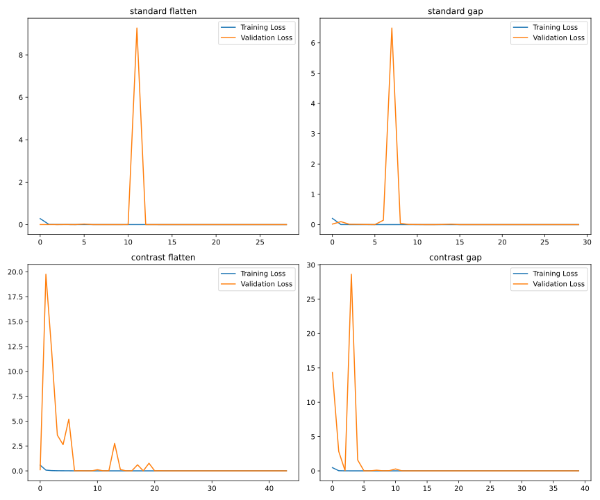

**Single Models - Training Accuracy**

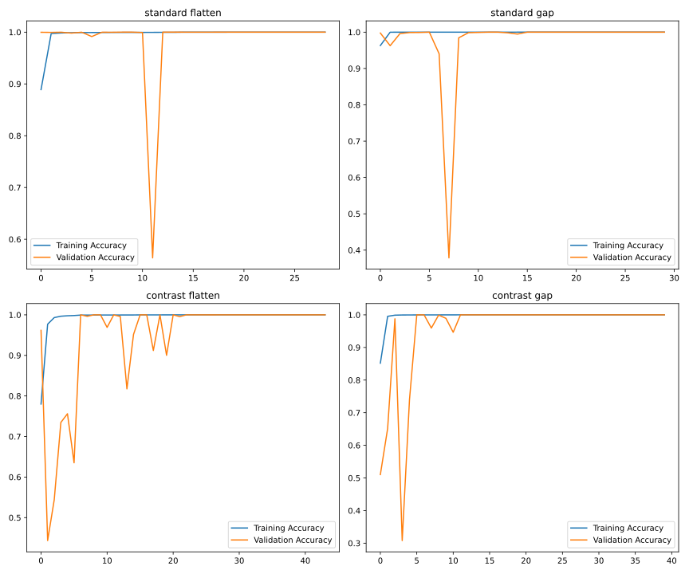

```text

============================================================
Single Model - standard flatten
--- Training History Summary ---
Total Epochs: 29
Best Epoch: 28
Final Training Loss: 7.70260339777451e-06
Final Validation Loss: 1.4069039480091305e-06
Final Training Accuracy: 1.0
Final Validation Accuracy: 1.0
--- Convergence Analysis ---
Generalization Gap: -6.2956994497653795e-06
Accuracy Gap: 0.0
Validation Stability (last 5): 5.61442714665976e-07

--- Evaluation Metrics Summary (primary) ---
Test Loss: 2.748692384813012e-10
Test Accuracy: 1.0
Macro Avg F1-Score: 1.0
Weighted Avg F1-Score: 1.0
--- Accuracy Verification (primary) ---
  (OK) Accuracy is 1.0 — all per-class precision, recall, and F1 are also 1.0. Confirmed.

============================================================
Single Model - standard gap
--- Training History Summary ---
Total Epochs: 30
Best Epoch: 29
Final Training Loss: 1.6286850978985967e-08
Final Validation Loss: 8.996289047047412e-09
Final Training Accuracy: 1.0
Final Validation Accuracy: 1.0
--- Convergence Analysis ---
Generalization Gap: -7.290561931938555e-09
Accuracy Gap: 0.0
Validation Stability (last 5): 1.835923080839167e-09

--- Evaluation Metrics Summary (primary) ---
Test Loss: 3.201416909348609e-09
Test Accuracy: 1.0
Macro Avg F1-Score: 1.0
Weighted Avg F1-Score: 1.0
--- Accuracy Verification (primary) ---
  (OK) Accuracy is 1.0 — all per-class precision, recall, and F1 are also 1.0. Confirmed.

============================================================
Single Model - contrast flatten
--- Training History Summary ---
Total Epochs: 44
Best Epoch: 34
Final Training Loss: 7.818264566594735e-05
Final Validation Loss: 3.179613088377664e-07
Final Training Accuracy: 0.9999809861183167
Final Validation Accuracy: 1.0
--- Convergence Analysis ---
Generalization Gap: -7.786468435710958e-05
Accuracy Gap: -1.901388168334961e-05
Validation Stability (last 5): 9.683276035703065e-08

--- Evaluation Metrics Summary (primary) ---
Test Loss: 1.4288687566477165e-07
Test Accuracy: 1.0
Macro Avg F1-Score: 1.0
Weighted Avg F1-Score: 1.0
--- Accuracy Verification (primary) ---
  (OK) Accuracy is 1.0 — all per-class precision, recall, and F1 are also 1.0. Confirmed.

--- Evaluation Metrics Summary (standard test) ---
Test Loss: 3.654132829655765e-10
Test Accuracy: 1.0
Macro Avg F1-Score: 1.0
Weighted Avg F1-Score: 1.0
--- Accuracy Verification (standard test) ---
  (OK) Accuracy is 1.0 — all per-class precision, recall, and F1 are also 1.0. Confirmed.

============================================================
Single Model - contrast gap
--- Training History Summary ---
Total Epochs: 40
Best Epoch: 40
Final Training Loss: 5.21130729680408e-08
Final Validation Loss: 1.0992817323085546e-08
Final Training Accuracy: 1.0
Final Validation Accuracy: 1.0
--- Convergence Analysis ---
Generalization Gap: -4.112025564495525e-08
Accuracy Gap: 0.0
Validation Stability (last 5): 1.2346085212868805e-08

--- Evaluation Metrics Summary (primary) ---
Test Loss: 1.7908259763999013e-08
Test Accuracy: 1.0
Macro Avg F1-Score: 1.0
Weighted Avg F1-Score: 1.0
--- Accuracy Verification (primary) ---
  (OK) Accuracy is 1.0 — all per-class precision, recall, and F1 are also 1.0. Confirmed.

--- Evaluation Metrics Summary (standard test) ---
Test Loss: 8.300152565254848e-09
Test Accuracy: 1.0
Macro Avg F1-Score: 1.0
Weighted Avg F1-Score: 1.0
--- Accuracy Verification (standard test) ---
  (OK) Accuracy is 1.0 — all per-class precision, recall, and F1 are also 1.0. Confirmed.
```

**Multi Models - Training Loss**

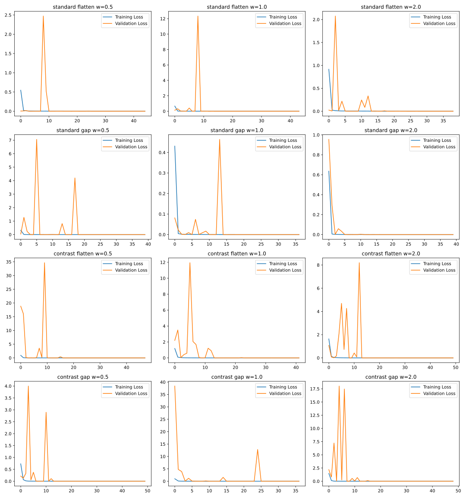

**Multi Models - Main Task Accuracy**

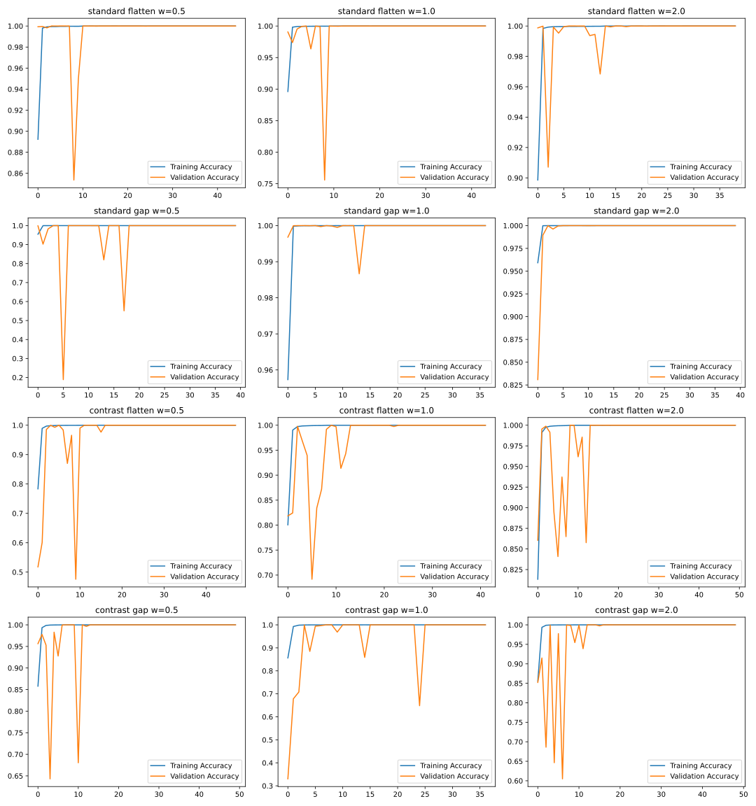

**Multi Models - Separate Losses**

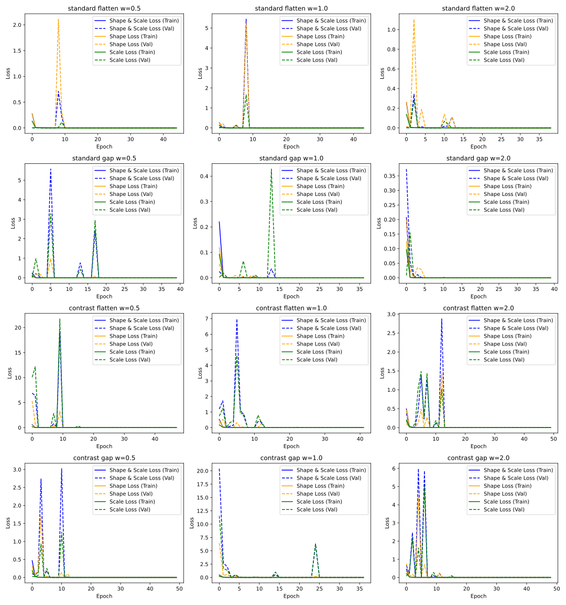

**Multi Models - Separate Accuracies**

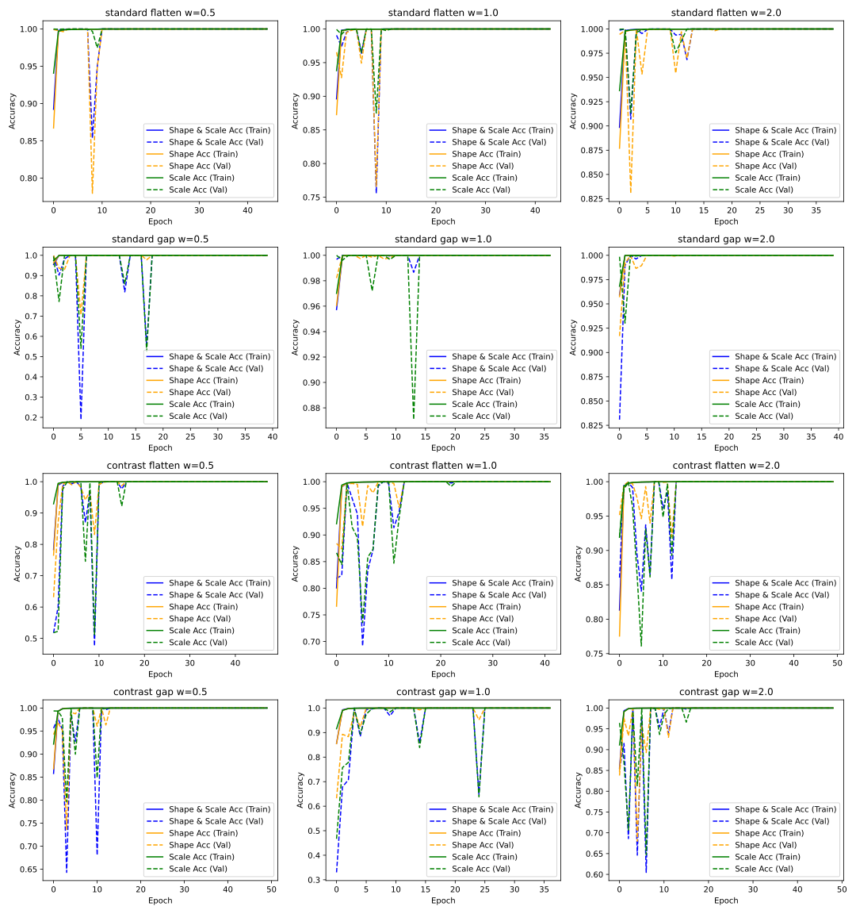

```text

============================================================
Multi Model - standard flatten w=0.5
--- Training History Summary ---
Total Epochs: 45
Best Epoch (min val_loss): 35
Final shape_and_scale_loss: 0.0000
Final val_shape_and_scale_loss: 0.0000
Final shape_and_scale_accuracy: 1.0000
Final val_shape_and_scale_accuracy: 1.0000
Final shape_loss: 0.0000
Final val_shape_loss: 0.0000
Final shape_accuracy: 1.0000
Final val_shape_accuracy: 1.0000
Final scale_loss: 0.0000
Final val_scale_loss: 0.0000
Final scale_accuracy: 1.0000
Final val_scale_accuracy: 1.0000

--- Evaluation Metrics Summary (primary) ---
Test Loss (total): 9.740073636521629e-09

  shape_and_scale_task:
    Loss: 1.8949779523325105e-09
    Accuracy: 1.0
    Macro Avg F1-Score: 1.0
    Weighted Avg F1-Score: 1.0
    (OK) Accuracy is 1.0 — all per-class precision, recall, and F1 are also 1.0. Confirmed.

  shape_task:
    Loss: 8.78935146886306e-09
    Accuracy: 1.0
    Macro Avg F1-Score: 1.0
    Weighted Avg F1-Score: 1.0
    (OK) Accuracy is 1.0 — all per-class precision, recall, and F1 are also 1.0. Confirmed.

  scale_task:
    Loss: 3.2337587468900253e-12
    Accuracy: 1.0
    Macro Avg F1-Score: 1.0
    Weighted Avg F1-Score: 1.0
    (OK) Accuracy is 1.0 — all per-class precision, recall, and F1 are also 1.0. Confirmed.

============================================================
Multi Model - standard flatten w=1.0
--- Training History Summary ---
Total Epochs: 44
Best Epoch (min val_loss): 35
Final shape_and_scale_loss: 0.0000
Final val_shape_and_scale_loss: 0.0000
Final shape_and_scale_accuracy: 1.0000
Final val_shape_and_scale_accuracy: 1.0000
Final shape_loss: 0.0000
Final val_shape_loss: 0.0000
Final shape_accuracy: 1.0000
Final val_shape_accuracy: 1.0000
Final scale_loss: 0.0000
Final val_scale_loss: 0.0000
Final scale_accuracy: 1.0000
Final val_scale_accuracy: 1.0000

--- Evaluation Metrics Summary (primary) ---
Test Loss (total): 1.827719309233089e-08

  shape_and_scale_task:
    Loss: 1.2482280764558595e-09
    Accuracy: 1.0
    Macro Avg F1-Score: 1.0
    Weighted Avg F1-Score: 1.0
    (OK) Accuracy is 1.0 — all per-class precision, recall, and F1 are also 1.0. Confirmed.

  shape_task:
    Loss: 1.702573193540502e-08
    Accuracy: 1.0
    Macro Avg F1-Score: 1.0
    Weighted Avg F1-Score: 1.0
    (OK) Accuracy is 1.0 — all per-class precision, recall, and F1 are also 1.0. Confirmed.

  scale_task:
    Loss: 3.2337587468900253e-12
    Accuracy: 1.0
    Macro Avg F1-Score: 1.0
    Weighted Avg F1-Score: 1.0
    (OK) Accuracy is 1.0 — all per-class precision, recall, and F1 are also 1.0. Confirmed.

============================================================
Multi Model - standard flatten w=2.0
--- Training History Summary ---
Total Epochs: 39
Best Epoch (min val_loss): 38
Final shape_and_scale_loss: 0.0000
Final val_shape_and_scale_loss: 0.0000
Final shape_and_scale_accuracy: 1.0000
Final val_shape_and_scale_accuracy: 1.0000
Final shape_loss: 0.0000
Final val_shape_loss: 0.0000
Final shape_accuracy: 1.0000
Final val_shape_accuracy: 1.0000
Final scale_loss: 0.0000
Final val_scale_loss: 0.0000
Final scale_accuracy: 1.0000
Final val_scale_accuracy: 1.0000

--- Evaluation Metrics Summary (primary) ---
Test Loss (total): 7.25331661399764e-09

  shape_and_scale_task:
    Loss: 9.054521715734509e-11
    Accuracy: 1.0
    Macro Avg F1-Score: 1.0
    Weighted Avg F1-Score: 1.0
    (OK) Accuracy is 1.0 — all per-class precision, recall, and F1 are also 1.0. Confirmed.

  shape_task:
    Loss: 7.059290929589679e-09
    Accuracy: 1.0
    Macro Avg F1-Score: 1.0
    Weighted Avg F1-Score: 1.0
    (OK) Accuracy is 1.0 — all per-class precision, recall, and F1 are also 1.0. Confirmed.

  scale_task:
    Loss: 1.2935034120198363e-11
    Accuracy: 1.0
    Macro Avg F1-Score: 1.0
    Weighted Avg F1-Score: 1.0
    (OK) Accuracy is 1.0 — all per-class precision, recall, and F1 are also 1.0. Confirmed.

============================================================
Multi Model - standard gap w=0.5
--- Training History Summary ---
Total Epochs: 40
Best Epoch (min val_loss): 37
Final shape_and_scale_loss: 0.0000
Final val_shape_and_scale_loss: 0.0000
Final shape_and_scale_accuracy: 1.0000
Final val_shape_and_scale_accuracy: 1.0000
Final shape_loss: 0.0000
Final val_shape_loss: 0.0000
Final shape_accuracy: 1.0000
Final val_shape_accuracy: 1.0000
Final scale_loss: 0.0000
Final val_scale_loss: 0.0000
Final scale_accuracy: 1.0000
Final val_scale_accuracy: 1.0000

--- Evaluation Metrics Summary (primary) ---
Test Loss (total): 7.880639252277888e-09

  shape_and_scale_task:
    Loss: 6.00182481491629e-09
    Accuracy: 1.0
    Macro Avg F1-Score: 1.0
    Weighted Avg F1-Score: 1.0
    (OK) Accuracy is 1.0 — all per-class precision, recall, and F1 are also 1.0. Confirmed.

  shape_task:
    Loss: 3.831992501091008e-09
    Accuracy: 1.0
    Macro Avg F1-Score: 1.0
    Weighted Avg F1-Score: 1.0
    (OK) Accuracy is 1.0 — all per-class precision, recall, and F1 are also 1.0. Confirmed.

  scale_task:
    Loss: 1.0477343437287345e-09
    Accuracy: 1.0
    Macro Avg F1-Score: 1.0
    Weighted Avg F1-Score: 1.0
    (OK) Accuracy is 1.0 — all per-class precision, recall, and F1 are also 1.0. Confirmed.

============================================================
Multi Model - standard gap w=1.0
--- Training History Summary ---
Total Epochs: 37
Best Epoch (min val_loss): 37
Final shape_and_scale_loss: 0.0000
Final val_shape_and_scale_loss: 0.0000
Final shape_and_scale_accuracy: 1.0000
Final val_shape_and_scale_accuracy: 1.0000
Final shape_loss: 0.0000
Final val_shape_loss: 0.0000
Final shape_accuracy: 1.0000
Final val_shape_accuracy: 1.0000
Final scale_loss: 0.0000
Final val_scale_loss: 0.0000
Final scale_accuracy: 1.0000
Final val_scale_accuracy: 1.0000

--- Evaluation Metrics Summary (primary) ---
Test Loss (total): 1.0519373816464395e-08

  shape_and_scale_task:
    Loss: 4.501372607990106e-09
    Accuracy: 1.0
    Macro Avg F1-Score: 1.0
    Weighted Avg F1-Score: 1.0
    (OK) Accuracy is 1.0 — all per-class precision, recall, and F1 are also 1.0. Confirmed.

  shape_task:
    Loss: 4.973501610550102e-09
    Accuracy: 1.0
    Macro Avg F1-Score: 1.0
    Weighted Avg F1-Score: 1.0
    (OK) Accuracy is 1.0 — all per-class precision, recall, and F1 are also 1.0. Confirmed.

  scale_task:
    Loss: 1.0444991538349768e-09
    Accuracy: 1.0
    Macro Avg F1-Score: 1.0
    Weighted Avg F1-Score: 1.0
    (OK) Accuracy is 1.0 — all per-class precision, recall, and F1 are also 1.0. Confirmed.

============================================================
Multi Model - standard gap w=2.0
--- Training History Summary ---
Total Epochs: 40
Best Epoch (min val_loss): 36
Final shape_and_scale_loss: 0.0000
Final val_shape_and_scale_loss: 0.0000
Final shape_and_scale_accuracy: 1.0000
Final val_shape_and_scale_accuracy: 1.0000
Final shape_loss: 0.0000
Final val_shape_loss: 0.0000
Final shape_accuracy: 1.0000
Final val_shape_accuracy: 1.0000
Final scale_loss: 0.0000
Final val_scale_loss: 0.0000
Final scale_accuracy: 1.0000
Final val_scale_accuracy: 1.0000

--- Evaluation Metrics Summary (primary) ---
Test Loss (total): 1.835781482384391e-08

  shape_and_scale_task:
    Loss: 5.891827470350108e-09
    Accuracy: 1.0
    Macro Avg F1-Score: 1.0
    Weighted Avg F1-Score: 1.0
    (OK) Accuracy is 1.0 — all per-class precision, recall, and F1 are also 1.0. Confirmed.

  shape_task:
    Loss: 5.930642199558633e-09
    Accuracy: 1.0
    Macro Avg F1-Score: 1.0
    Weighted Avg F1-Score: 1.0
    (OK) Accuracy is 1.0 — all per-class precision, recall, and F1 are also 1.0. Confirmed.

  scale_task:
    Loss: 6.435172950070012e-10
    Accuracy: 1.0
    Macro Avg F1-Score: 1.0
    Weighted Avg F1-Score: 1.0
    (OK) Accuracy is 1.0 — all per-class precision, recall, and F1 are also 1.0. Confirmed.

============================================================
Multi Model - contrast flatten w=0.5
--- Training History Summary ---
Total Epochs: 48
Best Epoch (min val_loss): 46
Final shape_and_scale_loss: 0.0001
Final val_shape_and_scale_loss: 0.0000
Final shape_and_scale_accuracy: 1.0000
Final val_shape_and_scale_accuracy: 1.0000
Final shape_loss: 0.0001
Final val_shape_loss: 0.0000
Final shape_accuracy: 1.0000
Final val_shape_accuracy: 1.0000
Final scale_loss: 0.0000
Final val_scale_loss: 0.0000
Final scale_accuracy: 1.0000
Final val_scale_accuracy: 1.0000

--- Evaluation Metrics Summary (primary) ---
Test Loss (total): 7.765521559122135e-08

  shape_and_scale_task:
    Loss: 6.309174693797104e-08
    Accuracy: 1.0
    Macro Avg F1-Score: 1.0
    Weighted Avg F1-Score: 1.0
    (OK) Accuracy is 1.0 — all per-class precision, recall, and F1 are also 1.0. Confirmed.

  shape_task:
    Loss: 4.314334134392084e-08
    Accuracy: 1.0
    Macro Avg F1-Score: 1.0
    Weighted Avg F1-Score: 1.0
    (OK) Accuracy is 1.0 — all per-class precision, recall, and F1 are also 1.0. Confirmed.

  scale_task:
    Loss: 2.9659976696905233e-09
    Accuracy: 1.0
    Macro Avg F1-Score: 1.0
    Weighted Avg F1-Score: 1.0
    (OK) Accuracy is 1.0 — all per-class precision, recall, and F1 are also 1.0. Confirmed.

--- Evaluation Metrics Summary (standard test) ---
Test Loss (total): 1.6168793734450126e-12

  shape_and_scale_task:
    Loss: 3.2337587468900253e-12
    Accuracy: 1.0
    Macro Avg F1-Score: 1.0
    Weighted Avg F1-Score: 1.0
    (OK) Accuracy is 1.0 — all per-class precision, recall, and F1 are also 1.0. Confirmed.

  shape_task:
    Loss: 0.0
    Accuracy: 1.0
    Macro Avg F1-Score: 1.0
    Weighted Avg F1-Score: 1.0
    (OK) Accuracy is 1.0 — all per-class precision, recall, and F1 are also 1.0. Confirmed.

  scale_task:
    Loss: 0.0
    Accuracy: 1.0
    Macro Avg F1-Score: 1.0
    Weighted Avg F1-Score: 1.0
    (OK) Accuracy is 1.0 — all per-class precision, recall, and F1 are also 1.0. Confirmed.

============================================================
Multi Model - contrast flatten w=1.0
--- Training History Summary ---
Total Epochs: 42
Best Epoch (min val_loss): 32
Final shape_and_scale_loss: 0.0001
Final val_shape_and_scale_loss: 0.0000
Final shape_and_scale_accuracy: 1.0000
Final val_shape_and_scale_accuracy: 1.0000
Final shape_loss: 0.0001
Final val_shape_loss: 0.0000
Final shape_accuracy: 1.0000
Final val_shape_accuracy: 1.0000
Final scale_loss: 0.0001
Final val_scale_loss: 0.0000
Final scale_accuracy: 1.0000
Final val_scale_accuracy: 1.0000

--- Evaluation Metrics Summary (primary) ---
Test Loss (total): 7.889579478614905e-07

  shape_and_scale_task:
    Loss: 1.4739143239239638e-07
    Accuracy: 1.0
    Macro Avg F1-Score: 1.0
    Weighted Avg F1-Score: 1.0
    (OK) Accuracy is 1.0 — all per-class precision, recall, and F1 are also 1.0. Confirmed.

  shape_task:
    Loss: 6.110633421485545e-07
    Accuracy: 1.0
    Macro Avg F1-Score: 1.0
    Weighted Avg F1-Score: 1.0
    (OK) Accuracy is 1.0 — all per-class precision, recall, and F1 are also 1.0. Confirmed.

  scale_task:
    Loss: 3.050318753139436e-08
    Accuracy: 1.0
    Macro Avg F1-Score: 1.0
    Weighted Avg F1-Score: 1.0
    (OK) Accuracy is 1.0 — all per-class precision, recall, and F1 are also 1.0. Confirmed.

--- Evaluation Metrics Summary (standard test) ---
Test Loss (total): 3.5570843692767085e-07

  shape_and_scale_task:
    Loss: 1.4195831177232776e-09
    Accuracy: 1.0
    Macro Avg F1-Score: 1.0
    Weighted Avg F1-Score: 1.0
    (OK) Accuracy is 1.0 — all per-class precision, recall, and F1 are also 1.0. Confirmed.

  shape_task:
    Loss: 3.542209583429212e-07
    Accuracy: 1.0
    Macro Avg F1-Score: 1.0
    Weighted Avg F1-Score: 1.0
    (OK) Accuracy is 1.0 — all per-class precision, recall, and F1 are also 1.0. Confirmed.

  scale_task:
    Loss: 6.790885215268716e-11
    Accuracy: 1.0
    Macro Avg F1-Score: 1.0
    Weighted Avg F1-Score: 1.0
    (OK) Accuracy is 1.0 — all per-class precision, recall, and F1 are also 1.0. Confirmed.

============================================================
Multi Model - contrast flatten w=2.0
--- Training History Summary ---
Total Epochs: 50
Best Epoch (min val_loss): 41
Final shape_and_scale_loss: 0.0000
Final val_shape_and_scale_loss: 0.0000
Final shape_and_scale_accuracy: 1.0000
Final val_shape_and_scale_accuracy: 1.0000
Final shape_loss: 0.0001
Final val_shape_loss: 0.0000
Final shape_accuracy: 1.0000
Final val_shape_accuracy: 1.0000
Final scale_loss: 0.0001
Final val_scale_loss: 0.0000
Final scale_accuracy: 1.0000
Final val_scale_accuracy: 1.0000

--- Evaluation Metrics Summary (primary) ---
Test Loss (total): 1.2578522046169383e-07

  shape_and_scale_task:
    Loss: 2.7874815344830495e-08
    Accuracy: 1.0
    Macro Avg F1-Score: 1.0
    Weighted Avg F1-Score: 1.0
    (OK) Accuracy is 1.0 — all per-class precision, recall, and F1 are also 1.0. Confirmed.

  shape_task:
    Loss: 6.60020802456529e-08
    Accuracy: 1.0
    Macro Avg F1-Score: 1.0
    Weighted Avg F1-Score: 1.0
    (OK) Accuracy is 1.0 — all per-class precision, recall, and F1 are also 1.0. Confirmed.

  scale_task:
    Loss: 4.033536615821731e-09
    Accuracy: 1.0
    Macro Avg F1-Score: 1.0
    Weighted Avg F1-Score: 1.0
    (OK) Accuracy is 1.0 — all per-class precision, recall, and F1 are also 1.0. Confirmed.

--- Evaluation Metrics Summary (standard test) ---
Test Loss (total): 6.507607963612827e-08

  shape_and_scale_task:
    Loss: 3.2337587468900253e-12
    Accuracy: 1.0
    Macro Avg F1-Score: 1.0
    Weighted Avg F1-Score: 1.0
    (OK) Accuracy is 1.0 — all per-class precision, recall, and F1 are also 1.0. Confirmed.

  shape_task:
    Loss: 6.506961369723285e-08
    Accuracy: 1.0
    Macro Avg F1-Score: 1.0
    Weighted Avg F1-Score: 1.0
    (OK) Accuracy is 1.0 — all per-class precision, recall, and F1 are also 1.0. Confirmed.

  scale_task:
    Loss: 0.0
    Accuracy: 1.0
    Macro Avg F1-Score: 1.0
    Weighted Avg F1-Score: 1.0
    (OK) Accuracy is 1.0 — all per-class precision, recall, and F1 are also 1.0. Confirmed.

============================================================
Multi Model - contrast gap w=0.5
--- Training History Summary ---
Total Epochs: 50
Best Epoch (min val_loss): 47
Final shape_and_scale_loss: 0.0000
Final val_shape_and_scale_loss: 0.0000
Final shape_and_scale_accuracy: 1.0000
Final val_shape_and_scale_accuracy: 1.0000
Final shape_loss: 0.0000
Final val_shape_loss: 0.0000
Final shape_accuracy: 1.0000
Final val_shape_accuracy: 1.0000
Final scale_loss: 0.0000
Final val_scale_loss: 0.0000
Final scale_accuracy: 1.0000
Final val_scale_accuracy: 1.0000

--- Evaluation Metrics Summary (primary) ---
Test Loss (total): 3.4511032254158636e-07

  shape_and_scale_task:
    Loss: 4.050848545489316e-08
    Accuracy: 1.0
    Macro Avg F1-Score: 1.0
    Weighted Avg F1-Score: 1.0
    (OK) Accuracy is 1.0 — all per-class precision, recall, and F1 are also 1.0. Confirmed.

  shape_task:
    Loss: 3.2205568345489155e-07
    Accuracy: 1.0
    Macro Avg F1-Score: 1.0
    Weighted Avg F1-Score: 1.0
    (OK) Accuracy is 1.0 — all per-class precision, recall, and F1 are also 1.0. Confirmed.

  scale_task:
    Loss: 2.8004032426309777e-09
    Accuracy: 1.0
    Macro Avg F1-Score: 1.0
    Weighted Avg F1-Score: 1.0
    (OK) Accuracy is 1.0 — all per-class precision, recall, and F1 are also 1.0. Confirmed.

--- Evaluation Metrics Summary (standard test) ---
Test Loss (total): 3.033121842577202e-08

  shape_and_scale_task:
    Loss: 1.7791194295568857e-08
    Accuracy: 1.0
    Macro Avg F1-Score: 1.0
    Weighted Avg F1-Score: 1.0
    (OK) Accuracy is 1.0 — all per-class precision, recall, and F1 are also 1.0. Confirmed.

  shape_task:
    Loss: 1.846384378723087e-08
    Accuracy: 1.0
    Macro Avg F1-Score: 1.0
    Weighted Avg F1-Score: 1.0
    (OK) Accuracy is 1.0 — all per-class precision, recall, and F1 are also 1.0. Confirmed.

  scale_task:
    Loss: 2.9717761584890923e-09
    Accuracy: 1.0
    Macro Avg F1-Score: 1.0
    Weighted Avg F1-Score: 1.0
    (OK) Accuracy is 1.0 — all per-class precision, recall, and F1 are also 1.0. Confirmed.

============================================================
Multi Model - contrast gap w=1.0
--- Training History Summary ---
Total Epochs: 37
Best Epoch (min val_loss): 27
Final shape_and_scale_loss: 0.0000
Final val_shape_and_scale_loss: 0.0000
Final shape_and_scale_accuracy: 1.0000
Final val_shape_and_scale_accuracy: 1.0000
Final shape_loss: 0.0000
Final val_shape_loss: 0.0000
Final shape_accuracy: 1.0000
Final val_shape_accuracy: 1.0000
Final scale_loss: 0.0000
Final val_scale_loss: 0.0000
Final scale_accuracy: 1.0000
Final val_scale_accuracy: 1.0000

--- Evaluation Metrics Summary (primary) ---
Test Loss (total): 1.5402193298541533e-07

  shape_and_scale_task:
    Loss: 6.423693577062295e-08
    Accuracy: 1.0
    Macro Avg F1-Score: 1.0
    Weighted Avg F1-Score: 1.0
    (OK) Accuracy is 1.0 — all per-class precision, recall, and F1 are also 1.0. Confirmed.

  shape_task:
    Loss: 7.185980166468653e-08
    Accuracy: 1.0
    Macro Avg F1-Score: 1.0
    Weighted Avg F1-Score: 1.0
    (OK) Accuracy is 1.0 — all per-class precision, recall, and F1 are also 1.0. Confirmed.

  scale_task:
    Loss: 1.7925232853599482e-08
    Accuracy: 1.0
    Macro Avg F1-Score: 1.0
    Weighted Avg F1-Score: 1.0
    (OK) Accuracy is 1.0 — all per-class precision, recall, and F1 are also 1.0. Confirmed.

--- Evaluation Metrics Summary (standard test) ---
Test Loss (total): 2.116117485684299e-07

  shape_and_scale_task:
    Loss: 8.039604892928764e-08
    Accuracy: 1.0
    Macro Avg F1-Score: 1.0
    Weighted Avg F1-Score: 1.0
    (OK) Accuracy is 1.0 — all per-class precision, recall, and F1 are also 1.0. Confirmed.

  shape_task:
    Loss: 1.0685088369655205e-07
    Accuracy: 1.0
    Macro Avg F1-Score: 1.0
    Weighted Avg F1-Score: 1.0
    (OK) Accuracy is 1.0 — all per-class precision, recall, and F1 are also 1.0. Confirmed.

  scale_task:
    Loss: 2.4364814166233373e-08
    Accuracy: 1.0
    Macro Avg F1-Score: 1.0
    Weighted Avg F1-Score: 1.0
    (OK) Accuracy is 1.0 — all per-class precision, recall, and F1 are also 1.0. Confirmed.

============================================================
Multi Model - contrast gap w=2.0
--- Training History Summary ---
Total Epochs: 49
Best Epoch (min val_loss): 47
Final shape_and_scale_loss: 0.0000
Final val_shape_and_scale_loss: 0.0000
Final shape_and_scale_accuracy: 1.0000
Final val_shape_and_scale_accuracy: 1.0000
Final shape_loss: 0.0000
Final val_shape_loss: 0.0000
Final shape_accuracy: 1.0000
Final val_shape_accuracy: 1.0000
Final scale_loss: 0.0000
Final val_scale_loss: 0.0000
Final scale_accuracy: 1.0000
Final val_scale_accuracy: 1.0000

--- Evaluation Metrics Summary (primary) ---
Test Loss (total): 5.9543484809410074e-08

  shape_and_scale_task:
    Loss: 1.3012593225170122e-09
    Accuracy: 1.0
    Macro Avg F1-Score: 1.0
    Weighted Avg F1-Score: 1.0
    (OK) Accuracy is 1.0 — all per-class precision, recall, and F1 are also 1.0. Confirmed.

  shape_task:
    Loss: 4.155932931126927e-09
    Accuracy: 1.0
    Macro Avg F1-Score: 1.0
    Weighted Avg F1-Score: 1.0
    (OK) Accuracy is 1.0 — all per-class precision, recall, and F1 are also 1.0. Confirmed.

  scale_task:
    Loss: 5.2785029680535445e-08
    Accuracy: 1.0
    Macro Avg F1-Score: 1.0
    Weighted Avg F1-Score: 1.0
    (OK) Accuracy is 1.0 — all per-class precision, recall, and F1 are also 1.0. Confirmed.

--- Evaluation Metrics Summary (standard test) ---
Test Loss (total): 2.6915702733276703e-07

  shape_and_scale_task:
    Loss: 8.763360592745073e-10
    Accuracy: 1.0
    Macro Avg F1-Score: 1.0
    Weighted Avg F1-Score: 1.0
    (OK) Accuracy is 1.0 — all per-class precision, recall, and F1 are also 1.0. Confirmed.

  shape_task:
    Loss: 6.3799010519005606e-09
    Accuracy: 1.0
    Macro Avg F1-Score: 1.0
    Weighted Avg F1-Score: 1.0
    (OK) Accuracy is 1.0 — all per-class precision, recall, and F1 are also 1.0. Confirmed.

  scale_task:
    Loss: 2.6102446781806066e-07
    Accuracy: 1.0
    Macro Avg F1-Score: 1.0
    Weighted Avg F1-Score: 1.0
    (OK) Accuracy is 1.0 — all per-class precision, recall, and F1 are also 1.0. Confirmed.
```

**Single - flatten - Architecture**

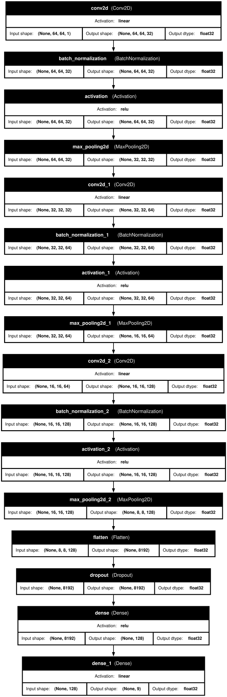

**Single - gap - Architecture**

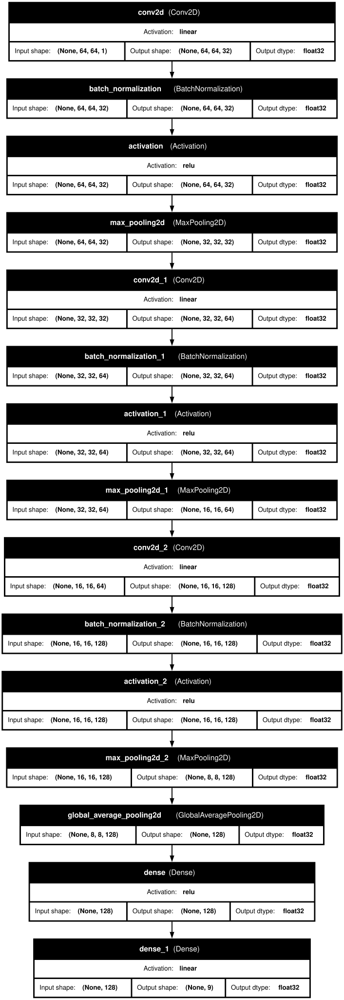

**Multi - flatten - Architecture**

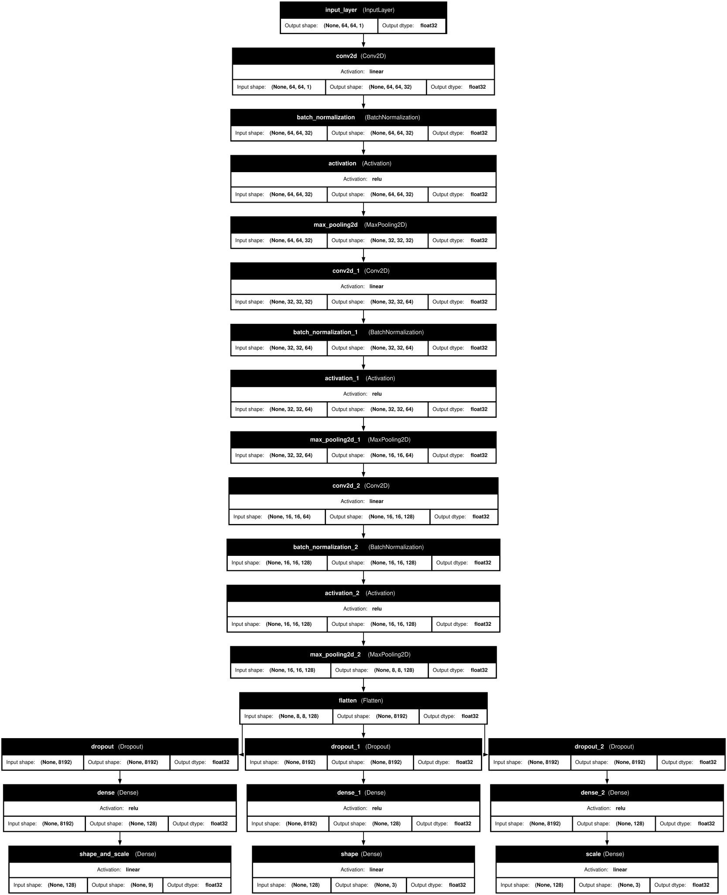

**Multi - gap - Architecture**

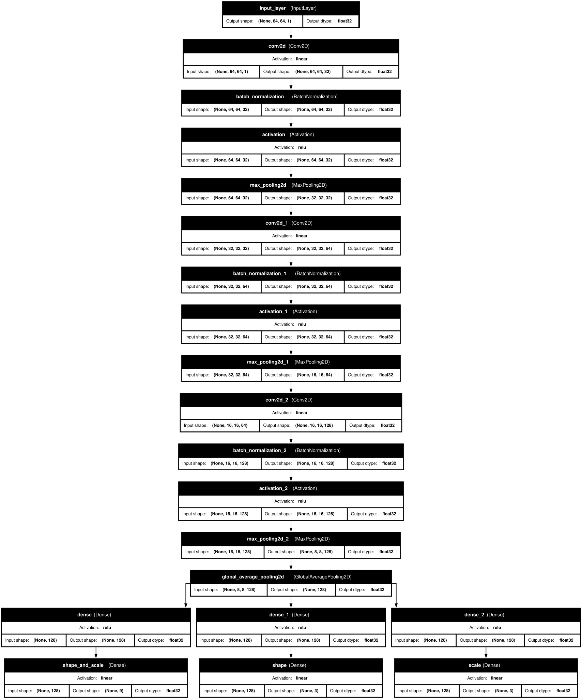

**Single Models - Latent Space PCA (2x2 Grid)**

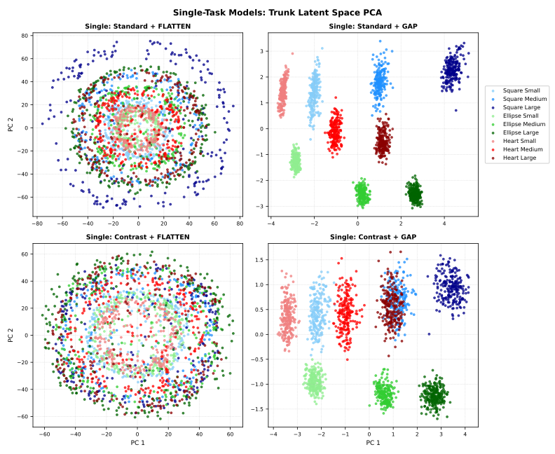

**Multi Models - Latent Space PCA (4x3 Grid)**


**Multi Models - Standard vs Contrast Latent PCA (GAP Only)**

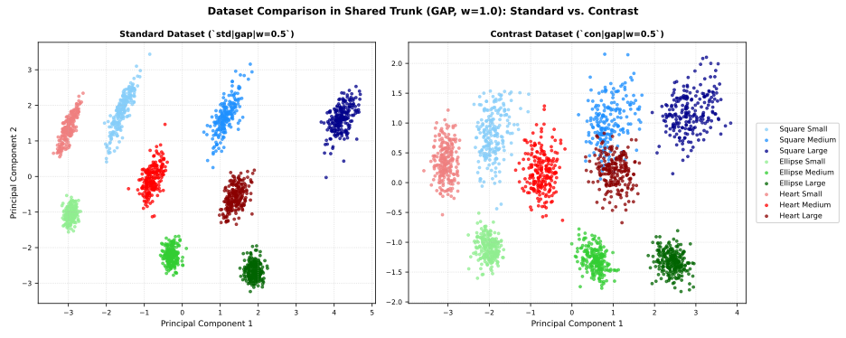

**Multi Models - Loss Weight Trajectory Latent PCA (con|gap)**

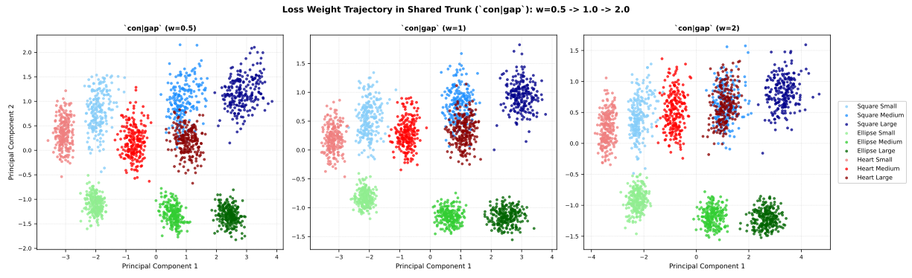

