```text
Loaded 48/48 evaluation files -> 240 slices (expected 240; N=36,864 per slice).
Per-image archetype role arrays: 14 entropy / 14 confidence groups.
================================================================================================================================
=== PART A — SECTION 1.1: HOW OFTEN DOES THE ATTACK SUCCEED? (NODE 0: GLOBAL ASR & 240-SLICE DISTRIBUTION) ===
================================================================================================================================
Observed result:
  - Clean accuracy is perfect on the unified standard test split (N=36,864) for all 12 models and all 3 branches,
    so every successful attack is caused by the perturbation.
  - Across the 240 (model x attack) slices, ASR is strongly left-skewed: the mean lies well below the median, a
    sizeable share of slices is almost untouched (small budgets, L_2, contrast models), and the upper quartile sits
    exactly at the 8/9 = 88.89% ceiling. Many slices cluster around this ceiling and a few reach ~100%.
--------------------------------------------------------------------------------------------------------------------------------

[1] Clean Baseline Verification on MY_DSPRITES_SPLIT (from b_models evaluation JSONs):
Model Label        | Primary Eval (Main / Shape / Scale)    | Standard-Test Eval (Main / Shape / Scale) 
----------------------------------------------------------------------------------------------------------
std|flat|w=0.5     | 1.0000 / 1.0000 / 1.0000               | N/A (primary is standard)                 
std|flat|w=1       | 1.0000 / 1.0000 / 1.0000               | N/A (primary is standard)                 
std|flat|w=2       | 1.0000 / 1.0000 / 1.0000               | N/A (primary is standard)                 
std|gap|w=0.5      | 1.0000 / 1.0000 / 1.0000               | N/A (primary is standard)                 
std|gap|w=1        | 1.0000 / 1.0000 / 1.0000               | N/A (primary is standard)                 
std|gap|w=2        | 1.0000 / 1.0000 / 1.0000               | N/A (primary is standard)                 
con|flat|w=0.5     | 1.0000 / 1.0000 / 1.0000               | 1.0000 / 1.0000 / 1.0000                  
con|flat|w=1       | 1.0000 / 1.0000 / 1.0000               | 1.0000 / 1.0000 / 1.0000                  
con|flat|w=2       | 1.0000 / 1.0000 / 1.0000               | 1.0000 / 1.0000 / 1.0000                  
con|gap|w=0.5      | 1.0000 / 1.0000 / 1.0000               | 1.0000 / 1.0000 / 1.0000                  
con|gap|w=1        | 1.0000 / 1.0000 / 1.0000               | 1.0000 / 1.0000 / 1.0000                  
con|gap|w=2        | 1.0000 / 1.0000 / 1.0000               | 1.0000 / 1.0000 / 1.0000                  
----------------------------------------------------------------------------------------------------------

[2] Global Pooled ASR vs. 240-Slice Distribution Summary:
  Pooled ASR (sum |S| / sum N) :  61.14%  [95% Wilson CI:  61.11%,  61.17%]  (|S| = 5,409,083 / N = 8,847,360)
  Unweighted 240-Slice Mean    :  61.14%  (Exact match because N = 36,864 is constant per slice)
  Slice Quantiles (n=240)      : Min =  0.00% | Q25 = 25.34% | Median = 81.11% | Q75 = 88.89% | Max = 100.00%
  Slice Spread                 : IQR = 63.54 pp | Std (sample) = 36.34 pp

[3] Slice Counts Across ASR Regimes (out of 240 slices):
ASR Band / Regime                                |   Slices (k / 240) |  Share (%)
------------------------------------------------------------------------------------
Near-zero (< 1.0%)                               |           30 / 240 |     12.50%
Untouched / very low (< 5.0%)                    |           44 / 240 |     18.33%
Intermediate (5.0% <= ASR < 80.0%)               |           72 / 240 |     30.00%
High / below ceiling (80.0% <= ASR < 88.0%)      |           37 / 240 |     15.42%
Around 8/9 ceiling (88.0% <= ASR <= 90.0%)       |           54 / 240 |     22.50%
  -> Tight 8/9 ceiling (|ASR - 88.89%| < 0.5)    |           49 / 240 |     20.42%
Above 8/9 ceiling (90.0% < ASR < 99.0%)          |           17 / 240 |      7.08%
Near / at 100% (ASR >= 99.0%)                    |           16 / 240 |      6.67%
  -> Exact 100.0% (ASR == 100.0%)                |            5 / 240 |      2.08%
------------------------------------------------------------------------------------

[4] Full 12 Models x 20 Attack Settings ASR (%) Matrix (Columns grouped: FGSM-L2 | PGD-L2 | FGSM-Linf | PGD-Linf):
Model            ||              FGSM-L2               ||               PGD-L2               ||             FGSM-LINF              ||              PGD-LINF              ||   Mean
(d|pi|w)         ||     e1     e2     e3     e4     e5 ||     e1     e2     e3     e4     e5 ||     e1     e2     e3     e4     e5 ||     e1     e2     e3     e4     e5 ||   ASR%
--------------------------------------------------------------------------------------------------------------------------------------------------------------------------------
std|flat|w=0.5   ||    0.0   21.1   36.3   71.3   77.6 ||    1.7   82.3   86.9   88.9   91.6 ||   19.0   78.9   80.3   88.5   88.8 ||   70.4   90.6   97.7  100.0  100.0 ||   68.6
std|flat|w=1     ||    0.0   27.8   40.3   61.8   70.7 ||    1.9   80.8   85.6   75.1   80.1 ||   24.4   66.8   83.2   88.9   88.9 ||   68.8   80.2   92.0   89.1   88.9 ||   64.8
std|flat|w=2     ||    0.0   27.3   30.6   44.1   66.2 ||    2.4   71.6   84.0   88.3   81.6 ||   17.2   68.4   84.8   89.4   89.3 ||   64.9   99.9   90.1   89.1   88.9 ||   63.9
--------------------------------------------------------------------------------------------------------------------------------------------------------------------------------
std|gap|w=0.5    ||    0.0   28.0   61.4   84.1   87.5 ||   32.1   88.9   88.9   88.9   88.9 ||   82.7   91.1   84.1   83.7   84.1 ||   89.8   89.4   97.1   89.1   88.9 ||   76.4
std|gap|w=1      ||    0.0   22.7   57.7   83.5   87.2 ||   25.5   88.9   88.9   88.9   88.9 ||   82.1   92.7   83.1   83.2   83.9 ||   92.5   92.2   89.1   88.9   88.9 ||   75.4
std|gap|w=2      ||    0.0   13.5   47.5   82.0   85.8 ||   24.9   88.9   88.9   88.9   88.9 ||   77.8   88.3   88.6   79.8   81.4 ||   82.8   99.9  100.0  100.0   88.9 ||   74.8
--------------------------------------------------------------------------------------------------------------------------------------------------------------------------------
con|flat|w=0.5   ||    0.0    0.2    0.6    1.6    3.6 ||    0.0    1.5    5.7   78.7   83.8 ||    0.0   47.3   43.9   50.3   52.3 ||    0.3   84.2   88.9   84.6   87.4 ||   35.7
con|flat|w=1     ||    0.0    1.4    3.1    4.9    5.6 ||    0.0    5.5   72.3   88.8   89.4 ||    0.0   55.4   61.6   66.0   67.9 ||    9.0   90.1   98.6  100.0  100.0 ||   46.0
con|flat|w=2     ||    0.0    0.7    2.5    5.3    6.4 ||    0.0    1.6   17.9   79.3   91.9 ||    0.0   50.1   66.9   67.9   67.8 ||    0.2   94.1   98.7   99.8  100.0 ||   42.6
--------------------------------------------------------------------------------------------------------------------------------------------------------------------------------
con|gap|w=0.5    ||    0.0    1.9   27.3   72.2   77.8 ||    0.0   75.1   83.4   91.3   88.9 ||    0.0   86.0   88.9   88.9   88.9 ||   12.2  100.0   88.9   88.9   88.9 ||   62.5
con|gap|w=1      ||    0.0    0.6   44.2   77.3   77.5 ||    0.0   65.6   88.9   88.9   98.9 ||    0.0   78.0   88.9   88.9   87.1 ||   20.9   99.4  100.0   89.0   88.9 ||   64.1
con|gap|w=2      ||    0.0    1.4   30.9   57.9   59.4 ||    0.0   35.1   85.4   88.9   88.9 ||    0.0   88.8   79.3   84.8   85.1 ||    1.7   88.9   99.9  100.0  100.0 ||   58.8
--------------------------------------------------------------------------------------------------------------------------------------------------------------------------------
Col Mean         ||    0.0   12.2   31.9   53.8   58.8 ||    7.4   57.1   73.1   86.2   88.5 ||   25.3   74.3   77.8   80.0   80.5 ||   42.8   92.4   95.1   93.2   92.5 ||   61.1
================================================================================================================================

```

**Figure 1: Global ASR Distribution (240 Slices) and 12 Models x 20 Attacks Heatmap**

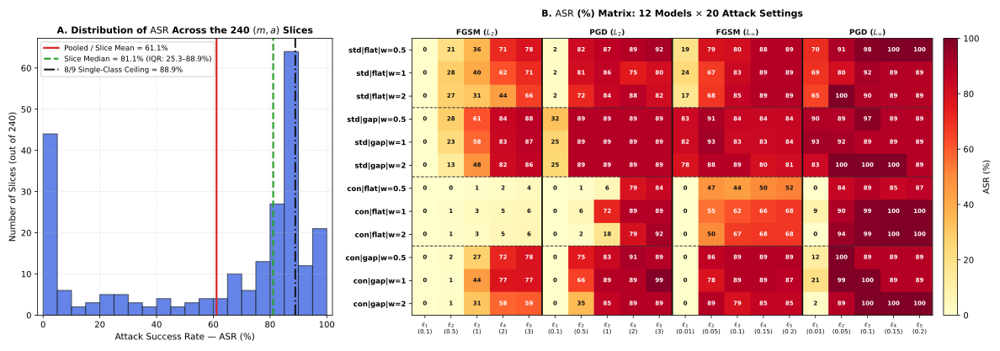

```text
================================================================================================================================
=== PART A — SECTION 1.2: WHAT DOES THE SUCCESS DEPEND ON? (NODE 0: FACTOR MARGINALS, D^2 & INTERACTIONS) ===
================================================================================================================================
Observed result:
  - Attack parameters (budget, norm, optimizer) explain most of the variation in ASR; L_inf is more effective than
    L_2 and PGD more effective than FGSM.
  - The budget effect depends on the norm: in L_inf ASR jumps sharply from eps_1 to eps_2 and then saturates,
    whereas in L_2 it keeps growing up to eps_4 (the pooled budget marginal mixes the two norms).
  - Architecture plays a secondary role: contrast training (con) and flatten pooling (flat) make `main` harder to
    fool overall, while loss weight w has a negligible effect.
  - `con | flat` strongly resists single-step FGSM-L2 at every budget, yields to multi-step PGD-L2 only at higher
    budgets, and yields almost completely under PGD-L_inf from eps_2 onward.
--------------------------------------------------------------------------------------------------------------------------------

[1] Node 0 Marginal ASR (%) Across All 6 Experimental Factors (Ordered by Decreasing Spread Delta):
Factor               | Delta (pp) |  D^2 (%) | Level Pooled ASR (%) [95% Wilson CI] (N per level)                              
--------------------------------------------------------------------------------------------------------------------------------
Budget Step (eps)    |      61.18 |   32.92% | eps_1: 18.86% [18.80,18.92] | eps_2: 59.01% [58.94,59.09] | eps_3: 69.45% [69.38,69.52] | eps_4: 78.32% [78.26,78.38] | eps_5: 80.04% [79.98,80.10]  (N=1,769,472)
Norm (p)             |      28.48 |   13.21% | L_inf: 75.38% [75.34,75.42] | L_2: 46.90% [46.85,46.94]  (N=4,423,680)
Optimizer (alpha)    |      23.37 |    8.84% | FGSM: 49.45% [49.41,49.50] | PGD: 72.82% [72.78,72.86]  (N=4,423,680)
Dataset (d)          |      19.04 |    5.84% | std: 70.66% [70.62,70.70] | con: 51.62% [51.57,51.66]  (N=4,423,680)
Pooling (pi)         |      15.10 |    3.67% | flat: 53.59% [53.54,53.63] | gap: 68.69% [68.65,68.73]  (N=4,423,680)
Loss Weight (w)      |       2.55 |    0.07% | w=0.5: 60.81% [60.75,60.86] | w=1.0: 62.58% [62.52,62.63] | w=2.0: 60.03% [59.97,60.08]  (N=2,949,120)
--------------------------------------------------------------------------------------------------------------------------------

[1b] Budget Marginals Split by Norm (Explicit Physical Scales eps_inf vs eps_2):
  L_inf  (Delta=52.58 pp, N/step=884,736) -> e1(0.01): 34.03% [33.93,34.13] | e2(0.05): 83.35% [83.28,83.43] | e3(0.1): 86.44% [86.37,86.51] | e4(0.15): 86.61% [86.54,86.68] | e5(0.2): 86.46% [86.39,86.53]
  L_2    (Delta=69.93 pp, N/step=884,736) -> e1(0.1):  3.69% [ 3.65, 3.73] | e2(0.5): 34.67% [34.57,34.77] | e3(1): 52.47% [52.36,52.57] | e4(2): 70.03% [69.94,70.13] | e5(3): 73.62% [73.53,73.71]

[2] Grouped Bernoulli KL-Deviance Attribution (D^2%) & Top 2-Way Interactions:
  Attack Parameters (eps + norm + optimizer) : D^2 =  54.96%  (eps=32.92%, norm=13.21%, atk=8.84%)
  Model Architecture (dataset + pool + w)    : D^2 =   9.58%  (data=5.84%, pool=3.67%, wght=0.07%)
  Top 5 Two-Way Interactions on Node 0 ASR:
    1. norm×eps     : D^2 =  6.14%  |  Cell Spread Delta = 82.92 pp
    2. data×eps     : D^2 =  4.67%  |  Cell Spread Delta = 83.81 pp
    3. atk×eps      : D^2 =  2.86%  |  Cell Spread Delta = 77.83 pp
    4. atk×norm     : D^2 =  1.21%  |  Cell Spread Delta = 51.85 pp
    5. pool×eps     : D^2 =  1.10%  |  Cell Spread Delta = 74.72 pp

[3] Pooled ASR (%) Across eps_1..eps_5 for the 4 Model Families x 4 Attack-Norm Combinations (with 95% Wilson CIs):
Attack-Norm  | Family     |  N / step |  Pooled ||    eps_1 [95% CI]     |    eps_2 [95% CI]     |    eps_3 [95% CI]     |    eps_4 [95% CI]     |    eps_5 [95% CI]    
------------------------------------------------------------------------------------------------------------------------------------------------------------------------
FGSM-LINF    | std|gap    |   110,592 |  84.44% ||  80.9% [ 80.6, 81.1] |  90.7% [ 90.5, 90.9] |  85.3% [ 85.0, 85.5] |  82.2% [ 82.0, 82.5] |  83.1% [ 82.9, 83.4]
FGSM-LINF    | std|flat   |   110,592 |  70.45% ||  20.2% [ 20.0, 20.4] |  71.4% [ 71.1, 71.6] |  82.8% [ 82.5, 83.0] |  88.9% [ 88.7, 89.1] |  89.0% [ 88.8, 89.2]
FGSM-LINF    | con|gap    |   110,592 |  68.90% ||   0.0% [  0.0,  0.0] |  84.3% [ 84.0, 84.5] |  85.7% [ 85.5, 85.9] |  87.5% [ 87.3, 87.7] |  87.0% [ 86.8, 87.2]
FGSM-LINF    | con|flat   |   110,592 |  46.49% ||   0.0% [  0.0,  0.0] |  50.9% [ 50.7, 51.2] |  57.5% [ 57.2, 57.8] |  61.4% [ 61.1, 61.6] |  62.6% [ 62.4, 62.9]
------------------------------------------------------------------------------------------------------------------------------------------------------------------------
PGD-LINF     | std|gap    |   110,592 |  91.83% ||  88.4% [ 88.2, 88.6] |  93.8% [ 93.7, 94.0] |  95.4% [ 95.3, 95.5] |  92.7% [ 92.5, 92.8] |  88.9% [ 88.7, 89.1]
PGD-LINF     | std|flat   |   110,592 |  87.37% ||  68.0% [ 67.8, 68.3] |  90.2% [ 90.0, 90.4] |  93.3% [ 93.1, 93.4] |  92.7% [ 92.6, 92.9] |  92.6% [ 92.4, 92.7]
PGD-LINF     | con|gap    |   110,592 |  77.83% ||  11.6% [ 11.4, 11.8] |  96.1% [ 96.0, 96.2] |  96.3% [ 96.2, 96.4] |  92.6% [ 92.5, 92.8] |  92.6% [ 92.4, 92.8]
PGD-LINF     | con|flat   |   110,592 |  75.72% ||   3.2% [  3.1,  3.3] |  89.5% [ 89.3, 89.6] |  95.4% [ 95.3, 95.5] |  94.8% [ 94.7, 94.9] |  95.8% [ 95.7, 95.9]
------------------------------------------------------------------------------------------------------------------------------------------------------------------------
FGSM-L2      | std|gap    |   110,592 |  49.40% ||   0.0% [  0.0,  0.0] |  21.4% [ 21.2, 21.6] |  55.6% [ 55.3, 55.8] |  83.2% [ 83.0, 83.4] |  86.8% [ 86.6, 87.0]
FGSM-L2      | std|flat   |   110,592 |  38.34% ||   0.0% [  0.0,  0.0] |  25.4% [ 25.1, 25.6] |  35.7% [ 35.5, 36.0] |  59.1% [ 58.8, 59.4] |  71.5% [ 71.2, 71.8]
FGSM-L2      | con|gap    |   110,592 |  35.22% ||   0.0% [  0.0,  0.0] |   1.3% [  1.2,  1.4] |  34.1% [ 33.8, 34.4] |  69.1% [ 68.9, 69.4] |  71.6% [ 71.3, 71.8]
FGSM-L2      | con|flat   |   110,592 |   2.39% ||   0.0% [  0.0,  0.0] |   0.8% [  0.7,  0.8] |   2.1% [  2.0,  2.2] |   3.9% [  3.8,  4.1] |   5.2% [  5.1,  5.3]
------------------------------------------------------------------------------------------------------------------------------------------------------------------------
PGD-L2       | std|gap    |   110,592 |  76.61% ||  27.5% [ 27.2, 27.8] |  88.9% [ 88.7, 89.1] |  88.9% [ 88.7, 89.1] |  88.9% [ 88.7, 89.1] |  88.9% [ 88.7, 89.1]
PGD-L2       | std|flat   |   110,592 |  66.84% ||   2.0% [  1.9,  2.1] |  78.2% [ 78.0, 78.5] |  85.5% [ 85.3, 85.7] |  84.1% [ 83.8, 84.3] |  84.4% [ 84.2, 84.6]
PGD-L2       | con|gap    |   110,592 |  65.28% ||   0.0% [  0.0,  0.0] |  58.6% [ 58.3, 58.9] |  85.9% [ 85.7, 86.1] |  89.7% [ 89.5, 89.9] |  92.2% [ 92.1, 92.4]
PGD-L2       | con|flat   |   110,592 |  41.09% ||   0.0% [  0.0,  0.0] |   2.8% [  2.7,  2.9] |  32.0% [ 31.7, 32.2] |  82.3% [ 82.1, 82.5] |  88.3% [ 88.2, 88.5]
------------------------------------------------------------------------------------------------------------------------------------------------------------------------

[4] Detailed Caution Comparison: `con | flat` vs `con | gap` Under FGSM-L2 and PGD-L2 by Loss Weight w (N=36,864 per cell):
Configuration (con | pool | w | attack-L2) |     Pooled ASR [95% CI] ||           e1 (0.1) |           e2 (0.5) |           e3 (1.0) |           e4 (2.0) |           e5 (3.0)
--------------------------------------------------------------------------------------------------------------------------------------------------------------------------------
con | flat | w=0.5 | FGSM-L2             |   1.20% [ 1.15, 1.25] ||  0.00% [ 0.0, 0.0] |  0.21% [ 0.2, 0.3] |  0.57% [ 0.5, 0.7] |  1.59% [ 1.5, 1.7] |  3.61% [ 3.4, 3.8]
con | flat | w=1   | FGSM-L2             |   3.00% [ 2.93, 3.08] ||  0.00% [ 0.0, 0.0] |  1.41% [ 1.3, 1.5] |  3.15% [ 3.0, 3.3] |  4.90% [ 4.7, 5.1] |  5.56% [ 5.3, 5.8]
con | flat | w=2   | FGSM-L2             |   2.98% [ 2.91, 3.06] ||  0.00% [ 0.0, 0.0] |  0.69% [ 0.6, 0.8] |  2.52% [ 2.4, 2.7] |  5.31% [ 5.1, 5.5] |  6.40% [ 6.2, 6.7]
--------------------------------------------------------------------------------------------------------------------------------------------------------------------------------
con | flat | w=0.5 | PGD-L2              |  33.94% [33.73,34.16] ||  0.00% [ 0.0, 0.0] |  1.45% [ 1.3, 1.6] |  5.71% [ 5.5, 6.0] | 78.74% [78.3,79.2] | 83.81% [83.4,84.2]
con | flat | w=1   | PGD-L2              |  51.20% [50.97,51.43] ||  0.02% [ 0.0, 0.0] |  5.50% [ 5.3, 5.7] | 72.31% [71.8,72.8] | 88.79% [88.5,89.1] | 89.36% [89.0,89.7]
con | flat | w=2   | PGD-L2              |  38.12% [37.90,38.34] ||  0.00% [ 0.0, 0.0] |  1.58% [ 1.5, 1.7] | 17.85% [17.5,18.2] | 79.31% [78.9,79.7] | 91.87% [91.6,92.1]
--------------------------------------------------------------------------------------------------------------------------------------------------------------------------------
con | gap  | w=0.5 | FGSM-L2             |  35.84% [35.62,36.06] ||  0.00% [ 0.0, 0.0] |  1.91% [ 1.8, 2.1] | 27.30% [26.9,27.8] | 72.24% [71.8,72.7] | 77.76% [77.3,78.2]
con | gap  | w=1   | FGSM-L2             |  39.91% [39.68,40.13] ||  0.00% [ 0.0, 0.0] |  0.62% [ 0.5, 0.7] | 44.17% [43.7,44.7] | 77.27% [76.8,77.7] | 77.48% [77.1,77.9]
con | gap  | w=2   | FGSM-L2             |  29.91% [29.70,30.12] ||  0.00% [ 0.0, 0.0] |  1.36% [ 1.2, 1.5] | 30.89% [30.4,31.4] | 57.89% [57.4,58.4] | 59.42% [58.9,59.9]
--------------------------------------------------------------------------------------------------------------------------------------------------------------------------------
con | gap  | w=0.5 | PGD-L2              |  67.74% [67.52,67.95] ||  0.01% [ 0.0, 0.0] | 75.12% [74.7,75.6] | 83.41% [83.0,83.8] | 91.25% [91.0,91.5] | 88.89% [88.6,89.2]
con | gap  | w=1   | PGD-L2              |  68.45% [68.24,68.66] ||  0.01% [ 0.0, 0.0] | 65.59% [65.1,66.1] | 88.88% [88.6,89.2] | 88.90% [88.6,89.2] | 98.87% [98.8,99.0]
con | gap  | w=2   | PGD-L2              |  59.65% [59.43,59.87] ||  0.01% [ 0.0, 0.0] | 35.08% [34.6,35.6] | 85.39% [85.0,85.7] | 88.89% [88.6,89.2] | 88.89% [88.6,89.2]
--------------------------------------------------------------------------------------------------------------------------------------------------------------------------------
================================================================================================================================

```

**Figure 2A: Node 0 ASR Trajectories Across Budget Steps by Optimizer, Norm, and Model Family**

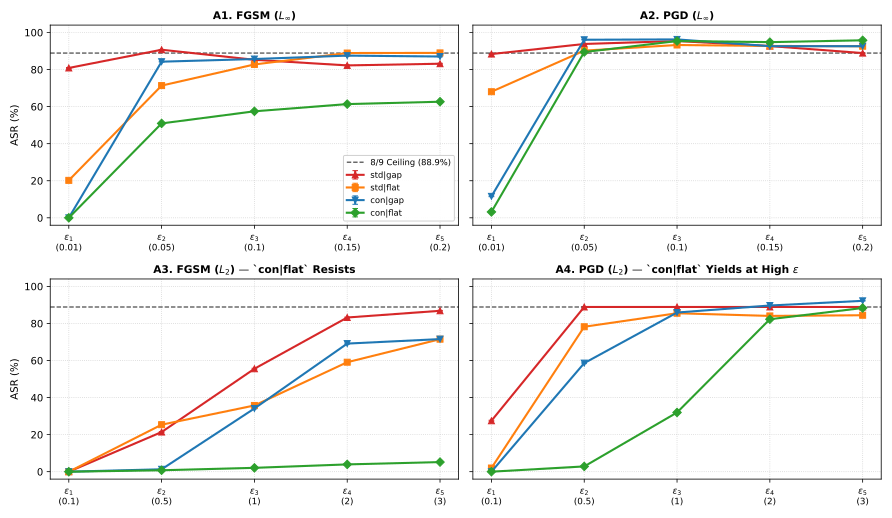

**Figure 2B: Node 0 Factor Marginal Spreads (Delta pp) and D^2 Share**

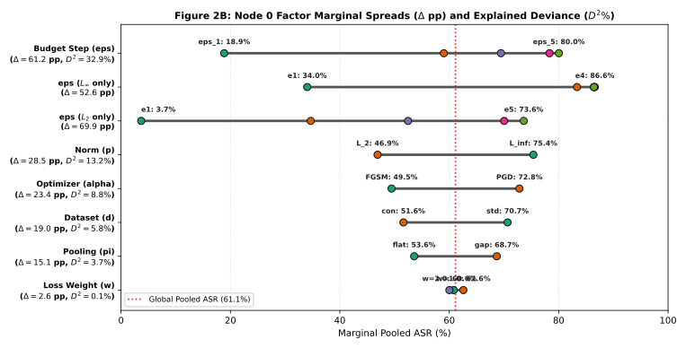

```text
================================================================================================================================
=== PART A — SECTION 2: HOW DOES THE MAIN MAKE MISTAKES? (NODE 1: SHIFT TYPOLOGY SR_s & COHEN'S w) ===
================================================================================================================================
Observed result:
  - At eps_1 most successful attacks alter a single factor; as the budget grows, the share of single-factor errors
    and the effect size against the (25%, 25%, 50%) reference both decrease steadily toward the random-error profile.
  - At eps_1, `gap` breaks scale first in both norms. In `flat`, shape exceeds scale in both norms, but under
    L_inf the most frequent shift is still joint, and the L_2 result rests on only ~2,200 images (moreover, within
    `std | flat` under PGD-L2 at eps_1, 73.7% of shape-shifts are full retention RR and only 26.3% are aligned AR,
    indicating that this L_2 shape-first excess is a near-boundary phenomenon).
  - Pooled effect size at eps_1 is smaller than the slice-median one, consistent with opposite pooling biases
    cancelling in pooled counts (the slice-median at eps_1 rests on few slices).
  - Contrast models (`con`) shift error mass toward joint errors relative to standard models (`std`).
--------------------------------------------------------------------------------------------------------------------------------

[1] Global Shift Typology Over All Successful Attacks S (Compared to 25% / 25% / 50% Uniform Random Reference):
Shift Metric                 |    Event Count (|S_s| / |S|) |  Pooled Rate [95% Wilson CI] |   Random Ref |  Diff vs Ref
------------------------------------------------------------------------------------------------------------------------
SR_shape  (Shape-Only)       |        1,553,254 / 5,409,083 |  28.72% [ 28.68%,  28.75%] |       25.00% |       +3.72 pp
SR_scale  (Scale-Only)       |        1,509,704 / 5,409,083 |  27.91% [ 27.87%,  27.95%] |       25.00% |       +2.91 pp
SR_joint  (Joint-Shift)      |        2,346,125 / 5,409,083 |  43.37% [ 43.33%,  43.42%] |       50.00% |       -6.63 pp
SR_single (Shape + Scale)    |        3,062,958 / 5,409,083 |  56.63% [ 56.58%,  56.67%] |       50.00% |       +6.63 pp
------------------------------------------------------------------------------------------------------------------------
  Global Pooled cohen_w = 0.133  |  Slice-Median cohen_w = 0.331 [IQR: 0.170–0.612] (n=214/240 valid slices >= 100)

[2] Shift Typology and Effect Size cohen_w Across Budget Steps eps_1..eps_5:
  [Note: At eps_1, pooled cohen_w is smaller than slice-median cohen_w, consistent with `gap` (scale-biased) and `flat`
   (shape/joint-biased) pulling in opposite directions when summed before computing w.]
Step     |  |S| (Succ.) |     SR_shape [95% CI] |     SR_scale [95% CI] |     SR_joint [95% CI] | SR_single | Pooled w |  Slice-Med w [Q25-Q75] (n)
------------------------------------------------------------------------------------------------------------------------------------------------
eps_1    |      333,712 | 30.06% [29.91,30.22] | 51.40% [51.23,51.57] | 18.54% [18.41,18.67] |    81.46% |    0.698 | 0.875 [0.553-1.192] (23)
eps_2    |    1,044,237 | 28.77% [28.68,28.85] | 30.54% [30.45,30.63] | 40.69% [40.60,40.78] |    59.31% |    0.188 | 0.437 [0.207-0.711] (47)
eps_3    |    1,228,942 | 29.46% [29.37,29.54] | 26.50% [26.42,26.58] | 44.05% [43.96,44.13] |    55.95% |    0.126 | 0.285 [0.151-0.571] (48)
eps_4    |    1,385,889 | 29.15% [29.08,29.23] | 25.24% [25.17,25.32] | 45.61% [45.52,45.69] |    54.39% |    0.104 | 0.280 [0.082-0.544] (48)
eps_5    |    1,416,303 | 27.29% [27.22,27.37] | 24.27% [24.20,24.34] | 48.44% [48.35,48.52] |    51.56% |    0.053 | 0.244 [0.072-0.449] (48)
------------------------------------------------------------------------------------------------------------------------------------------------

[3] Shift Typology by Pooling, Dataset, and Model Family (Pooled Across All Attacks):
Subgroup               |  |S| (Succ.) |     SR_shape [95% CI] |     SR_scale [95% CI] |     SR_joint [95% CI] | Pooled w |  Slice-Med w [Q25-Q75]
--------------------------------------------------------------------------------------------------------------------------------------------
Pooling: flat          |    2,370,489 | 26.98% [26.93,27.04] | 22.18% [22.13,22.23] | 50.83% [50.77,50.90] |    0.070 | 0.339 [0.195-0.619]
Pooling: gap           |    3,038,594 | 30.07% [30.01,30.12] | 32.38% [32.33,32.43] | 37.55% [37.50,37.61] |    0.251 | 0.327 [0.090-0.612]
--------------------------------------------------------------------------------------------------------------------------------------------
Dataset: std           |    3,125,757 | 31.07% [31.02,31.12] | 30.18% [30.13,30.23] | 38.75% [38.70,38.81] |    0.225 | 0.397 [0.217-0.635]
Dataset: con           |    2,283,326 | 25.49% [25.43,25.55] | 24.81% [24.75,24.86] | 49.70% [49.64,49.77] |    0.011 | 0.289 [0.107-0.594]
--------------------------------------------------------------------------------------------------------------------------------------------
Family: std|flat       |    1,454,275 | 29.14% [29.07,29.22] | 21.45% [21.38,21.52] | 49.41% [49.33,49.49] |    0.109 | 0.306 [0.165-0.587]
Family: std|gap        |    1,671,482 | 32.75% [32.68,32.82] | 37.77% [37.70,37.84] | 29.48% [29.41,29.55] |    0.416 | 0.527 [0.261-0.674]
Family: con|flat       |      916,214 | 23.56% [23.47,23.64] | 23.34% [23.26,23.43] | 53.10% [53.00,53.20] |    0.062 | 0.384 [0.253-0.703]
Family: con|gap        |    1,367,112 | 26.79% [26.71,26.86] | 25.79% [25.72,25.86] | 47.42% [47.34,47.51] |    0.053 | 0.183 [0.000-0.407]
--------------------------------------------------------------------------------------------------------------------------------------------

[4] Initial Boundary Breakdown at eps_1: {flat, gap} x {L_inf, L_2} and `std|gap` vs `std|flat` Under PGD-L2:
eps_1 Subgroup                     |  |S| (Succ.) |     SR_shape [95% CI] |     SR_scale [95% CI] |     SR_joint [95% CI] | Pooled w
--------------------------------------------------------------------------------------------------------------------------------
eps_1: flat x L_inf                |      101,112 | 36.54% [36.24,36.84] | 17.17% [16.94,17.40] | 46.29% [45.98,46.60] |    0.284
eps_1: gap  x L_inf                |      199,981 | 30.27% [30.07,30.47] | 62.57% [62.36,62.79] |  7.16% [ 7.04, 7.27] |    0.971
--------------------------------------------------------------------------------------------------------------------------------
eps_1: flat x L_2                  |        2,204 | 66.11% [64.10,68.05] |  0.00% [ 0.00, 0.17] | 33.89% [31.95,35.90] |    0.989
eps_1: gap  x L_2                  |       30,415 |  4.58% [ 4.35, 4.82] | 95.41% [95.17,95.64] |  0.01% [ 0.00, 0.03] |    1.628
--------------------------------------------------------------------------------------------------------------------------------
eps_1 PGD-L2: std|gap  (all w)     |       30,405 |  4.55% [ 4.32, 4.79] | 95.44% [95.20,95.67] |  0.01% [ 0.00, 0.02] |    1.628
eps_1 PGD-L2: std|flat (all w)     |        2,195 | 66.10% [64.10,68.06] |  0.00% [ 0.00, 0.17] | 33.90% [31.94,35.90] |    0.989
================================================================================================================================

```

**Figure 3A: Node 1 Shift Typology Across Budget Steps, Cohen's w, and Pooling x Norm Breakdown at eps_1**

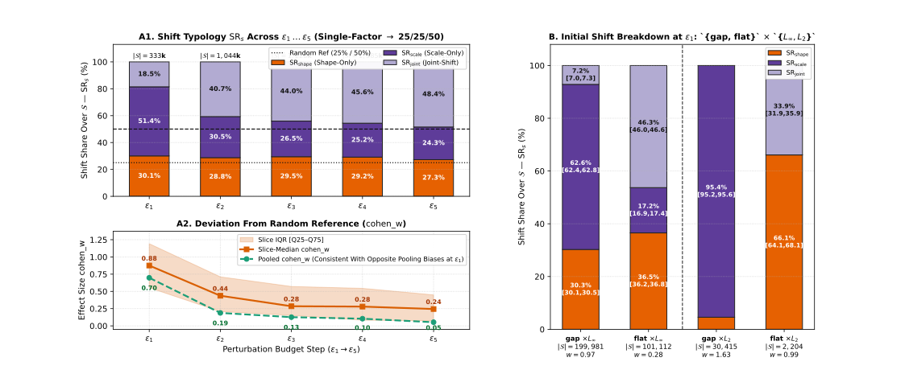

```text
[Figure 3B Deterministic Sampling Log — np.random.default_rng(29)]:
  Row 1 (Scale-Shift | std|gap|w=1.0  | PGD-L2 eps_1=0.10): total scale-shifts = 8,752, dominant state RA = 7,200 (82.3%) -> selected sample_index = 34452
  Row 2 (Shape-Shift | std|flat|w=1.0 | PGD-L2 eps_1=0.10): total shape-shifts = 449, majority state RR (boundary retention) = 331 (73.7%) vs minority AR = 118 (26.3%) -> selected RR sample_index = 1380

```

**Figure 3B: Deterministic Sample Strip — Scale-Shift (Dominant State RA in std|gap) vs Boundary Shape-Shift (Majority State RR in std|flat)**

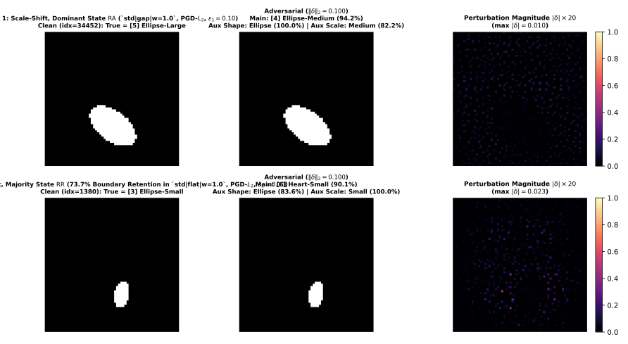

```text
================================================================================================================================
=== PART B — SECTION B0: PRELIMINARY CHECK — WHAT HAPPENS IF THE ATTACK FAILS? (ON S^c WHERE main IS CORRECT) ===
================================================================================================================================
Observed result:
  - On failed attacks (main correct), both auxiliary branches usually stay correct, but a minority of samples show
    'silent auxiliary corruption', mostly on the scale head.
  - This corruption grows steadily with the budget and is larger under L_inf, standard training (`std`) and
    single-step FGSM.
--------------------------------------------------------------------------------------------------------------------------------
Subgroup on S^c (Failed Attacks) | |S^c| (Failed N) |   Shape Aux OK [95% CI] |   Scale Aux OK [95% CI] |    Both Aux OK [95% CI] |   Silent Corr. [95% CI]
----------------------------------------------------------------------------------------------------------------------------------------------------
GLOBAL ALL (240 slices)      |        3,438,277 |  97.85% [97.83,97.86] |  95.35% [95.32,95.37] |  93.35% [93.32,93.37] |   6.65% [ 6.63, 6.68]
----------------------------------------------------------------------------------------------------------------------------------------------------
Budget: eps_1                |        1,435,760 |  99.53% [99.51,99.54] |  99.23% [99.21,99.24] |  98.77% [98.75,98.79] |   1.23% [ 1.21, 1.25]
Budget: eps_2                |          725,235 |  96.79% [96.75,96.83] |  95.99% [95.95,96.04] |  92.91% [92.85,92.97] |   7.09% [ 7.03, 7.15]
Budget: eps_3                |          540,530 |  96.65% [96.60,96.69] |  94.36% [94.30,94.42] |  91.36% [91.29,91.44] |   8.64% [ 8.56, 8.71]
Budget: eps_4                |          383,583 |  96.80% [96.74,96.85] |  89.77% [89.67,89.87] |  86.80% [86.69,86.91] |  13.20% [13.09,13.31]
Budget: eps_5                |          353,169 |  96.18% [96.11,96.24] |  85.79% [85.67,85.91] |  82.33% [82.20,82.45] |  17.67% [17.55,17.80]
----------------------------------------------------------------------------------------------------------------------------------------------------
Norm: L_inf                  |        1,089,134 |  96.11% [96.08,96.15] |  91.77% [91.71,91.82] |  88.08% [88.02,88.14] |  11.92% [11.86,11.98]
Norm: L_2                    |        2,349,143 |  98.65% [98.64,98.67] |  97.00% [96.98,97.03] |  95.79% [95.76,95.81] |   4.21% [ 4.19, 4.24]
----------------------------------------------------------------------------------------------------------------------------------------------------
Dataset: std                 |        1,297,923 |  97.80% [97.77,97.83] |  92.25% [92.21,92.30] |  90.25% [90.20,90.30] |   9.75% [ 9.70, 9.80]
Dataset: con                 |        2,140,354 |  97.88% [97.86,97.90] |  97.22% [97.20,97.24] |  95.22% [95.19,95.25] |   4.78% [ 4.75, 4.81]
----------------------------------------------------------------------------------------------------------------------------------------------------
Optimizer: FGSM              |        2,235,980 |  97.39% [97.37,97.41] |  94.61% [94.58,94.64] |  92.24% [92.20,92.27] |   7.76% [ 7.73, 7.80]
Optimizer: PGD               |        1,202,297 |  98.69% [98.67,98.72] |  96.71% [96.68,96.74] |  95.41% [95.37,95.45] |   4.59% [ 4.55, 4.63]
================================================================================================================================

================================================================================================================================
=== PART B — SECTION 3: DO THE AUXILIARIES FOLLOW THE MAIN? (NODE 2: FULL ALIGNMENT & COMPOSITE REGIMES) ===
================================================================================================================================
Observed result:
  - In most successful attacks the auxiliary branches follow `main` (Full Alignment is the dominant regime).
  - In single-factor shifts the shifted auxiliary aligns with `main` while the unshifted one retains the truth;
    this is consistent with a partially factorised trunk but does not distinguish it from holistic class prototypes.
  - When the shifted auxiliary errs, it almost always picks the same wrong class as `main`, far above the 50%
    conditional random wrong-class chance.
  - Alignment is higher overall under `gap` than `flat` and lowest in `con | flat`, but it varies substantially
    within pools (e.g. `con | gap` drops sharply as w increases from 0.5 to 2.0).
  - The aligned state is the most frequent one in most of the 48 (model x attack-norm) configurations; the Wilson
    star criterion is passed almost everywhere because large N makes CI_low > 1/|K_s| easy, so frequencies are
    more informative.
--------------------------------------------------------------------------------------------------------------------------------

[1] Global Partition of Successful Attacks S Into the 4 Mutually Exclusive Composite Regimes:
Composite Regime                     |        Event Count (k / |S|) |  Pooled Rate (%) [95% Wilson CI] | Definition Summary
--------------------------------------------------------------------------------------------------------------------------------------
FAR (Full Alignment Regime)          |        4,089,052 / 5,409,083 |  75.60% [ 75.56%,  75.63%] | Shifted aux(s) follow main; unshifted aux (if any) retains truth
FRR (Full Retention Regime)          |          130,403 / 5,409,083 |   2.41% [  2.40%,   2.42%] | Both aux branches retain ground truth despite main error (RR)
PRR (Partial Retention Regime)       |          339,914 / 5,409,083 |   6.28% [  6.26%,   6.30%] | Joint-shift where one aux aligns with main and one retains truth (RA+AR)
DR (Divergence Regime)               |          849,714 / 5,409,083 |  15.71% [ 15.68%,  15.74%] | At least one aux predicts a class != truth and != main-implied factor
--------------------------------------------------------------------------------------------------------------------------------------
  Exhaustiveness Check: FAR + FRR + PRR + DR = 100.000000%  (Sum of counts = 5,409,083 == |S| = 5,409,083)

[2] Shift-Specific Full Alignment (FAR_s) and Conditional Alignment Given Auxiliary Error on the Shifted Factor:
  Benchmark (a): Uniform state-space chance 1/|K_s| (1/6 = 16.67% for shape/scale; 1/9 = 11.11% for joint) — compares to FAR_s.
  Benchmark (b): Conditional wrong-class chance given the shifted auxiliary errs (50.00% for 1 factor; 25.00% for 2 factors)
                 — compares to P(Aux aligns with Main | Aux errs on shifted factor), NOT directly to unconditional FAR_s.
Shift Type & Aligned State         |    FAR_s [95% Wilson CI] |  1/|K_s| ||   P(Align | Aux Errs on Shifted) | Cond. Chance
----------------------------------------------------------------------------------------------------------------------------
Shape-Shift: FAR_shape (ARR_shape,AR) |  74.45% [74.38%,74.52%] |   16.67% ||                           91.70% |       50.00%
Scale-Shift: FAR_scale (ARR_scale,RA) |  80.04% [79.98%,80.10%] |   16.67% ||                           95.66% |       50.00%
Joint-Shift: FAR_joint (ARR_joint,AA) |  73.50% [73.44%,73.55%] |   11.11% ||                           88.21% |       25.00%
----------------------------------------------------------------------------------------------------------------------------

[3] Full Alignment (FAR_s & Overall FAR) and Composite Regimes by Pooling, Dataset, and All 12 Models:
Group / Model      | |S| (Succ.) |       FAR_shape (|S_sh|) |       FAR_scale (|S_sc|) |       FAR_joint (|S_jt|) ||        FAR [95% CI] |   FRR% |   PRR% |    DR%
------------------------------------------------------------------------------------------------------------------------------------------------------------------
Pool: gap          |   3,038,594 |  83.18% ( 913,595) |  83.49% ( 983,891) |  83.07% (1,141,108) || 83.24% [83.2,83.3] |  1.99% |  3.67% | 11.10%
Pool: flat         |   2,370,489 |  61.98% ( 639,659) |  73.58% ( 525,813) |  64.43% (1,205,017) || 65.80% [65.7,65.9] |  2.95% |  9.64% | 21.61%
------------------------------------------------------------------------------------------------------------------------------------------------------------------
Data: std          |   3,125,757 |  77.93% ( 971,231) |  85.50% ( 943,243) |  78.26% (1,211,283) || 80.34% [80.3,80.4] |  2.03% |  4.07% | 13.56%
Data: con          |   2,283,326 |  68.64% ( 582,023) |  70.94% ( 566,461) |  68.41% (1,134,842) || 69.10% [69.0,69.2] |  2.93% |  9.32% | 18.65%
------------------------------------------------------------------------------------------------------------------------------------------------------------------
std|flat|w=0.5     |     505,677 |  84.17% ( 143,533) |  64.78% ( 107,771) |  66.53% ( 254,373) || 71.16% [71.0,71.3] |  0.88% |  9.88% | 18.08%
std|flat|w=1       |     477,517 |  81.37% ( 135,175) |  88.23% ( 105,168) |  72.88% ( 237,174) || 78.67% [78.6,78.8] |  1.70% |  5.75% | 13.87%
std|flat|w=2       |     471,081 |  59.05% ( 145,111) |  78.74% (  98,997) |  69.63% ( 226,973) || 68.29% [68.2,68.4] |  3.16% |  3.91% | 24.65%
------------------------------------------------------------------------------------------------------------------------------------------------------------------
std|gap|w=0.5      |     563,561 |  80.78% ( 178,546) |  87.89% ( 212,035) |  91.77% ( 172,980) || 86.83% [86.7,86.9] |  1.98% |  1.78% |  9.41%
std|gap|w=1        |     556,155 |  74.52% ( 198,342) |  90.58% ( 199,337) |  89.97% ( 158,476) || 84.68% [84.6,84.8] |  3.08% |  2.10% | 10.14%
std|gap|w=2        |     551,766 |  86.99% ( 170,524) |  90.49% ( 219,935) |  90.81% ( 161,307) || 89.50% [89.4,89.6] |  1.39% |  1.75% |  7.36%
------------------------------------------------------------------------------------------------------------------------------------------------------------------
con|flat|w=0.5     |     263,516 |  25.81% (  69,294) |  69.23% (  65,149) |  67.10% ( 129,073) || 56.77% [56.6,57.0] |  5.09% |  8.98% | 29.15%
con|flat|w=1       |     338,963 |  29.86% (  39,939) |  73.03% (  74,537) |  41.74% ( 224,487) || 47.22% [47.1,47.4] |  4.48% | 26.22% | 22.08%
con|flat|w=2       |     313,735 |  47.03% ( 106,607) |  63.11% (  74,191) |  72.15% ( 132,937) || 61.48% [61.3,61.6] |  4.43% |  6.41% | 27.68%
------------------------------------------------------------------------------------------------------------------------------------------------------------------
con|gap|w=0.5      |     460,577 |  96.42% ( 146,965) |  84.11% ( 113,376) |  90.61% ( 200,236) || 90.86% [90.8,90.9] |  2.74% |  2.59% |  3.81%
con|gap|w=1        |     472,883 |  87.38% ( 108,840) |  67.13% ( 131,925) |  69.94% ( 232,118) || 73.17% [73.0,73.3] |  1.15% |  6.96% | 18.72%
con|gap|w=2        |     433,652 |  74.98% ( 110,378) |  66.74% ( 107,283) |  72.39% ( 215,991) || 71.65% [71.5,71.8] |  1.49% |  8.11% | 18.74%
------------------------------------------------------------------------------------------------------------------------------------------------------------------

[4] Dominance Counts Out of the 48 (12 Models x 4 Attack-Norm) Configurations (Pooled Over eps_1..eps_5):
  Shape-Shift Aligned State (AR) : Plurality #1 in 39/48 configs  |  Wilson Criterion ** (CI_low > 1/|K_s|) in 47/48 configs (valid N >= 100 in 48/48)
  Scale-Shift Aligned State (RA) : Plurality #1 in 39/48 configs  |  Wilson Criterion ** (CI_low > 1/|K_s|) in 45/48 configs (valid N >= 100 in 48/48)
  Joint-Shift Aligned State (AA) : Plurality #1 in 45/48 configs  |  Wilson Criterion ** (CI_low > 1/|K_s|) in 47/48 configs (valid N >= 100 in 48/48)
================================================================================================================================

```

**Figure 4A: Global 3-Stage Conditional Probability Sankey Diagram (Stopped at the 4 Composite Regimes)**

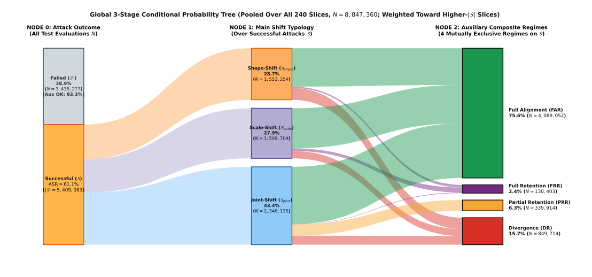

**Figure 4B: Composite Regimes Across the 12 Models (Panel A) and Full Alignment by Pooling (Panel B)**

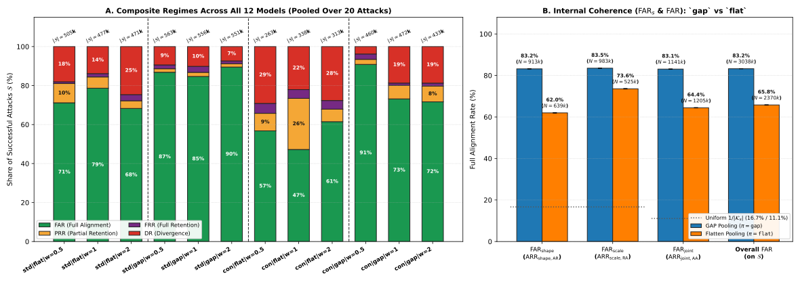

```text
================================================================================================================================
=== PART B — SECTION 4: FULL RETENTION: MAIN FOOLED, BOTH AUXILIARIES KEEP THE TRUTH (FRR & ARR_{s,RR}) ===
================================================================================================================================
Observed result:
  - Full retention (both auxiliaries keep the truth although `main` is fooled) is rare and splits into two optimizer
    regimes:
    * Under PGD it is a near-boundary phenomenon: present at eps_1, then very rare from eps_2 onward.
    * Under FGSM it persists at a low but stable level across budgets; in scale-shift under FGSM it increases in the
      `con` models, while `std` remains stable from eps_3 onward.
  - At eps_1, `con` shows much higher retention than `std`, but it rests on few successful attacks, almost all
    PGD-L_inf (only 9 come from FGSM).
  - Retention is more frequent in scale-shift than in shape-shift or joint-shift.
--------------------------------------------------------------------------------------------------------------------------------

[1] Global Full Retention Rates (Overall FRR and Shift-Conditional ARR_{s,RR}):
Retention Metric                     |      Event Count (k / Denom) |    Pooled Rate [95% Wilson CI]
------------------------------------------------------------------------------------------------------
Overall FRR (over S)                 |          130,403 / 5,409,083 |   2.41% [  2.40%,   2.42%]
Shape-Shift: ARR_shape,RR (over S_sh) |           42,033 / 1,553,254 |   2.71% [  2.68%,   2.73%]
Scale-Shift: ARR_scale,RR (over S_sc) |           78,295 / 1,509,704 |   5.19% [  5.15%,   5.22%]
Joint-Shift: ARR_joint,RR (over S_jt) |           10,075 / 2,346,125 |   0.43% [  0.42%,   0.44%]
------------------------------------------------------------------------------------------------------

[2] Full Retention Across Budget Steps eps_1..eps_5 by Optimizer (FGSM vs PGD) (* flags |S_s| < 100):
Opt x Step     |     ARR_shape,RR [95% CI] (|S_sh|) |     ARR_scale,RR [95% CI] (|S_sc|) |     ARR_joint,RR [95% CI] (|S_jt|) |         Overall FRR [95% CI] (|S|)
------------------------------------------------------------------------------------------------------------------------------------------------------------------
FGSM eps_1     |    15.41% [14.96,15.87] ( 23,947)  |     8.63% [ 8.42, 8.84] ( 67,702)  |     1.72% [ 1.55, 1.91] ( 20,139)  |     8.84% [ 8.67, 9.00] (111,788) 
FGSM eps_2     |     9.74% [ 9.56, 9.93] ( 97,415)  |     4.96% [ 4.84, 5.09] (121,175)  |     0.41% [ 0.38, 0.45] (164,165)  |     4.23% [ 4.16, 4.29] (382,755) 
FGSM eps_3     |     7.81% [ 7.67, 7.96] (139,890)  |     9.87% [ 9.71,10.04] (131,734)  |     0.28% [ 0.26, 0.31] (213,516)  |     5.06% [ 5.00, 5.12] (485,140) 
FGSM eps_4     |     4.99% [ 4.89, 5.10] (175,639)  |    10.76% [10.62,10.91] (168,844)  |     1.03% [ 0.99, 1.07] (247,636)  |     4.98% [ 4.92, 5.03] (592,119) 
FGSM eps_5     |     2.73% [ 2.66, 2.81] (167,271)  |    12.07% [11.92,12.22] (174,513)  |     1.20% [ 1.16, 1.24] (274,114)  |     4.70% [ 4.64, 4.75] (615,898) 
FGSM Pooled    |     6.20% [ 6.14, 6.26] (604,162)  |     9.65% [ 9.58, 9.72] (663,968)  |     0.81% [ 0.79, 0.83] (919,570)  |   4.98% [ 4.95, 5.01] (2,187,700) 
------------------------------------------------------------------------------------------------------------------------------------------------------------------
PGD eps_1      |     5.51% [ 5.35, 5.68] ( 76,380)  |     9.96% [ 9.78,10.15] (103,816)  |     5.41% [ 5.19, 5.63] ( 41,728)  |     7.57% [ 7.47, 7.69] (221,924) 
PGD eps_2      |     0.12% [ 0.10, 0.13] (202,990)  |     1.70% [ 1.64, 1.76] (197,760)  |     0.14% [ 0.12, 0.15] (260,732)  |     0.60% [ 0.58, 0.62] (661,482) 
PGD eps_3      |     0.04% [ 0.03, 0.05] (222,097)  |     0.24% [ 0.22, 0.27] (193,911)  |     0.00% [ 0.00, 0.00] (327,794)  |     0.07% [ 0.07, 0.08] (743,802) 
PGD eps_4      |     0.01% [ 0.01, 0.02] (228,357)  |     0.01% [ 0.01, 0.02] (180,996)  |     0.00% [ 0.00, 0.00] (384,417)  |     0.01% [ 0.01, 0.01] (793,770) 
PGD eps_5      |     0.01% [ 0.00, 0.01] (219,268)  |     0.00% [ 0.00, 0.01] (169,253)  |     0.00% [ 0.00, 0.00] (411,884)  |     0.00% [ 0.00, 0.00] (800,405) 
PGD Pooled     |     0.48% [ 0.47, 0.50] (949,092)  |     1.68% [ 1.65, 1.71] (845,736)  |   0.18% [ 0.18, 0.19] (1,426,555)  |   0.66% [ 0.66, 0.67] (3,221,383) 
------------------------------------------------------------------------------------------------------------------------------------------------------------------

[2b] FGSM Scale-Shift Retention Split by Dataset (`FGSM x std` vs `FGSM x con` Across eps_1..eps_5):
  FGSM x std -> e1:  8.63% [ 8.42, 8.84] ( 67,701)  | e2:  3.11% [ 2.99, 3.24] ( 78,117)  | e3:  7.54% [ 7.35, 7.73] ( 74,333)  | e4:  7.79% [ 7.62, 7.96] ( 98,003)  | e5:  7.65% [ 7.49, 7.81] (104,197) 
  FGSM x con -> e1:  0.00% [ 0.00,79.35] (      1)* | e2:  8.32% [ 8.06, 8.58] ( 43,058)  | e3: 12.90% [12.63,13.18] ( 57,401)  | e4: 14.87% [14.61,15.14] ( 70,841)  | e5: 18.62% [18.33,18.91] ( 70,316) 

[3] Boundary Retention at eps_1: Standard (`std`) vs Contrast (`con`) (Overall & Split by Optimizer and Norm):
eps_1 Subgroup             |     ARR_shape,RR [95% CI] (|S_sh|) |     ARR_scale,RR [95% CI] (|S_sc|) |     ARR_joint,RR [95% CI] (|S_jt|) |         Overall FRR [95% CI] (|S|)
------------------------------------------------------------------------------------------------------------------------------------------------------------------------------
eps_1: std (all)           |     6.76% [ 6.60, 6.92] ( 97,336)  |     7.28% [ 7.15, 7.40] (161,967)  |     0.93% [ 0.86, 1.01] ( 58,060)  |     5.96% [ 5.87, 6.04] (317,363) 
eps_1: con (all)           |    44.27% [42.49,46.05] (  2,991)  |    46.08% [45.08,47.08] (  9,551)  |    54.14% [52.55,55.71] (  3,807)  |    47.62% [46.86,48.39] ( 16,349) 
------------------------------------------------------------------------------------------------------------------------------------------------------------------------------
eps_1: std x FGSM          |    15.40% [14.95,15.87] ( 23,943)  |     8.63% [ 8.42, 8.84] ( 67,701)  |     1.71% [ 1.54, 1.90] ( 20,135)  |     8.83% [ 8.67, 9.00] (111,779) 
eps_1: con x FGSM          |    50.00% [15.00,85.00] (      4)* |     0.00% [ 0.00,79.35] (      1)* |    50.00% [15.00,85.00] (      4)* |    44.44% [18.88,73.33] (      9)*
eps_1: std x PGD           |     3.94% [ 3.80, 4.08] ( 73,393)  |     6.30% [ 6.15, 6.46] ( 94,266)  |     0.52% [ 0.45, 0.60] ( 37,925)  |     4.39% [ 4.30, 4.48] (205,584) 
eps_1: con x PGD           |    44.26% [42.49,46.05] (  2,987)  |    46.08% [45.09,47.08] (  9,550)  |    54.14% [52.55,55.72] (  3,803)  |    47.63% [46.86,48.39] ( 16,340) 
------------------------------------------------------------------------------------------------------------------------------------------------------------------------------
eps_1: std x L_inf         |     5.71% [ 5.57, 5.86] ( 94,501)  |     5.80% [ 5.67, 5.92] (132,948)  |     0.94% [ 0.86, 1.02] ( 57,314)  |     4.79% [ 4.71, 4.87] (284,763) 
eps_1: con x L_inf         |    44.32% [42.54,46.11] (  2,976)  |    46.08% [45.08,47.08] (  9,551)  |    54.17% [52.58,55.75] (  3,803)  |    47.64% [46.88,48.41] ( 16,330) 
eps_1: std x L_2           |    41.55% [39.75,43.38] (  2,835)  |    14.06% [13.66,14.46] ( 29,019)  |     0.67% [ 0.29, 1.56] (    746)  |    16.14% [15.75,16.54] ( 32,600) 
eps_1: con x L_2           |    33.33% [15.18,58.29] (     15)* |          --   [  -- ,  -- ] (N=0!) |    25.00% [ 4.56,69.94] (      4)* |    31.58% [15.36,53.99] (     19)*
================================================================================================================================

```

**Figure 5: Full Retention Trajectories (ARR_{s,RR}) Across Budget Steps by Optimizer and Dataset (Masked if |S_s| < 100)**

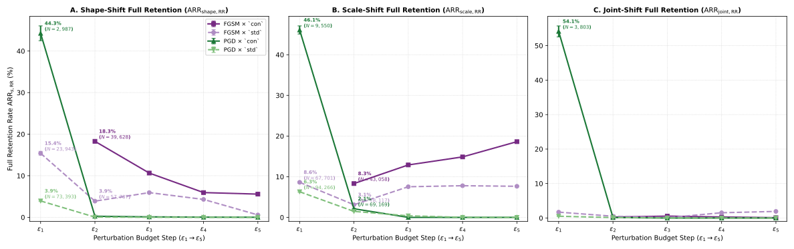

```text
================================================================================================================================
=== PART B — SECTION 5: WHEN ONLY ONE AUXILIARY DECOUPLES FROM MAIN — PARTIAL RETENTION (PRR) & COLLATERAL DIVERGENCE ===
================================================================================================================================
Observed result:
  - Partial retention and collateral divergence are governed by a `dataset x pooling` interaction rather than by
    pooling alone:
    * Within `con`, a mirror pattern appears: in `con | flat` the scale head resists in joint-shift and diverges
      in shape-shift; in `con | gap` the shape head resists in joint-shift and diverges in scale-shift.
    * Within `std`, the pattern reverses: `std | flat` has the shape head resisting more often than the scale head
      in joint-shift, and collateral divergence of the scale head in shape-shift is more frequent in `std | gap`.
  - Error inversion on the unshifted factor is virtually absent when pooled; within `con | gap` shape-shift, both
    collateral divergence and inversion are near zero.
--------------------------------------------------------------------------------------------------------------------------------

[1] Global Partial Retention (PRR Over S and Decomposition Over Joint-Shift S_joint):
Metric                                     |      Event Count (k / Denom) |    Pooled Rate [95% Wilson CI]
------------------------------------------------------------------------------------------------------------
Overall PRR (over S)                       |          339,914 / 5,409,083 |   6.28% [  6.26%,   6.30%]
PRR_joint = ARR_joint,RA + ARR_joint,AR (S_jt) |          339,914 / 2,346,125 |  14.49% [ 14.44%,  14.53%]
  -> ARR_joint,RA (Shape retains, Scale aligns) |          177,880 / 2,346,125 |   7.58% [  7.55%,   7.62%]
  -> ARR_joint,AR (Scale retains, Shape aligns) |          162,034 / 2,346,125 |   6.91% [  6.87%,   6.94%]
------------------------------------------------------------------------------------------------------------

[2] `Dataset x Pooling` Mirror Symmetry: Partial Retention (S_joint) & Collateral Divergence (S_shape, S_scale):
Family (d | pi)  |            ARR_joint,RA (|S_jt|) |            ARR_joint,AR (|S_jt|) |            ARR_shape,AD (|S_sh|) |            ARR_scale,DA (|S_sc|)
--------------------------------------------------------------------------------------------------------------------------------------------------------------
std|flat         |  10.63% [10.56,10.70] (718,520)  |   2.71% [ 2.67, 2.75] (718,520)  |   7.32% [ 7.24, 7.40] (423,819)  |  10.47% [10.36,10.58] (311,936) 
std|gap          |   1.47% [ 1.44, 1.51] (492,763)  |   4.90% [ 4.84, 4.96] (492,763)  |  16.17% [16.07,16.26] (547,412)  |   2.10% [ 2.07, 2.14] (631,307) 
con|flat         |   4.27% [ 4.21, 4.33] (486,497)  |  23.00% [22.89,23.12] (486,497)  |  47.79% [47.58,48.00] (215,840)  |  12.78% [12.64,12.92] (213,877) 
con|gap          |  11.33% [11.26,11.41] (648,345)  |   1.01% [ 0.98, 1.03] (648,345)  |   0.15% [ 0.14, 0.16] (366,183)  |  23.77% [23.63,23.91] (352,584) 
--------------------------------------------------------------------------------------------------------------------------------------------------------------

[3] Non-Inversion Check: Collateral Divergence Along Aligned Shifted Factor (AD, DA) vs Inverted Retention (RD, DR):
Group            | Shape-Shift |S_sh| |   ARR_shape,AD [95% CI] |   ARR_shape,RD [95% CI] || Scale-Shift |S_sc| |   ARR_scale,DA [95% CI] |   ARR_scale,DR [95% CI]
--------------------------------------------------------------------------------------------------------------------------------------------------------
std|flat         |      423,819 |   7.32% [ 7.24, 7.40] |   0.06% [ 0.05, 0.07] ||      311,936 |  10.47% [10.36,10.58] |   1.22% [ 1.18, 1.26]
std|gap          |      547,412 |  16.17% [16.07,16.26] |   0.91% [ 0.88, 0.93] ||      631,307 |   2.10% [ 2.07, 2.14] |   0.01% [ 0.01, 0.01]
con|flat         |      215,840 |  47.79% [47.58,48.00] |   0.52% [ 0.49, 0.55] ||      213,877 |  12.78% [12.64,12.92] |   0.06% [ 0.05, 0.08]
con|gap          |      366,183 |   0.15% [ 0.14, 0.16] |   0.11% [ 0.10, 0.12] ||      352,584 |  23.77% [23.63,23.91] |   0.00% [ 0.00, 0.01]
--------------------------------------------------------------------------------------------------------------------------------------------------------
GLOBAL ALL       |    1,553,254 |  14.37% [14.32,14.43] |   0.43% [ 0.42, 0.44] ||    1,509,704 |  10.40% [10.35,10.45] |   0.27% [ 0.26, 0.27]
--------------------------------------------------------------------------------------------------------------------------------------------------------

[4] Complete 12 Models x 21 States Auxiliary Reaction Matrix ARR_{s,c} (%) (** = Wilson CI_low > 1/|K_s|):

  --- Shift Type s = 'shape' (|K_shape| = 6, Uniform Null = 16.67%) ---
  Model (d|pi|w)   |     |S_sh| ||         AR |         AD |         RR |         RD |         DR |         DD
  ----------------------------------------------------------------------------------------------------------------
  std|flat|w=0.5   |    143,533 ||  84.17%** |   2.12%   |   0.86%   |   0.00%   |  12.41%*  |   0.43%  
  std|flat|w=1     |    135,175 ||  81.37%** |   8.52%   |   0.85%   |   0.11%   |   1.53%   |   7.62%  
  std|flat|w=2     |    145,111 ||  59.05%** |  11.34%*  |   4.62%   |   0.07%   |   7.19%   |  17.73%**
  ----------------------------------------------------------------------------------------------------------------
  std|gap|w=0.5    |    178,546 ||  80.78%** |  15.83%*  |   1.86%   |   0.74%   |   0.78%   |   0.00%  
  std|gap|w=1      |    198,342 ||  74.52%** |  22.51%** |   2.03%   |   0.53%   |   0.41%   |   0.00%  
  std|gap|w=2      |    170,524 ||  86.99%** |   9.13%   |   1.40%   |   1.51%   |   0.96%   |   0.00%  
  ----------------------------------------------------------------------------------------------------------------
  con|flat|w=0.5   |     69,294 ||  25.81%** |  74.02%** |   0.15%   |   0.01%   |   0.01%   |   0.00%  
  con|flat|w=1     |     39,939 ||  29.86%** |  65.27%** |   1.60%   |   0.26%   |   0.55%   |   2.46%  
  con|flat|w=2     |    106,607 ||  47.03%** |  24.19%** |  12.23%*  |   0.96%   |  12.74%*  |   2.85%  
  ----------------------------------------------------------------------------------------------------------------
  con|gap|w=0.5    |    146,965 ||  96.42%** |   0.22%   |   1.70%   |   0.00%   |   1.66%   |   0.00%  
  con|gap|w=1      |    108,840 ||  87.38%** |   0.00%   |   1.00%   |   0.13%   |  11.49%*  |   0.00%  
  con|gap|w=2      |    110,378 ||  74.98%** |   0.20%   |   5.28%   |   0.25%   |  19.29%** |   0.00%  
  ----------------------------------------------------------------------------------------------------------------

  --- Shift Type s = 'scale' (|K_scale| = 6, Uniform Null = 16.67%) ---
  Model (d|pi|w)   |     |S_sc| ||         RA |         RR |         RD |         DA |         DR |         DD
  ----------------------------------------------------------------------------------------------------------------
  std|flat|w=0.5   |    107,771 ||  64.78%** |   2.34%   |   7.17%   |  21.33%** |   0.57%   |   3.81%  
  std|flat|w=1     |    105,168 ||  88.23%** |   3.36%   |   5.21%   |   3.08%   |   0.12%   |   0.01%  
  std|flat|w=2     |     98,997 ||  78.74%** |   5.69%   |   5.99%   |   6.49%   |   3.08%   |   0.01%  
  ----------------------------------------------------------------------------------------------------------------
  std|gap|w=0.5    |    212,035 ||  87.89%** |   3.67%   |   6.65%   |   1.78%   |   0.00%   |   0.02%  
  std|gap|w=1      |    199,337 ||  90.58%** |   6.57%   |   0.12%   |   2.72%   |   0.00%   |   0.00%  
  std|gap|w=2      |    219,935 ||  90.49%** |   2.39%   |   5.24%   |   1.85%   |   0.03%   |   0.00%  
  ----------------------------------------------------------------------------------------------------------------
  con|flat|w=0.5   |     65,149 ||  69.23%** |  20.27%** |  10.50%*  |   0.01%   |   0.00%   |   0.00%  
  con|flat|w=1     |     74,537 ||  73.03%** |  18.38%** |   6.89%   |   1.41%   |   0.13%   |   0.16%  
  con|flat|w=2     |     74,191 ||  63.11%** |   1.06%   |   0.11%   |  35.42%** |   0.05%   |   0.25%  
  ----------------------------------------------------------------------------------------------------------------
  con|gap|w=0.5    |    113,376 ||  84.11%** |   7.70%   |   0.01%   |   8.18%   |   0.01%   |   0.00%  
  con|gap|w=1      |    131,925 ||  67.13%** |   2.79%   |   0.27%   |  29.81%** |   0.00%   |   0.00%  
  con|gap|w=2      |    107,283 ||  66.74%** |   0.37%   |   0.09%   |  32.80%** |   0.00%   |   0.00%  
  ----------------------------------------------------------------------------------------------------------------

  --- Shift Type s = 'joint' (|K_joint| = 9, Uniform Null = 11.11%) ---
  Model (d|pi|w)   |     |S_jo| ||         AA |         AR |         AD |         RA |         RR |         RD |         DA |         DR |         DD
  -------------------------------------------------------------------------------------------------------------------------------------------------------
  std|flat|w=0.5   |    254,373 ||  66.53%** |   2.52%   |   6.92%   |  17.11%** |   0.28%   |   3.39%   |   1.36%   |   0.04%   |   1.84%  
  std|flat|w=1     |    237,174 ||  72.88%** |   2.79%   |   9.18%   |   8.80%   |   1.46%   |   0.62%   |   0.08%   |   4.19%   |   0.00%  
  std|flat|w=2     |    226,973 ||  69.63%** |   2.84%   |   3.74%   |   5.27%   |   1.12%   |   2.23%   |   6.37%   |   6.55%   |   2.26%  
  -------------------------------------------------------------------------------------------------------------------------------------------------------
  std|gap|w=0.5    |    172,980 ||  91.77%** |   4.74%   |   1.02%   |   1.07%   |   0.03%   |   0.00%   |   1.36%   |   0.00%   |   0.00%  
  std|gap|w=1      |    158,476 ||  89.97%** |   5.34%   |   1.14%   |   2.04%   |   0.01%   |   0.00%   |   1.51%   |   0.00%   |   0.00%  
  std|gap|w=2      |    161,307 ||  90.81%** |   4.62%   |   1.27%   |   1.36%   |   0.00%   |   0.00%   |   1.93%   |   0.00%   |   0.00%  
  -------------------------------------------------------------------------------------------------------------------------------------------------------
  con|flat|w=0.5   |    129,073 ||  67.10%** |  18.27%** |  14.46%** |   0.07%   |   0.09%   |   0.00%   |   0.00%   |   0.00%   |   0.00%  
  con|flat|w=1     |    224,487 ||  41.74%** |  34.53%** |  17.76%** |   5.06%   |   0.37%   |   0.11%   |   0.13%   |   0.22%   |   0.08%  
  con|flat|w=2     |    132,937 ||  72.15%** |   8.13%   |   0.55%   |   7.01%   |   0.04%   |   0.22%   |  10.23%*  |   0.21%   |   1.46%  
  -------------------------------------------------------------------------------------------------------------------------------------------------------
  con|gap|w=0.5    |    200,236 ||  90.61%** |   2.10%   |   0.07%   |   3.85%   |   0.70%   |   0.00%   |   2.67%   |   0.00%   |   0.00%  
  con|gap|w=1      |    232,118 ||  69.94%** |   0.44%   |   0.26%   |  13.74%** |   0.29%   |   0.01%   |  15.33%** |   0.00%   |   0.00%  
  con|gap|w=2      |    215,991 ||  72.39%** |   0.60%   |   0.50%   |  15.69%** |   0.11%   |   0.00%   |  10.70%*  |   0.00%   |   0.00%  
  -------------------------------------------------------------------------------------------------------------------------------------------------------
================================================================================================================================

```

**Figure 6A: Dataset x Pooling Mirror Symmetry in Partial Retention (PRR) and Collateral Divergence**

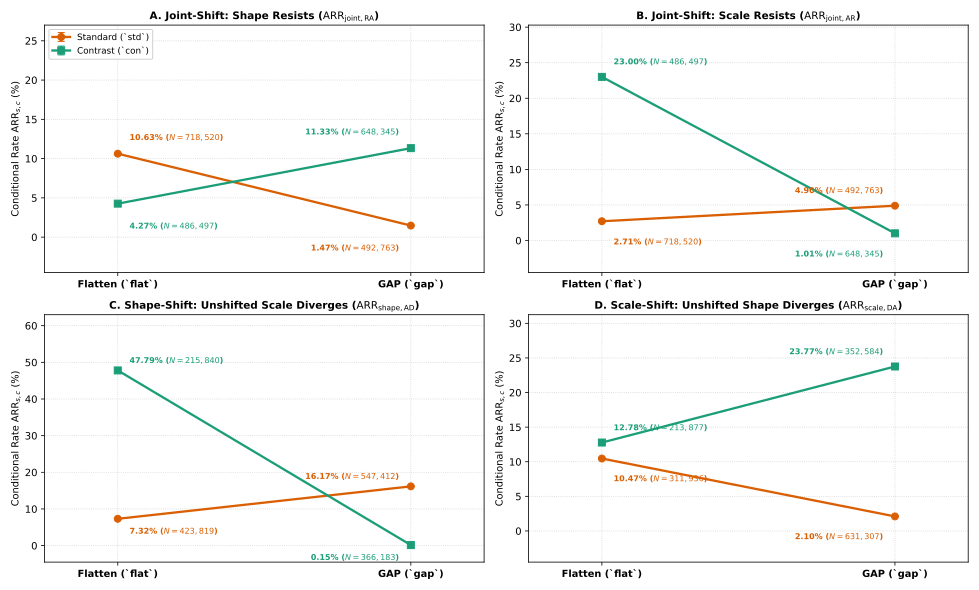

**Figure 6B: 12 Models x 21 States Heatmap of ARR_{s,c} Across Shape, Scale, and Joint Shifts**

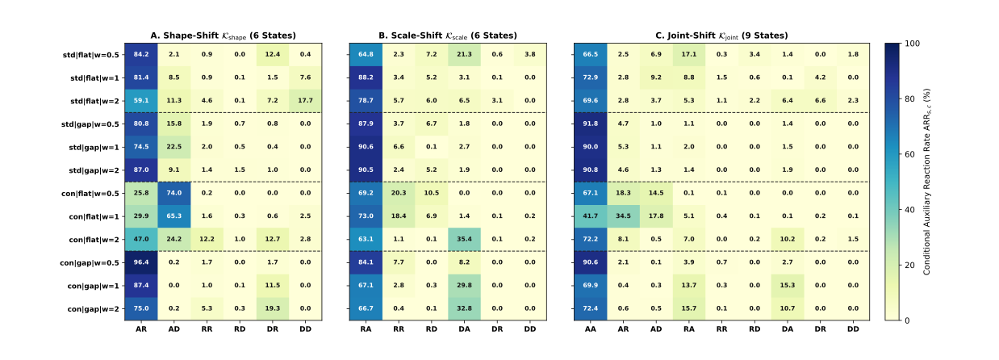

```text
[Figure 6C Deterministic Sampling Log — np.random.default_rng(29)]:
  Collateral Divergence State AD in S_shape (`std|flat|w=1.0`, PGD-Linf eps_2=0.05): pool = 1,557 candidates -> selected sample_index = 34479

```

**Figure 6C: Deterministic Sample Strip — Collateral Divergence (State AD During Shape-Shift)**

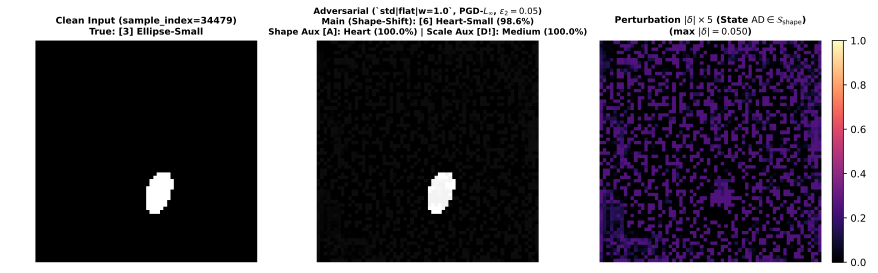

```text
================================================================================================================================
=== PART B — SECTION 6: WHEN THE HEADS CONTRADICT EACH OTHER — THREE-WAY DIVERGENCE (DR_s^{(k)} & ARR_{s,DD}) ===
================================================================================================================================
Observed result:
  - On a shifted factor, state 'D' is a strict 3-way contradiction: truth, main's prediction and the auxiliary's
    prediction are all different classes.
  - This happens about twice as often on shape (categorical) as on scale (ordinal).
  - Double divergence is essentially exclusive to `flat`: it is absent in `gap`, although total divergence is
    present in `gap` too (e.g. in `con | gap` at w >= 1).
  - Pooled across models, shape-head divergence increases with w in all three shift types (one training run per w);
    within `flat` the trend is not monotonic in shape-shift and scale-shift.
--------------------------------------------------------------------------------------------------------------------------------

[1] Global Divergence Breakdown by Shift Type s and Auxiliary Branch (Shape vs Scale vs Double Divergence DD):
Scope / Shift Type         |  Denom |S_s| |    DR_s^(shape) [95% CI] |    DR_s^(scale) [95% CI] |      Total DR_s [95% CI] |   Double Div DD [95% CI]
----------------------------------------------------------------------------------------------------------------------------------------------------
Shape-Shift (s=shape)      |    1,553,254 |   8.04% [ 8.00, 8.08] |  17.42% [17.36,17.48] |  22.84% [22.78,22.91] |   2.62% [ 2.59, 2.64]
Scale-Shift (s=scale)      |    1,509,704 |  10.96% [10.91,11.01] |   4.11% [ 4.08, 4.14] |  14.77% [14.72,14.83] |   0.30% [ 0.29, 0.30]
Joint-Shift (s=joint)      |    2,346,125 |   6.03% [ 6.00, 6.06] |   6.06% [ 6.03, 6.09] |  11.59% [11.55,11.63] |   0.51% [ 0.50, 0.52]
----------------------------------------------------------------------------------------------------------------------------------------------------
Overall on S (All)         |    5,409,083 |   7.99% [ 7.96, 8.01] |   8.78% [ 8.76, 8.80] |  15.71% [15.68,15.74] |   1.06% [ 1.05, 1.06]
----------------------------------------------------------------------------------------------------------------------------------------------------

[2] Direct Shifted-Factor 3-Way Contradiction Comparison (Categorical Shape vs Ordinal Scale):
  DR_shape^(shape) = ARR_shape,DR + ARR_shape,DD :   8.04% [ 8.00%,  8.08%]  (k = 124,885 / |S_shape| = 1,553,254)
  DR_scale^(scale) = ARR_scale,RD + ARR_scale,DD :   4.11% [ 4.08%,  4.14%]  (k = 62,000 / |S_scale| = 1,509,704)
  Ratio DR_shape^(shape) / DR_scale^(scale)      :  1.96x  (Difference = +3.93 pp)

[3] Double Divergence (ARR_{s,DD}) and Total Divergence (DR_s) by Pooling (`flat` vs `gap`):
Pooling    |            ARR_shape,DD (|S_sh|) |            ARR_scale,DD (|S_sc|) |            ARR_joint,DD (|S_jt|) ||        Overall DD on S |        Overall DR on S
--------------------------------------------------------------------------------------------------------------------------------------------------------------------
flat       |   6.36% [ 6.30, 6.42] (639,659)  |   0.84% [ 0.82, 0.87] (525,813)  |  0.99% [ 0.97, 1.01] (1,205,017)  ||  2.41% [2.39,2.43] | 21.61% [21.56,21.66]
gap        |   0.00% [ 0.00, 0.00] (913,595)  |   0.00% [ 0.00, 0.01] (983,891)  |  0.00% [ 0.00, 0.00] (1,141,108)  ||  0.00% [0.00,0.00] | 11.10% [11.07,11.14]
--------------------------------------------------------------------------------------------------------------------------------------------------------------------

[4] Shape Auxiliary Divergence DR_s^{(shape)} Across Loss Weights w in {0.5, 1.0, 2.0} (Observed Trend Across 1 Run/w):
Scope & Loss Weight      |          DR_shape^(shape) (|S_sh|) |          DR_scale^(shape) (|S_sc|) |          DR_joint^(shape) (|S_jt|) |           Overall DR^(shape) (|S|)
----------------------------------------------------------------------------------------------------------------------------------------------------------------------------
All Models (w=0.5)       |     4.14% [ 4.09, 4.19] (538,338)  |     8.19% [ 8.11, 8.26] (498,331)  |     2.11% [ 2.08, 2.14] (756,662)  |   4.41% [ 4.38, 4.44] (1,793,331) 
All Models (w=1)         |     5.58% [ 5.51, 5.64] (482,296)  |     9.67% [ 9.59, 9.75] (510,967)  |     5.76% [ 5.71, 5.81] (852,255)  |   6.79% [ 6.76, 6.83] (1,845,518) 
All Models (w=2)         |    14.22% [14.12,14.31] (532,620)  |    15.05% [14.95,15.15] (500,406)  |    10.38% [10.31,10.45] (737,208)  |  12.85% [12.80,12.90] (1,770,234) 
----------------------------------------------------------------------------------------------------------------------------------------------------------------------------
Flat Models (w=0.5)      |     8.66% [ 8.54, 8.78] (212,827)  |    16.03% [15.86,16.20] (172,920)  |     2.16% [ 2.11, 2.20] (383,446)  |     7.07% [ 7.02, 7.13] (769,193) 
Flat Models (w=1)        |     7.75% [ 7.63, 7.88] (175,114)  |     2.58% [ 2.51, 2.66] (179,705)  |     2.41% [ 2.36, 2.45] (461,661)  |     3.59% [ 3.55, 3.63] (816,480) 
Flat Models (w=2)        |    20.97% [20.81,21.12] (251,718)  |    20.78% [20.59,20.97] (173,188)  |    13.97% [13.85,14.08] (359,910)  |    17.71% [17.63,17.80] (784,816) 
----------------------------------------------------------------------------------------------------------------------------------------------------------------------------
================================================================================================================================

```

**Figure 7A: Shape Auxiliary Divergence DR_s^{(shape)} by Loss Weight w Across Shift Types**

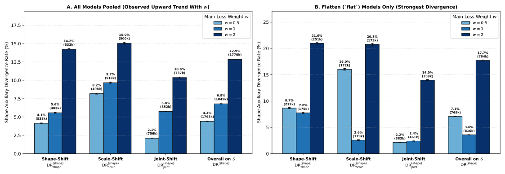

```text
[Figure 7B Deterministic Sampling Log — np.random.default_rng(29)]:
  Three-Way Shape Divergence State DR in S_shape (`std|flat|w=2.0`, FGSM-Linf eps_2=0.05): pool = 497 candidates -> selected sample_index = 34566

```

**Figure 7B: Deterministic Sample Strip — Three-Way Shape Contradiction (Truth != Main != Shape Aux)**

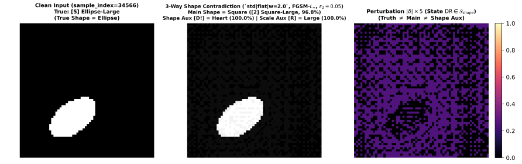

```text
================================================================================================================================
=== PART B — SECTION 7: CHECK — IS THE DISAGREEMENT UNCERTAIN OR CONFIDENTLY CONTRADICTORY? ===
================================================================================================================================
Observed result:
  - Compared with failed attacks, aligned (FAR), partially retained (PRR) and divergent (DR) heads are
    overwhelmingly high-confidence: median confidence is ~100% and median entropy ~0 with IQR [0, 0], so quartiles
    are uninformative and tail shares or means must be used.
  - Divergent auxiliaries are confidently contradictory from eps_2 onward; at eps_1 they are noticeably less
    confident. In PRR the resisting auxiliary is slightly less confident than the fooled one.
  - Lower confidence in Full Retention (FRR) is a tail effect, not the typical sample: mean confidence of `main`
    drops (more under PGD) and the scale head is more uncertain than the shape head, but medians stay very high.
  - Aligned heads are as confident as unfooled predictions, so confidence alone does not separate them from failed
    attacks (the comparison here is with failed attacks, not with clean images).
--------------------------------------------------------------------------------------------------------------------------------

[1] Per-Image Confidence (%) & Normalized Shannon Entropy H~_t (%) Across the 5 Archetypes and Head Roles:
Archetype        | Head Role                          |   Instances N | Mean Conf% |    Median Conf [Q25-Q75] || Mean H~_t% |    Median H~_t [Q25-Q75]
----------------------------------------------------------------------------------------------------------------------------------------------------
Failed (S^c)     | Main Branch (9-class)              |     3,438,277 |     99.48% | 100.00% [100.00, 100.00] ||      0.57% |   0.00% [  0.00,   0.00]
Failed (S^c)     | Shape Aux (3-class)                |     3,438,277 |     99.81% | 100.00% [100.00, 100.00] ||      0.43% |   0.00% [  0.00,   0.00]
Failed (S^c)     | Scale Aux (3-class)                |     3,438,277 |     99.75% | 100.00% [100.00, 100.00] ||      0.56% |   0.00% [  0.00,   0.00]
----------------------------------------------------------------------------------------------------------------------------------------------------
FAR (Aligned)    | Main Branch (9-class)              |     4,089,052 |     99.53% | 100.00% [100.00, 100.00] ||      0.54% |   0.00% [ -0.00,   0.00]
FAR (Aligned)    | Shape Aux (3-class)                |     4,089,052 |     99.77% | 100.00% [100.00, 100.00] ||      0.50% |  -0.00% [ -0.00,   0.00]
FAR (Aligned)    | Scale Aux (3-class)                |     4,089,052 |     99.65% | 100.00% [100.00, 100.00] ||      0.75% |  -0.00% [ -0.00,   0.00]
----------------------------------------------------------------------------------------------------------------------------------------------------
FRR (Retained)   | Main Branch (9-class)              |       130,403 |     94.08% |  99.98% [ 96.16, 100.00] ||      6.00% |   0.08% [  0.00,   7.47]
FRR (Retained)   | Shape Aux (3-class)                |       130,403 |     98.28% | 100.00% [100.00, 100.00] ||      3.54% |   0.00% [  0.00,   0.00]
FRR (Retained)   | Scale Aux (3-class)                |       130,403 |     95.95% | 100.00% [ 99.37, 100.00] ||      8.31% |   0.00% [ -0.00,   3.46]
----------------------------------------------------------------------------------------------------------------------------------------------------
PRR (Partial)    | Main Branch (9-class)              |       339,914 |     98.22% | 100.00% [100.00, 100.00] ||      1.90% |  -0.00% [  0.00,   0.00]
PRR (Partial)    | Resisting Aux (Retains Truth)      |       339,914 |     98.43% | 100.00% [100.00, 100.00] ||      3.31% |   0.00% [  0.00,   0.00]
PRR (Partial)    | Fooled Aux (Follows Main)          |       339,914 |     99.64% | 100.00% [100.00, 100.00] ||      0.81% |  -0.00% [  0.00,   0.00]
----------------------------------------------------------------------------------------------------------------------------------------------------
DR (Diverged)    | Main Branch (9-class)              |       849,714 |     98.79% | 100.00% [100.00, 100.00] ||      1.33% |   0.00% [  0.00,   0.00]
DR (Diverged)    | Divergent Aux (3-Way / Collateral) |       906,807 |     98.80% | 100.00% [100.00, 100.00] ||      2.55% |   0.00% [ -0.00,   0.00]
----------------------------------------------------------------------------------------------------------------------------------------------------

[2] Boundary vs Divergence Uncertainty Across Budget Steps eps_1..eps_5 (FRR vs DR Pooled Means):
Step     |     FRR N |   FRR Main Conf / H~ |  FRR Shape Conf / H~ |  FRR Scale Conf / H~ ||     DR N (Heads) |    DR Main Conf / H~ |  DR DivAux Conf / H~
----------------------------------------------------------------------------------------------------------------------------------------------------------
eps_1    |    26,688 |       88.3% /  11.6% |       96.3% /   7.7% |       91.0% /  18.2% ||  10,147 (10,210) |       95.0% /   5.8% |       92.3% /  16.1%
eps_2    |    20,140 |       96.1% /   4.1% |       98.7% /   2.6% |       97.8% /   4.6% || 174,063 (176,306) |       99.0% /   1.1% |       98.5% /   3.2%
eps_3    |    25,092 |       91.5% /   8.3% |       97.7% /   4.6% |       95.6% /   9.0% || 200,098 (212,072) |       98.4% /   1.8% |       98.6% /   3.0%
eps_4    |    29,534 |       96.5% /   3.8% |       99.0% /   2.1% |       97.3% /   5.6% || 226,937 (248,712) |       98.8% /   1.3% |       99.0% /   2.1%
eps_5    |    28,949 |       97.7% /   2.5% |       99.5% /   1.0% |       98.1% /   4.0% || 238,469 (259,507) |       99.1% /   1.0% |       99.3% /   1.6%
----------------------------------------------------------------------------------------------------------------------------------------------------------

[3] FRR and DR Confidence (%) / Normalized Entropy H~_t (%) by Optimizer (FGSM vs PGD) and Dataset (`std` vs `con`):
Subgroup         |     FRR N |   FRR Main Conf / H~ |  FRR Shape Conf / H~ |  FRR Scale Conf / H~ ||     DR N (Heads) |    DR Main Conf / H~ |  DR DivAux Conf / H~
----------------------------------------------------------------------------------------------------------------------------------------------------------
Opt: FGSM        |   109,013 |  95.4% /   4.8% |  98.7% /   2.7% |  97.0% /   6.3% || 360,872 (374,347) |  97.7% /   2.5% |  98.8% /   2.5%
Opt: PGD         |    21,390 |  87.4% /  12.2% |  96.3% /   7.7% |  90.5% /  18.8% || 488,842 (532,460) |  99.6% /   0.5% |  98.8% /   2.6%
----------------------------------------------------------------------------------------------------------------------------------------------------------
Data: std        |    63,393 |  92.2% /   7.7% |  97.7% /   4.6% |  93.4% /  13.4% || 423,839 (474,483) |  98.3% /   1.8% |  98.3% /   3.7%
Data: con        |    67,010 |  95.8% /   4.4% |  98.8% /   2.5% |  98.4% /   3.5% || 425,875 (432,324) |  99.2% /   0.8% |  99.4% /   1.3%
================================================================================================================================

```

**Figure 8: Low-Confidence Tail Share (Conf < 90%) Across Archetypes and Head Roles**

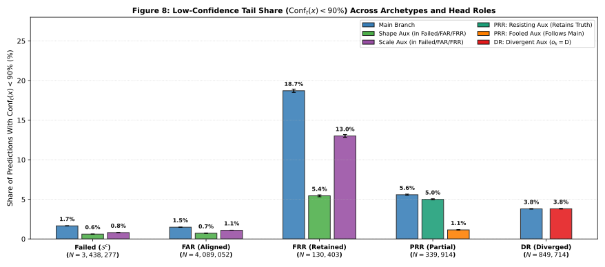

```text
================================================================================================================================
=== PART C — SECTION 8: WHAT HAPPENS AT HIGH BUDGET — COLLAPSE ONTO A SINGLE CLASS (SINK ATTRACTORS) ===
================================================================================================================================
Observed result:
  - At the strict >= 99% single-class threshold, 23 / 240 slices collapse onto a `Large`-scale sink class
    (`[8] Heart-Large` in 20, `[2] Square-Large` in 3). A constant prediction is right on 1/9 of a balanced test
    set, which yields ASR = 8/9 = 88.89%, a (25, 25, 50) shift profile and cohen_w ~ 0.
  - The 8/9 ceiling is broader than this detector: 49 slices sit near it, including `std | gap` under PGD-L2 at
    eps_2..eps_5, where no single class exceeds 99%.
  - Among the 15 slices with ASR >= 99.5%, 9 concentrate all predictions into two classes, while the others
    spread over more classes. `con | flat` never collapses onto a single class but still reaches ~100% ASR under
    PGD-L_inf, sometimes onto small-scale sinks.
  - Auxiliaries collapse synchronously with `main` in 16/23 slices; scale lags in `std | flat` under FGSM and
    shape lags in `con | gap` Square-Large slices.
--------------------------------------------------------------------------------------------------------------------------------

[1] All Single-Class Collapsed Slices (main_top1_pct >= 99.0%): 23 / 240 Slices:
Model (d|pi|w)   | Attack-Norm | Step (eps)    | Sink Class         | Main Sink% | Shape Sink% | Scale Sink% |    ASR% | cohen_w | 3-Head Sync Status
----------------------------------------------------------------------------------------------------------------------------------------------------------
con|gap|w=0.5    | FGSM-LINF   | e3 (0.1)      | [8] Heart-Large    |    100.00% |     100.00% |     100.00% |  88.89% |   0.000 | Synchronous (All >=99%)
con|gap|w=0.5    | FGSM-LINF   | e4 (0.15)     | [8] Heart-Large    |    100.00% |     100.00% |     100.00% |  88.89% |   0.000 | Synchronous (All >=99%)
con|gap|w=0.5    | FGSM-LINF   | e5 (0.2)      | [8] Heart-Large    |    100.00% |     100.00% |     100.00% |  88.89% |   0.000 | Synchronous (All >=99%)
con|gap|w=0.5    | PGD-L2      | e5 (3)        | [8] Heart-Large    |    100.00% |     100.00% |     100.00% |  88.89% |   0.000 | Synchronous (All >=99%)
con|gap|w=0.5    | PGD-LINF    | e3 (0.1)      | [8] Heart-Large    |    100.00% |     100.00% |     100.00% |  88.89% |   0.000 | Synchronous (All >=99%)
con|gap|w=0.5    | PGD-LINF    | e4 (0.15)     | [8] Heart-Large    |    100.00% |     100.00% |     100.00% |  88.89% |   0.000 | Synchronous (All >=99%)
con|gap|w=0.5    | PGD-LINF    | e5 (0.2)      | [8] Heart-Large    |    100.00% |     100.00% |     100.00% |  88.89% |   0.000 | Synchronous (All >=99%)
con|gap|w=1      | FGSM-LINF   | e3 (0.1)      | [8] Heart-Large    |    100.00% |     100.00% |     100.00% |  88.89% |   0.000 | Synchronous (All >=99%)
con|gap|w=1      | FGSM-LINF   | e4 (0.15)     | [8] Heart-Large    |    100.00% |     100.00% |     100.00% |  88.89% |   0.000 | Synchronous (All >=99%)
con|gap|w=1      | PGD-L2      | e3 (1)        | [2] Square-Large   |     99.99% |      62.39% |     100.00% |  88.88% |   0.000 | Desync: Shape lags (62.4%)
con|gap|w=1      | PGD-LINF    | e5 (0.2)      | [8] Heart-Large    |     99.97% |      99.98% |     100.00% |  88.91% |   0.001 | Synchronous (All >=99%)
con|gap|w=2      | PGD-L2      | e4 (2)        | [2] Square-Large   |     99.99% |      87.47% |     100.00% |  88.89% |   0.000 | Desync: Shape lags (87.5%)
con|gap|w=2      | PGD-LINF    | e2 (0.05)     | [2] Square-Large   |     99.98% |      82.50% |     100.00% |  88.89% |   0.000 | Desync: Shape lags (82.5%)
std|flat|w=0.5   | FGSM-LINF   | e4 (0.15)     | [8] Heart-Large    |     99.58% |     100.00% |      96.29% |  88.48% |   0.008 | Desync: Scale lags (96.3%)
std|flat|w=0.5   | FGSM-LINF   | e5 (0.2)      | [8] Heart-Large    |     99.90% |     100.00% |     100.00% |  88.79% |   0.002 | Synchronous (All >=99%)
std|flat|w=1     | FGSM-LINF   | e4 (0.15)     | [8] Heart-Large    |    100.00% |     100.00% |      94.70% |  88.89% |   0.000 | Desync: Scale lags (94.7%)
std|flat|w=1     | FGSM-LINF   | e5 (0.2)      | [8] Heart-Large    |    100.00% |     100.00% |      95.64% |  88.89% |   0.000 | Desync: Scale lags (95.6%)
std|flat|w=1     | PGD-LINF    | e4 (0.15)     | [8] Heart-Large    |     99.74% |      99.74% |     100.00% |  89.15% |   0.005 | Synchronous (All >=99%)
std|flat|w=1     | PGD-LINF    | e5 (0.2)      | [8] Heart-Large    |    100.00% |     100.00% |     100.00% |  88.89% |   0.000 | Synchronous (All >=99%)
std|flat|w=2     | FGSM-LINF   | e5 (0.2)      | [8] Heart-Large    |     99.48% |      99.77% |      88.86% |  89.30% |   0.008 | Desync: Scale lags (88.9%)
std|gap|w=0.5    | PGD-LINF    | e4 (0.15)     | [8] Heart-Large    |     99.76% |     100.00% |      99.79% |  89.13% |   0.005 | Synchronous (All >=99%)
std|gap|w=0.5    | PGD-LINF    | e5 (0.2)      | [8] Heart-Large    |    100.00% |     100.00% |     100.00% |  88.89% |   0.000 | Synchronous (All >=99%)
std|gap|w=2      | PGD-LINF    | e5 (0.2)      | [8] Heart-Large    |     99.70% |     100.00% |      99.65% |  88.89% |   0.008 | Synchronous (All >=99%)
----------------------------------------------------------------------------------------------------------------------------------------------------------

[2] Compact Grouped Collapse Table (Consecutive eps Steps Merged -> 14 Groups):
Configuration Group                  | Slices | eps Range    | Sink Class         |     Main Mean [Range] |  Shape Aux Mean [Range] |  Scale Aux Mean [Range]
------------------------------------------------------------------------------------------------------------------------------------------------------------
con|gap|w=0.5 | FGSM-LINF (e3..e5)   |      3 | 0.1..0.2     | [8] Heart-Large    | 100.00% [100.0,100.0] |   100.00% [100.0,100.0] |   100.00% [100.0,100.0]
con|gap|w=0.5 | PGD-L2 (e5)          |      1 | 3            | [8] Heart-Large    | 100.00% [100.0,100.0] |   100.00% [100.0,100.0] |   100.00% [100.0,100.0]
con|gap|w=0.5 | PGD-LINF (e3..e5)    |      3 | 0.1..0.2     | [8] Heart-Large    | 100.00% [100.0,100.0] |   100.00% [100.0,100.0] |   100.00% [100.0,100.0]
con|gap|w=1 | FGSM-LINF (e3..e4)     |      2 | 0.1..0.15    | [8] Heart-Large    | 100.00% [100.0,100.0] |   100.00% [100.0,100.0] |   100.00% [100.0,100.0]
con|gap|w=1 | PGD-L2 (e3)            |      1 | 1            | [2] Square-Large   |  99.99% [100.0,100.0] |    62.39% [ 62.4, 62.4] |   100.00% [100.0,100.0]
con|gap|w=1 | PGD-LINF (e5)          |      1 | 0.2          | [8] Heart-Large    |  99.97% [100.0,100.0] |    99.98% [100.0,100.0] |   100.00% [100.0,100.0]
con|gap|w=2 | PGD-L2 (e4)            |      1 | 2            | [2] Square-Large   |  99.99% [100.0,100.0] |    87.47% [ 87.5, 87.5] |   100.00% [100.0,100.0]
con|gap|w=2 | PGD-LINF (e2)          |      1 | 0.05         | [2] Square-Large   |  99.98% [100.0,100.0] |    82.50% [ 82.5, 82.5] |   100.00% [100.0,100.0]
std|flat|w=0.5 | FGSM-LINF (e4..e5)  |      2 | 0.15..0.2    | [8] Heart-Large    |  99.74% [ 99.6, 99.9] |   100.00% [100.0,100.0] |    98.14% [ 96.3,100.0]
std|flat|w=1 | FGSM-LINF (e4..e5)    |      2 | 0.15..0.2    | [8] Heart-Large    | 100.00% [100.0,100.0] |   100.00% [100.0,100.0] |    95.17% [ 94.7, 95.6]
std|flat|w=1 | PGD-LINF (e4..e5)     |      2 | 0.15..0.2    | [8] Heart-Large    |  99.87% [ 99.7,100.0] |    99.87% [ 99.7,100.0] |   100.00% [100.0,100.0]
std|flat|w=2 | FGSM-LINF (e5)        |      1 | 0.2          | [8] Heart-Large    |  99.48% [ 99.5, 99.5] |    99.77% [ 99.8, 99.8] |    88.86% [ 88.9, 88.9]
std|gap|w=0.5 | PGD-LINF (e4..e5)    |      2 | 0.15..0.2    | [8] Heart-Large    |  99.88% [ 99.8,100.0] |   100.00% [100.0,100.0] |    99.90% [ 99.8,100.0]
std|gap|w=2 | PGD-LINF (e5)          |      1 | 0.2          | [8] Heart-Large    |  99.70% [ 99.7, 99.7] |   100.00% [100.0,100.0] |    99.65% [ 99.7, 99.7]
------------------------------------------------------------------------------------------------------------------------------------------------------------

[3] Summary Counts of Single-Class Collapsed Slices by Model Family and by Sink Class:
  Family std|gap    :  3 / 60 slices collapsed  ([8] Heart-Large: 3)
  Family std|flat   :  7 / 60 slices collapsed  ([8] Heart-Large: 7)
  Family con|gap    : 13 / 60 slices collapsed  ([8] Heart-Large: 10, [2] Square-Large: 3)
  Family con|flat   :  0 / 60 slices collapsed  (None (0 collapsed slices))

  Sink Class Totals Across All Collapsed Slices:
    [8] Heart-Large      : 20 / 23 collapsed slices
    [2] Square-Large     :  3 / 23 collapsed slices

[3b] Two-Sink Collapse Inspection: Slices with ASR >= 99.5% (15 slices evade the 88.89% single-sink ceiling):
Model (d|pi|w)   | Attack-Norm | Step (eps)    |    ASR% | Top-1 Class (Share%)         | Top-2 Class (Share%)         | Top1+Top2%
--------------------------------------------------------------------------------------------------------------------------------
con|flat|w=1     | PGD-LINF    | e4 (0.15)     |  99.97% | [8] Heart-Large (49.6%)      | [6] Heart-Small (34.7%)      |     84.31%
con|flat|w=1     | PGD-LINF    | e5 (0.2)      | 100.00% | [8] Heart-Large (59.2%)      | [6] Heart-Small (33.9%)      |     93.13%
con|flat|w=2     | PGD-LINF    | e4 (0.15)     |  99.82% | [6] Heart-Small (89.1%)      | [0] Square-Small (10.9%)     |    100.00%
con|flat|w=2     | PGD-LINF    | e5 (0.2)      |  99.99% | [6] Heart-Small (88.9%)      | [0] Square-Small (11.1%)     |    100.00%
con|gap|w=0.5    | PGD-LINF    | e2 (0.05)     |  99.99% | [8] Heart-Large (75.2%)      | [2] Square-Large (24.8%)     |    100.00%
con|gap|w=1      | PGD-LINF    | e3 (0.1)      | 100.00% | [8] Heart-Large (54.9%)      | [2] Square-Large (45.1%)     |    100.00%
con|gap|w=2      | PGD-LINF    | e3 (0.1)      |  99.93% | [2] Square-Large (77.8%)     | [8] Heart-Large (22.2%)      |    100.00%
con|gap|w=2      | PGD-LINF    | e4 (0.15)     | 100.00% | [2] Square-Large (58.9%)     | [8] Heart-Large (41.1%)      |    100.00%
con|gap|w=2      | PGD-LINF    | e5 (0.2)      | 100.00% | [8] Heart-Large (57.1%)      | [2] Square-Large (42.9%)     |    100.00%
std|flat|w=0.5   | PGD-LINF    | e4 (0.15)     | 100.00% | [8] Heart-Large (65.1%)      | [2] Square-Large (34.9%)     |    100.00%
std|flat|w=0.5   | PGD-LINF    | e5 (0.2)      | 100.00% | [8] Heart-Large (66.7%)      | [2] Square-Large (33.3%)     |    100.00%
std|flat|w=2     | PGD-LINF    | e2 (0.05)     |  99.89% | [8] Heart-Large (33.3%)      | [2] Square-Large (28.9%)     |     62.21%
std|gap|w=2      | PGD-LINF    | e2 (0.05)     |  99.86% | [6] Heart-Small (33.5%)      | [7] Heart-Medium (22.8%)     |     56.23%
std|gap|w=2      | PGD-LINF    | e3 (0.1)      | 100.00% | [8] Heart-Large (54.6%)      | [6] Heart-Small (28.8%)      |     83.33%
std|gap|w=2      | PGD-LINF    | e4 (0.15)     | 100.00% | [8] Heart-Large (66.7%)      | [6] Heart-Small (22.2%)      |     88.89%
================================================================================================================================

[Figure 9B Deterministic Sampling Log — np.random.default_rng(29) on `con|gap|w=0.5` FGSM-LINF eps=0.1 -> Sink [8] Heart-Large]:
  True Class [0] Square-Small   -> pool = 4,096 candidates -> selected sample_index = 34476
  True Class [1] Square-Medium  -> pool = 4,096 candidates -> selected sample_index = 1640
  True Class [2] Square-Large   -> pool = 4,096 candidates -> selected sample_index = 22579
  True Class [3] Ellipse-Small  -> pool = 4,096 candidates -> selected sample_index = 18640

```

**Figure 9B: Deterministic Sample Strip — Four Distinct Classes Collapsing Into a Single Sink Class**

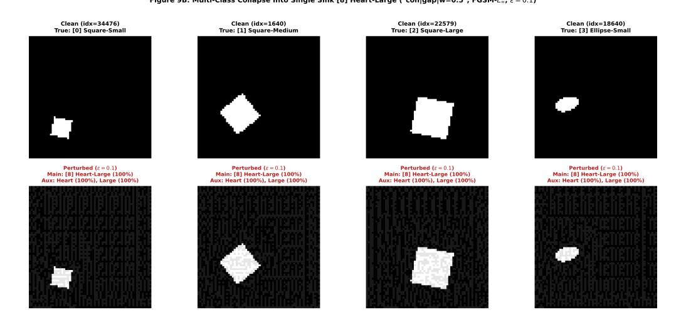

```text
================================================================================================================================
=== PART C — SECTION 9: WHICH FACTORS EXPLAIN THE VARIATION AT EACH NODE (D^2 ATTRIBUTION & SYNTHESIS) ===
================================================================================================================================
Observed result:
  - D^2 is a descriptive attribution of variation, not a causal effect.
  - Node 0 (ASR): attack parameters explain much more than architecture.
  - Node 1: mixed picture. Budget is the strongest single factor for SR_scale, SR_joint and cohen_w, and cohen_w is
    explained mainly by attack factors; at group level, architecture explains more of SR_shape and SR_joint, and
    attack factors more of SR_scale.
  - Node 2, dominant regimes (FAR_s, PRR, collateral divergence): with few exceptions (e.g. ARR_{joint,RA}, where
    optimizer main effect exceeds architecture main effect, but the data x pool interaction is 15.3%), pooling,
    dataset and their interaction explain more than attack factors, though total main-effect D^2 on overall FAR is modest.
  - Node 2, boundary regimes (FRR, ARR_{s,RR}): optimizer and budget explain most of the variation. DR remains
    mostly architectural, with loss weight relevant for shape divergence.
--------------------------------------------------------------------------------------------------------------------------------

[1] Complete Explained Deviance Share D^2 (%) Across All 23 Tree Metrics (Single Factors, Grouped Totals, Top 2F):
Node   | Metric               ||    eps |   norm |    atk |   data |   pool |   wght || Attack D2% |  Arch D2% || Top 2-Way Interaction (D2%)
----------------------------------------------------------------------------------------------------------------------------------------------
Node 0 | ASR                  ||  32.9% |  13.2% |   8.8% |   5.8% |   3.7% |   0.1% ||      55.0% |      9.6% || norm×eps (6.1%)           
----------------------------------------------------------------------------------------------------------------------------------------------
Node 1 | SR_shape             ||   0.5% |   0.6% |   0.5% |   4.8% |   1.5% |   2.2% ||       1.7% |      8.4% || data×wght (6.4%)          
Node 1 | SR_scale             ||  17.6% |   1.4% |   1.9% |   3.3% |  12.2% |   0.0% ||      20.9% |     15.5% || pool×eps (8.0%)           
Node 1 | SR_joint             ||  17.4% |   2.6% |   0.4% |   9.9% |  14.7% |   1.4% ||      20.4% |     25.9% || data×pool (6.4%)          
Node 1 | cohen_w              ||  23.7% |   3.7% |   0.2% |   6.9% |   1.0% |   0.1% ||      27.5% |      8.0% || data×pool (9.3%)          
----------------------------------------------------------------------------------------------------------------------------------------------
Node 2 | FAR                  ||   1.2% |   0.1% |   0.6% |   6.1% |  15.0% |   1.2% ||       1.8% |     22.4% || norm×eps (4.6%)           
Node 2 | FAR_shape            ||   1.7% |   0.4% |   0.5% |   2.0% |  10.9% |   1.8% ||       2.5% |     14.7% || data×pool (9.5%)          
Node 2 | FAR_scale            ||   1.5% |   0.0% |   3.2% |   7.1% |   3.2% |   0.2% ||       4.6% |     10.5% || pool×atk (8.9%)           
Node 2 | FAR_joint            ||   0.7% |   1.3% |   0.0% |   3.4% |  12.5% |   3.6% ||       2.0% |     19.5% || wght×atk (3.9%)           
Node 2 | FRR                  ||   7.5% |   0.1% |  25.8% |   1.1% |   1.3% |   0.0% ||      33.4% |      2.4% || atk×eps (12.5%)           
Node 2 | ARR_{shape,RR}       ||   6.8% |   4.3% |  27.2% |   3.2% |   1.7% |  10.6% ||      38.3% |     15.5% || atk×eps (9.6%)            
Node 2 | ARR_{scale,RR}       ||   3.2% |   0.6% |  15.7% |   2.1% |   2.6% |   4.2% ||      19.5% |      8.9% || atk×eps (9.5%)            
Node 2 | ARR_{joint,RR}       ||  14.5% |   6.5% |   7.6% |   1.6% |   4.0% |   1.2% ||      28.5% |      6.8% || data×eps (21.9%)          
Node 2 | PRR                  ||   0.4% |   0.0% |   1.7% |   9.9% |  13.2% |   4.5% ||       2.2% |     27.6% || data×wght (5.5%)          
Node 2 | ARR_{joint,RA}       ||   1.7% |   0.1% |   5.3% |   0.4% |   0.2% |   0.1% ||       7.1% |      0.7% || data×pool (15.3%)         
Node 2 | ARR_{joint,AR}       ||   0.4% |   0.0% |   0.1% |   8.6% |  12.9% |   7.2% ||       0.6% |     28.7% || data×pool (19.4%)         
Node 2 | ARR_{shape,AD}       ||   4.0% |   1.0% |   1.3% |   1.4% |   6.0% |   1.4% ||       6.3% |      8.7% || data×pool (34.5%)         
Node 2 | ARR_{scale,DA}       ||   4.1% |   0.4% |   0.1% |  14.3% |   0.2% |   2.5% ||       4.6% |     16.9% || data×wght (8.8%)          
Node 2 | DR                   ||   5.8% |   0.2% |   0.2% |   2.5% |  10.6% |   1.6% ||       6.1% |     14.7% || norm×eps (8.0%)           
Node 2 | DR_shape^{(shape)}   ||   2.9% |   1.1% |   0.9% |   0.4% |   7.8% |   8.0% ||       4.9% |     16.2% || data×atk (11.3%)          
Node 2 | DR_scale^{(scale)}   ||   6.7% |   0.0% |   2.5% |   3.4% |   5.6% |   5.1% ||       9.2% |     14.1% || pool×atk (26.5%)          
Node 2 | DR_joint^{(shape)}   ||   2.8% |   1.2% |   0.1% |   1.0% |   0.1% |  10.1% ||       4.2% |     11.1% || data×pool (8.9%)          
Node 2 | DR_joint^{(scale)}   ||   2.5% |   1.9% |   3.7% |   0.2% |  36.8% |   4.2% ||       8.0% |     41.2% || pool×atk (4.6%)           
----------------------------------------------------------------------------------------------------------------------------------------------

[2] Factor x Node Directional Synthesis Across the Conditional Probability Tree:
Factor / Interaction      | Node 0 (Attack Success ASR)                  | Node 1 (Shift Typology SR_s & cohen_w)       | Node 2 (Auxiliary Regimes FAR/FRR/PRR/DR)
------------------------------------------------------------------------------------------------------------------------------------------------------------------------
Budget (eps_1 -> eps_5)   | Strongest driver: ASR jumps 18.9% -> 80.0%; single-class collapses start at eps_2 | SR_single drops 81.5% -> 51.6%; cohen_w 0.70 -> 0.05 (25/25/50) | FRR and FAR both drop between eps_1 and eps_2, then stay roughly constant
Norm (L_inf vs L_2)       | L_inf > L_2 (75.4% vs 46.9%); L_inf drives most sink collapses | L_2 sharpens single-factor bias at eps_1; L_inf reaches 25/25/50 faster | Negligible main effect on Node 2 regimes (norm D^2 <= 1.5% across all metrics)
Optimizer (FGSM vs PGD)   | Iterative PGD > single-step FGSM (72.8% vs 49.5%); breaks `con|flat` in L_2 | PGD pushes SR_joint higher (44.3% vs 42.0%)  | FGSM sustains retention FRR (5.0% vs 0.66%) & scale lag in `std|flat`
Dataset (`std` vs `con`)  | `con` lowers ASR (51.6% vs 70.7%) and prevents `con|flat` >=99% collapse | `con` shifts errors to SR_joint (49.7% vs 38.8%) | `con` elevates PRR (9.3% vs 4.1%) and FRR (2.9% vs 2.0%)
Pooling (`flat` vs `gap`) | `flat` more resistant overall (53.6% vs `gap` 68.7%) | Different biases: `gap` breaks scale (32.4%), `flat` has higher shape (27.0%) | `gap` higher FAR (83.2% vs 65.8%); `flat` owns DD (2.41% vs 0.00%)
Loss Weight (w: 0.5->2.0) | Negligible on ASR (60.8% vs 60.0%, D^2 < 0.1%) | No monotone effect on SR_joint (peaks at w=1.0) | Pooled upward trend in DR^(shape): 4.41% -> 12.85% (non-monotonic in `flat` shape- & scale-shift)
Interaction `data x pool` | `con|flat` resists FGSM-L2 (ASR=2.4% pooled, 1.2-3.0% per w) while `con|gap` yields | `con|flat` strongly joint-shifted (53.1%) vs `std|gap` scale-shifted (37.8%) | In `con`: `con|flat` -> ARR_joint,AR=23.0%, `con|gap` -> ARR_joint,RA=11.3% (reversed in `std`)
================================================================================================================================

```

**Figure 10: Global D^2 (%) Attribution Heatmap Across All 23 Tree Metrics**

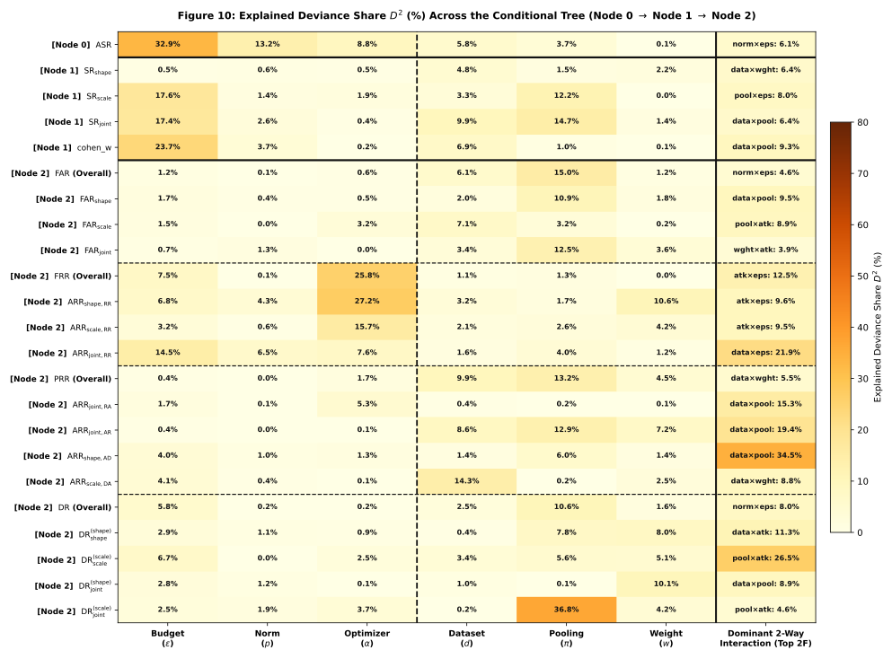

